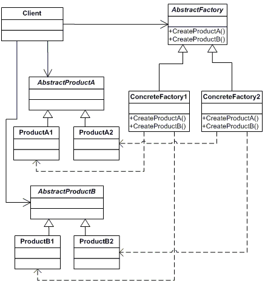

# C# Abstract Factory Design Pattern

> **分類**：Creational Patterns（建立型模式）  
> **使用頻率 (Frequency of use)**：高 (High)  
> **原文連結**：[https://www.dofactory.com/net/abstract-factory-design-pattern](https://www.dofactory.com/net/abstract-factory-design-pattern)

---

## 定義與概述 (Definition)

**Abstract Factory** Design Pattern 提供一個介面（Interface），用於建立相關或相依物件的家族，而無須指定它們的具體類別（Concrete Classes）。

**Abstract Factory** Design Pattern 的 C# 程式碼範例除了提供 Dofactory 原版的 3 種形式外，亦額外補充針對 **.NET 11 / C# 15** 的現代化實務優化版本：
- [結構化程式碼 (Structural code)](#structural-code-in-c-結構化程式碼)
- [真實世界程式碼 (Real-world code)](#real-world-code-in-c-真實世界程式碼)
- [.NET 最佳化程式碼 (.NET optimized code)](#net-optimized-code-in-c-net-最佳化程式碼)
- [🚀 .NET 11 / C# 15 現代化實務優化 (Modern .NET 11 & C# 15)](#net-11--c-15-現代化實務優化-modern-net-11--c-15)

---

## UML 類別圖 (UML Class Diagram)

以下是參與此 Pattern 的類別與物件之視覺化關係圖：



---

## 參與者 (Participants)

參與此 Pattern 的類別與物件包括：

- **AbstractFactory** (`ContinentFactory`)
  - 宣告用於建立抽象產品（Abstract Products）之操作的介面。
- **ConcreteFactory** (`AfricaFactory`, `AmericaFactory`)
  - 實作建立具體產品（Concrete Product）物件的操作。
- **AbstractProduct** (`Herbivore`, `Carnivore`)
  - 為一種類型的產品物件宣告介面。
- **Product** (`Wildebeest`, `Lion`, `Bison`, `Wolf`)
  - 定義將由對應的具體工廠（Concrete Factory）所建立的產品物件。
  - 實作 `AbstractProduct` 介面。
- **Client** (`AnimalWorld`)
  - 僅使用由 `AbstractFactory` 與 `AbstractProduct` 類別所宣告的介面。

---

## Structural code in C# (結構化程式碼)

這段結構化（Structural）程式碼示範了 Abstract Factory Pattern 如何建立平行階層的物件。物件的建立已被抽象化，因此在用戶端（Client）程式碼中不需要寫死（Hard-coded）類別名稱。

```csharp
using System;

namespace DoFactory.GangOfFour.Abstract.Structural
{
    /// <summary>
    /// MainApp startup class for Structural
    /// Abstract Factory Design Pattern.
    /// </summary>

    class MainApp
    {
        /// <summary>
        /// Entry point into console application.
        /// </summary>

        public static void Main()
        {
            // Abstract factory #1

            AbstractFactory factory1 = new ConcreteFactory1();
            Client client1 = new Client(factory1);
            client1.Run();

            // Abstract factory #2

            AbstractFactory factory2 = new ConcreteFactory2();
            Client client2 = new Client(factory2);
            client2.Run();

            // Wait for user input

            Console.ReadKey();
        }
    }

    /// <summary>
    /// The 'AbstractFactory' abstract class
    /// </summary>

    abstract class AbstractFactory
    {
        public abstract AbstractProductA CreateProductA();
        public abstract AbstractProductB CreateProductB();
    }


    /// <summary>
    /// The 'ConcreteFactory1' class
    /// </summary>

    class ConcreteFactory1 : AbstractFactory
    {
        public override AbstractProductA CreateProductA()
        {
            return new ProductA1();
        }
        public override AbstractProductB CreateProductB()
        {
            return new ProductB1();
        }
    }

    /// <summary>
    /// The 'ConcreteFactory2' class
    /// </summary>

    class ConcreteFactory2 : AbstractFactory
    {
        public override AbstractProductA CreateProductA()
        {
            return new ProductA2();
        }
        public override AbstractProductB CreateProductB()
        {
            return new ProductB2();
        }
    }

    /// <summary>
    /// The 'AbstractProductA' abstract class
    /// </summary>

    abstract class AbstractProductA
    {
    }

    /// <summary>
    /// The 'AbstractProductB' abstract class
    /// </summary>

    abstract class AbstractProductB
    {
        public abstract void Interact(AbstractProductA a);
    }


    /// <summary>
    /// The 'ProductA1' class
    /// </summary>

    class ProductA1 : AbstractProductA
    {
    }

    /// <summary>
    /// The 'ProductB1' class
    /// </summary>

    class ProductB1 : AbstractProductB
    {
        public override void Interact(AbstractProductA a)
        {
            Console.WriteLine(this.GetType().Name +
              " interacts with " + a.GetType().Name);
        }
    }

    /// <summary>
    /// The 'ProductA2' class
    /// </summary>

    class ProductA2 : AbstractProductA
    {
    }

    /// <summary>
    /// The 'ProductB2' class
    /// </summary>

    class ProductB2 : AbstractProductB
    {
        public override void Interact(AbstractProductA a)
        {
            Console.WriteLine(this.GetType().Name +
              " interacts with " + a.GetType().Name);
        }
    }

    /// <summary>
    /// The 'Client' class. Interaction environment for the products.
    /// </summary>

    class Client
    {
        private AbstractProductA _abstractProductA;
        private AbstractProductB _abstractProductB;

        // Constructor

        public Client(AbstractFactory factory)
        {
            _abstractProductB = factory.CreateProductB();
            _abstractProductA = factory.CreateProductA();
        }

        public void Run()
        {
            _abstractProductB.Interact(_abstractProductA);
        }
    }
}
```

### 輸出結果 (Output)

```text
ProductB1 interacts with ProductA1

  ProductB2 interacts with ProductA2
```

---

## Real-world code in C# (真實世界程式碼)

這段真實世界（Real-world）程式碼示範了在電腦遊戲中使用不同的工廠來建立不同的動物世界。雖然由各洲（Continent）工廠所建立的動物不同，但動物之間的互動方式依然保持一致。

```csharp
using System;

namespace DoFactory.GangOfFour.Abstract.RealWorld
{
    /// <summary>
    /// MainApp startup class for Real-World
    /// Abstract Factory Design Pattern.
    /// </summary>

    class MainApp
    {
        /// <summary>
        /// Entry point into console application.
        /// </summary>

        public static void Main()
        {
            // Create and run the African animal world

            ContinentFactory africa = new AfricaFactory();
            AnimalWorld world = new AnimalWorld(africa);
            world.RunFoodChain();

            // Create and run the American animal world

            ContinentFactory america = new AmericaFactory();
            world = new AnimalWorld(america);
            world.RunFoodChain();

            // Wait for user input

            Console.ReadKey();
        }
    }


    /// <summary>
    /// The 'AbstractFactory' abstract class
    /// </summary>

    abstract class ContinentFactory
    {
        public abstract Herbivore CreateHerbivore();
        public abstract Carnivore CreateCarnivore();
    }

    /// <summary>
    /// The 'ConcreteFactory1' class
    /// </summary>

    class AfricaFactory : ContinentFactory
    {
        public override Herbivore CreateHerbivore()
        {
            return new Wildebeest();
        }
        public override Carnivore CreateCarnivore()
        {
            return new Lion();
        }
    }

    /// <summary>
    /// The 'ConcreteFactory2' class
    /// </summary>

    class AmericaFactory : ContinentFactory
    {
        public override Herbivore CreateHerbivore()
        {
            return new Bison();
        }
        public override Carnivore CreateCarnivore()
        {
            return new Wolf();
        }
    }

    /// <summary>
    /// The 'AbstractProductA' abstract class
    /// </summary>

    abstract class Herbivore
    {
    }

    /// <summary>
    /// The 'AbstractProductB' abstract class
    /// </summary>

    abstract class Carnivore
    {
        public abstract void Eat(Herbivore h);
    }

    /// <summary>
    /// The 'ProductA1' class
    /// </summary>

    class Wildebeest : Herbivore
    {
    }

    /// <summary>
    /// The 'ProductB1' class
    /// </summary>

    class Lion : Carnivore
    {
        public override void Eat(Herbivore h)
        {
            // Eat Wildebeest

            Console.WriteLine(this.GetType().Name +
              " eats " + h.GetType().Name);
        }
    }

    /// <summary>
    /// The 'ProductA2' class
    /// </summary>

    class Bison : Herbivore
    {
    }

    /// <summary>
    /// The 'ProductB2' class
    /// </summary>

    class Wolf : Carnivore
    {
        public override void Eat(Herbivore h)
        {
            // Eat Bison

            Console.WriteLine(this.GetType().Name +
              " eats " + h.GetType().Name);
        }
    }

    /// <summary>
    /// The 'Client' class 
    /// </summary>

    class AnimalWorld
    {
        private Herbivore _herbivore;
        private Carnivore _carnivore;

        // Constructor

        public AnimalWorld(ContinentFactory factory)
        {
            _carnivore = factory.CreateCarnivore();
            _herbivore = factory.CreateHerbivore();
        }

        public void RunFoodChain()
        {
            _carnivore.Eat(_herbivore);
        }
    }
}
```

### 輸出結果 (Output)

```text
Lion eats Wildebeest

  Wolf eats Bison
```

---

## .NET Optimized code in C# (.NET 最佳化程式碼)

這段 .NET 最佳化（.NET Optimized）程式碼示範了與上述相同的邏輯，但採用了更現代化的 C# 與 .NET 功能（例如泛型 `AnimalWorld<T>`、介面與運算式主體成員）。這是一個優雅的 C# Abstract Factory 解決方案。

```csharp
namespace Abstract.NetOptimized;

using static System.Console;

/// <summary>
/// Abstract Factory Design Pattern.
/// </summary>
public class Program
{
    public static void Main()
    {
        // Create and run the African animal world
        var africa = new AnimalWorld<Africa>();
        africa.RunFoodChain();

        // Create and run the American animal world
        var america = new AnimalWorld<America>();
        america.RunFoodChain();

        // Wait for user input
        ReadKey();
    }
}

/// <summary>
/// The 'AbstractFactory' interface. 
/// </summary>
public interface IContinentFactory
{
    IHerbivore CreateHerbivore();
    ICarnivore CreateCarnivore();
}

/// <summary>
/// The 'ConcreteFactory1' class.
/// </summary>
public class Africa : IContinentFactory
{
    public IHerbivore CreateHerbivore() => new Wildebeest();

    public ICarnivore CreateCarnivore() => new Lion();
}

/// <summary>
/// The 'ConcreteFactory2' class.
/// </summary>
public class America : IContinentFactory
{
    public IHerbivore CreateHerbivore() => new Bison();

    public ICarnivore CreateCarnivore() => new Wolf();
}

/// <summary>
/// The 'AbstractProductA' interface
/// </summary>
public interface IHerbivore
{
}

/// <summary>
/// The 'AbstractProductB' interface
/// </summary>
public interface ICarnivore
{
    void Eat(IHerbivore h);
}

/// <summary>
/// The 'ProductA1' class
/// </summary>
public class Wildebeest : IHerbivore
{
}

/// <summary>
/// The 'ProductB1' class
/// </summary>
public class Lion : ICarnivore
{
    // Eat Wildebeest
    public void Eat(IHerbivore h) =>
        WriteLine($"{GetType().Name} eats {h.GetType().Name}");
}

/// <summary>
/// The 'ProductA2' class
/// </summary>
public class Bison : IHerbivore
{
}

/// <summary>
/// The 'ProductB2' class
/// </summary>
public class Wolf : ICarnivore
{
    // Eat Bison
    public void Eat(IHerbivore h) =>
        WriteLine($"{GetType().Name} eats {h.GetType().Name}");
}

/// <summary>
/// The 'Client' interface
/// </summary>
public interface IAnimalWorld
{
    void RunFoodChain();
}

/// <summary>
/// The 'Client' class
/// </summary>
public class AnimalWorld<T> : IAnimalWorld where T : IContinentFactory, new()
{
    private readonly IHerbivore herbivore;
    private readonly ICarnivore carnivore;

    public AnimalWorld()
    {
        // Create new continent factory
        var factory = new T();

        // Factory creates carnivores and herbivores
        carnivore = factory.CreateCarnivore();
        herbivore = factory.CreateHerbivore();
    }

    /// <summary>
    /// Runs the foodchain: carnivores are eating herbivores.
    /// </summary>
    public void RunFoodChain()
    {
        carnivore.Eat(herbivore);
    }
}
```

### 輸出結果 (Output)

```text
Lion eats Wildebeest

    Wolf eats Bison
```

---

## .NET 11 / C# 15 現代化實務優化 (Modern .NET 11 & C# 15)

### 原版範例的限制與盲點

- **`where T : new()` 的反射開銷與限制**：Dofactory 的 `.NET Optimized` 版本使用 `AnimalWorld<T> where T : IContinentFactory, new()`，在建構函式中執行 `new T()`。在舊式泛型中，`new T()` 底層會透過 `Activator.CreateInstance` 產生呼叫開銷，且無法強制工廠本身為無狀態（Stateless）或傳遞建構參數。
- **缺乏相依性注入（DI）整合**：現代 .NET 應用程式很少在 Client 內部直接 `new` 出工廠，而是透過 DI 容器或 C# 的 **Static Abstract Interface Members（靜態抽象介面成員）** 在編譯期完成靜態分派（Zero-allocation）。

### C# 15 / .NET 11 優化重點

- **Static Abstract Interface Members**：在 `IContinentFactory` 定義 `static abstract` 方法，完全不需實例化工廠物件（零記憶體配置），並在編譯期直接內聯（Inline）呼叫。
- **`closed` 繼承階層（C# 15）**：將抽象產品標記為 `closed` 或使用 `record`，確保產品家族的型別安全。
- **.NET 11 DI Keyed Services 實務對照**：在 ASP.NET Core / .NET 11 中，也可透過 `services.AddKeyedSingleton<IContinentFactory, Africa>("Africa")` 動態切換產品家族。

### 現代化 C# 15 / .NET 11 程式碼範例

```csharp
namespace AbstractFactory.ModernNet11;

using static System.Console;

public static class Program
{
    public static void Main()
    {
        // 編譯期靜態分派：無須 new Africa() 工廠實例，達成零額外配置 (Zero-allocation)
        AnimalWorld.RunFoodChain<Africa>();
        AnimalWorld.RunFoodChain<America>();
    }
}

/// <summary>
/// 利用 C# Static Abstract Interface Members 定義抽象工廠介面
/// </summary>
public interface IContinentFactory
{
    static abstract IHerbivore CreateHerbivore();
    static abstract ICarnivore CreateCarnivore();
}

public sealed class Africa : IContinentFactory
{
    public static IHerbivore CreateHerbivore() => new Wildebeest();
    public static ICarnivore CreateCarnivore() => new Lion();
}

public sealed class America : IContinentFactory
{
    public static IHerbivore CreateHerbivore() => new Bison();
    public static ICarnivore CreateCarnivore() => new Wolf();
}

public interface IHerbivore { string Name => GetType().Name; }

public interface ICarnivore
{
    void Eat(IHerbivore herbivore);
}

public sealed record Wildebeest : IHerbivore;
public sealed record Bison : IHerbivore;

public sealed record Lion : ICarnivore
{
    public void Eat(IHerbivore h) => WriteLine($"{nameof(Lion)} eats {h.Name}");
}

public sealed record Wolf : ICarnivore
{
    public void Eat(IHerbivore h) => WriteLine($"{nameof(Wolf)} eats {h.Name}");
}

/// <summary>
/// Client 端直接透過泛型型別參數呼叫靜態工廠方法
/// </summary>
public static class AnimalWorld
{
    public static void RunFoodChain<TFactory>() where TFactory : IContinentFactory
    {
        var carnivore = TFactory.CreateCarnivore();
        var herbivore = TFactory.CreateHerbivore();
        carnivore.Eat(herbivore);
    }
}
```

---

## 導覽 (Navigation)

| 上一篇 | 總覽 | 下一篇 |
| :--- | :---: | ---: |
| [← 返回 C# Design Patterns 總覽 (Index)](Index.md) | [🏠 C# Design Patterns 總覽](Index.md) | [下一篇：Builder →](Builder.md) |
