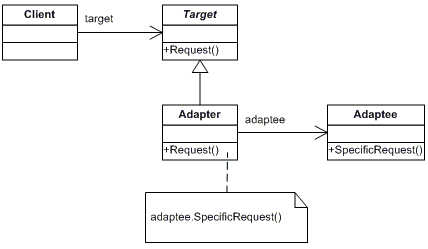

# C# Adapter Design Pattern

> **分類**：Structural Patterns（結構型模式）  
> **使用頻率 (Frequency of use)**：中高 (Medium-High)  
> **原文連結**：[https://www.dofactory.com/net/adapter-design-pattern](https://www.dofactory.com/net/adapter-design-pattern)

---

## 定義與概述 (Definition)

**Adapter** Design Pattern 將一個類別的介面轉換成用戶端（Clients）所期望的另一個介面。此 Design Pattern 讓原本因為介面不相容而無法一起運作的類別能夠協同運作。

本篇分成兩個部分：

- **[現代 C# 實作](#現代-c-實作-net-11--c-15)**：可以直接建置與執行的範例專案，建議由此開始閱讀。
- **[附錄：Dofactory 原版範例](#附錄dofactory-原版範例)**：Structural、Real-world、.NET Optimized 三種原版程式碼，作為對照。

---

## 問題情境 (Problem)

公司有一個既有的 `ChemicalDatabank` 類別可以查詢化合物資料，但它的介面是舊式設計：用字串代碼區分查詢項目，資料分散在三個方法裡。每個使用它的地方都得知道這些細節：

```csharp
// 示意：每個呼叫的地方都要知道 "M" 是熔點、"B" 是沸點
double melting = databank.GetCriticalPoint("water", "M");
double boiling = databank.GetCriticalPoint("water", "B");
string formula = databank.GetMolecularStructure("water");
```

- 代碼字串擴散到整個程式，打錯字不會有編譯錯誤。
- 舊 API 一旦改版或換成別的資料來源，所有呼叫的地方都要修改。
- 我們不能修改 `ChemicalDatabank`（它可能來自第三方或其他團隊）。

Adapter 是一個夾在中間的轉接類別：對內呼叫舊 API，對外提供我們想要的介面。

---

## UML 類別圖 (UML Class Diagram)

以下是參與此 Pattern 的類別與物件之視覺化關係圖：



---

## 參與者 (Participants)

參與此 Pattern 的類別與物件包括：

> 括號內是 Dofactory 原版範例（見附錄）使用的類別名稱。現代 C# 實作中各角色對應的型別，請見下一節開頭的「角色對照」。

- **Target** (`ChemicalCompound`)
  - 定義 `Client` 所使用的特定領域（Domain-specific）介面。
- **Adapter** (`Compound`)
  - 將 `Adaptee` 的介面轉接（Adapts）至 `Target` 介面。
- **Adaptee** (`ChemicalDatabank`)
  - 定義一個需要被轉接的既有介面。
- **Client** (`AdapterApp`)
  - 與符合 `Target` 介面的物件協同運作。

---

## 現代 C# 實作 (.NET 11 / C# 15)

> **範例專案**：[samples/Adapter](samples/Adapter)  
> **執行方式**：`dotnet run --project samples/Adapter`

**角色對照**：Target = `ICompound`；Adapter = `CompoundAdapter`；Adaptee = `ChemicalDatabank`；Client = 最上方的迴圈。

<!-- sample:Adapter/Program.cs -->
```csharp
// Adapter：既有類別的介面不合用、又不能修改它時，寫一個轉接類別把它包成我們想要的介面。

var databank = new ChemicalDatabank();

ICompound[] compounds =
[
    new CompoundAdapter(databank, "Water"),
    new CompoundAdapter(databank, "Benzene"),
    new CompoundAdapter(databank, "Ethanol"),
];

foreach (ICompound compound in compounds)
{
    Console.WriteLine($"Compound: {compound.Name}");
    Console.WriteLine($"  Formula   : {compound.Formula}");
    Console.WriteLine($"  Weight    : {compound.MolecularWeight}");
    Console.WriteLine($"  Melting Pt: {compound.MeltingPoint}");
    Console.WriteLine($"  Boiling Pt: {compound.BoilingPoint}");
}

// ---- Target：我們的程式希望使用的介面 ----
public interface ICompound
{
    string Name { get; }
    string Formula { get; }
    double MolecularWeight { get; }
    double MeltingPoint { get; }
    double BoilingPoint { get; }
}

// ---- Adapter：用「組合」持有 Adaptee，把呼叫轉換過去 ----
public sealed class CompoundAdapter(ChemicalDatabank databank, string name) : ICompound
{
    public string Name => name;
    public string Formula => databank.GetMolecularStructure(name);
    public double MolecularWeight => databank.GetMolecularWeight(name);

    // 舊 API 用 "M" / "B" 這種代碼區分熔點與沸點，這個細節只留在 Adapter 裡
    public double MeltingPoint => databank.GetCriticalPoint(name, "M");
    public double BoilingPoint => databank.GetCriticalPoint(name, "B");
}

// ---- Adaptee：既有或第三方的 API，假設我們不能修改它 ----
public sealed class ChemicalDatabank
{
    public double GetCriticalPoint(string compound, string point) => (compound.ToLowerInvariant(), point) switch
    {
        ("water", "M") => 0.0,
        ("water", "B") => 100.0,
        ("benzene", "M") => 5.5,
        ("benzene", "B") => 80.1,
        ("ethanol", "M") => -114.1,
        ("ethanol", "B") => 78.3,
        _ => 0d,
    };

    public string GetMolecularStructure(string compound) => compound.ToLowerInvariant() switch
    {
        "water" => "H2O",
        "benzene" => "C6H6",
        "ethanol" => "C2H5OH",
        _ => "",
    };

    public double GetMolecularWeight(string compound) => compound.ToLowerInvariant() switch
    {
        "water" => 18.015,
        "benzene" => 78.1134,
        "ethanol" => 46.0688,
        _ => 0d,
    };
}
```
<!-- /sample -->

### 輸出結果 (Output)

<!-- output:Adapter -->
```text
Compound: Water
  Formula   : H2O
  Weight    : 18.015
  Melting Pt: 0
  Boiling Pt: 100
Compound: Benzene
  Formula   : C6H6
  Weight    : 78.1134
  Melting Pt: 5.5
  Boiling Pt: 80.1
Compound: Ethanol
  Formula   : C2H5OH
  Weight    : 46.0688
  Melting Pt: -114.1
  Boiling Pt: 78.3
```
<!-- /output -->

### 重點解說

- **用組合而不是繼承**：`CompoundAdapter` 在建構函式接收 `ChemicalDatabank` 並持有它（Object Adapter），不需要繼承任何類別。
- **Adaptee 完全沒有被修改**：所有轉換都發生在 Adapter 裡。
- **舊 API 的細節只出現在一處**：`"M"` 與 `"B"` 這兩個代碼只存在於 `CompoundAdapter`。
- **Client 只相依 `ICompound`**：日後要換資料來源，只需要再寫一個實作 `ICompound` 的類別，迴圈不必修改。

---

## 與 Dofactory 原版的差異

- 原版的 `RichCompound` 繼承自 `Compound`，在建構時把資料讀出來存進欄位，並且自己負責顯示。本版的 Target 是介面，Adapter 只做轉換，顯示交給呼叫端。
- 原版把水的分子式寫成 `H20`（數字 0），本版更正為 `H2O`。
- 原版的 Adaptee 以 `float` 回傳臨界點。`float` 轉成 `double` 時會顯示出誤差（例如 `80.1f` 變成 `80.0999984741211`），本版的 Adaptee 直接使用 `double`。

---

## .NET 中的對應 (In .NET)

- **`StreamReader` 與 `StreamWriter`**：把以位元組為單位的 `Stream`，轉接成以文字為單位的 `TextReader` 與 `TextWriter`。
- **`DbDataAdapter`**：把資料庫查詢結果轉接成 `DataSet`。
- **包裝第三方 SDK**：把金流、簡訊、雲端儲存等外部 SDK 包成自己定義的介面。日後更換廠商時只需要換一個 Adapter。

---

## 何時該用、何時不該用

**適合使用**

- 要使用一個無法修改的類別（第三方元件、舊系統），但它的介面不符合需求。
- 想把對外部元件的相依集中在一個地方。

**不適合使用**

- 兩邊的程式碼都是自己的，而且可以直接修改介面：改介面比多一層轉接好。
- Adapter 裡開始出現商業邏輯：它的責任應該只有轉換。

---

## 練習題

1. 新增 `ICompound` 的第二個實作 `InMemoryCompound`，資料直接由建構函式傳入。把它加進陣列，確認迴圈不需要修改。
2. 舊 API 對不認識的化合物會回傳 `0` 與空字串。讓 `CompoundAdapter` 在這種情況下丟出 `KeyNotFoundException`，把舊 API 的怪行為擋在 Adapter 裡。
3. `CompoundAdapter` 每讀取一次屬性就查詢一次舊 API。如果查詢很慢，可以怎麼改？

---

## 附錄：Dofactory 原版範例

> 以下保留 Dofactory 網站的三種原版程式碼作為對照，點選標題即可展開。  
> 輸出結果是實際編譯並執行這些程式碼所得（執行時移除了會等待按鍵的 `Console.ReadKey()`，文化特性為 en-US）。  
> 原版使用較舊的 C# 寫法，撰寫新程式時請以上方的「現代 C# 實作」為準。

<details>
<summary><b>Structural code（結構化程式碼）</b></summary>

這段結構化（Structural）程式碼示範了 Adapter Pattern 如何將一個類別的介面映射（Maps）到另一個類別上，使它們能夠一起運作。這些不相容的類別可能來自不同的函式庫或框架。

```csharp
using System;

namespace Adapter.Structural
{
    /// <summary>
    /// Adapter Design Pattern
    /// </summary>

    public class Program
    {
        public static void Main(string[] args)
        {
            // Create adapter and place a request

            Target target = new Adapter();
            target.Request();

            // Wait for user

            Console.ReadKey();
        }

    }

    /// <summary>
    /// The 'Target' class
    /// </summary>

    public class Target
    {
        public virtual void Request()
        {
            Console.WriteLine("Called Target Request()");
        }
    }

    /// <summary>
    /// The 'Adapter' class
    /// </summary>

    public class Adapter : Target
    {
        private Adaptee adaptee = new Adaptee();

        public override void Request()
        {
            // Possibly do some other work
            // and then call SpecificRequest

            adaptee.SpecificRequest();
        }
    }

    /// <summary>
    /// The 'Adaptee' class
    /// </summary>

    public class Adaptee
    {
        public void SpecificRequest()
        {
            Console.WriteLine("Called SpecificRequest()");
        }
    }
}
```

**輸出結果 (Output)**

```text
Called SpecificRequest()
```

</details>

<details>
<summary><b>Real-world code（真實世界程式碼）</b></summary>

這段真實世界（Real-world）程式碼示範了如何使用一個舊版（Legacy）的化學資料庫（`ChemicalDatabank`）。化學化合物（`Compound`）物件會透過一個 `Adapter` 介面來存取該資料庫。

```csharp
using System;

namespace Adapter.RealWorld
{
    /// <summary>
    /// Adapter Design Pattern
    /// </summary>

    public class Program
    {
        public static void Main(string[] args)
        {
            // Non-adapted chemical compound

            Compound unknown = new Compound();
            unknown.Display();

            // Adapted chemical compounds

            Compound water = new RichCompound("Water");
            water.Display();

            Compound benzene = new RichCompound("Benzene");
            benzene.Display();

            Compound ethanol = new RichCompound("Ethanol");
            ethanol.Display();

            // Wait for user

            Console.ReadKey();
        }
    }

    /// <summary>
    /// The 'Target' class
    /// </summary>

    public class Compound
    {
        protected float boilingPoint;
        protected float meltingPoint;
        protected double molecularWeight;
        protected string molecularFormula;

        public virtual void Display()
        {
            Console.WriteLine("\nCompound: Unknown ------ ");
        }
    }

    /// <summary>
    /// The 'Adapter' class
    /// </summary>

    public class RichCompound : Compound
    {
        private string chemical;
        private ChemicalDatabank bank;

        // Constructor

        public RichCompound(string chemical)
        {
            this.chemical = chemical;
        }

        public override void Display()
        {
            // The Adaptee

            bank = new ChemicalDatabank();

            boilingPoint = bank.GetCriticalPoint(chemical, "B");
            meltingPoint = bank.GetCriticalPoint(chemical, "M");
            molecularWeight = bank.GetMolecularWeight(chemical);
            molecularFormula = bank.GetMolecularStructure(chemical);

            Console.WriteLine("\nCompound: {0} ------ ", chemical);
            Console.WriteLine(" Formula: {0}", molecularFormula);
            Console.WriteLine(" Weight : {0}", molecularWeight);
            Console.WriteLine(" Melting Pt: {0}", meltingPoint);
            Console.WriteLine(" Boiling Pt: {0}", boilingPoint);
        }
    }

    /// <summary>
    /// The 'Adaptee' class
    /// </summary>

    public class ChemicalDatabank
    {
        // The databank 'legacy API'

        public float GetCriticalPoint(string compound, string point)
        {
            // Melting Point
            if (point == "M")
            {
                switch (compound.ToLower())
                {
                    case "water": return 0.0f;
                    case "benzene": return 5.5f;
                    case "ethanol": return -114.1f;
                    default: return 0f;
                }
            }

            // Boiling Point

            else
            {
                switch (compound.ToLower())
                {
                    case "water": return 100.0f;
                    case "benzene": return 80.1f;
                    case "ethanol": return 78.3f;
                    default: return 0f;
                }
            }
        }

        public string GetMolecularStructure(string compound)
        {
            switch (compound.ToLower())
            {
                case "water": return "H20";
                case "benzene": return "C6H6";
                case "ethanol": return "C2H5OH";
                default: return "";
            }
        }

        public double GetMolecularWeight(string compound)
        {
            switch (compound.ToLower())
            {
                case "water": return 18.015;
                case "benzene": return 78.1134;
                case "ethanol": return 46.0688;
                default: return 0d;
            }
        }
    }
}
```

**輸出結果 (Output)**

```text
Compound: Unknown ------

Compound: Water ------
 Formula: H20
 Weight : 18.015
 Melting Pt: 0
 Boiling Pt: 100

Compound: Benzene ------
 Formula: C6H6
 Weight : 78.1134
 Melting Pt: 5.5
 Boiling Pt: 80.1

Compound: Ethanol ------
 Formula: C2H5OH
 Weight : 46.0688
 Melting Pt: -114.1
 Boiling Pt: 78.3
```

</details>

<details>
<summary><b>.NET Optimized code（.NET 最佳化程式碼）</b></summary>

這段 .NET 最佳化（.NET Optimized）程式碼示範了與上述相同的邏輯，但採用了更現代化的 C# 與 .NET 功能（例如 C# `switch` 運算式 Pattern Matching 與列舉型別 `Chemical`）。此版本的實作細節與限制，請見上方的〈與 Dofactory 原版的差異〉。

```csharp
namespace Adapter.NetOptimized;

using static System.Console;

/// <summary>
/// Adapter Design Pattern
/// </summary>
public class Program
{
    public static void Main()
    {
        // Non-adapted chemical compound 
        var unknown = new Compound();
        unknown.Display();

        // Adapted chemical compounds
        var water = new RichCompound(Chemical.Water);
        water.Display();

        var benzene = new RichCompound(Chemical.Benzene);
        benzene.Display();

        var ethanol = new RichCompound(Chemical.Ethanol);
        ethanol.Display();

        // Wait for user
        ReadKey();
    }
}

/// <summary>
/// The 'Target' class
/// </summary>
public class Compound
{
    public Chemical Chemical { get; protected set; }
    public float BoilingPoint { get; protected set; }
    public float MeltingPoint { get; protected set; }
    public double MolecularWeight { get; protected set; }
    public string? MolecularFormula { get; protected set; }

    public virtual void Display()
    {
        WriteLine("\nCompound: Unknown ------ ");
    }
}

/// <summary>
/// The 'Adapter' class
/// </summary>
public class RichCompound : Compound
{
    private readonly ChemicalDatabank bank = new();

    // Constructor
    public RichCompound(Chemical chemical)
    {
        Chemical = chemical;
    }

    public override void Display()
    {
        // Adaptee request methods
        BoilingPoint = bank.GetCriticalPoint(Chemical, State.Boiling);
        MeltingPoint = bank.GetCriticalPoint(Chemical, State.Melting);
        MolecularWeight = bank.GetMolecularWeight(Chemical);
        MolecularFormula = bank.GetMolecularStructure(Chemical);

        WriteLine($"\nCompound: { Chemical} ------ ");
        WriteLine($" Formula: {MolecularFormula}");
        WriteLine($" Weight : {MolecularWeight}");
        WriteLine($" Melting Pt: {MeltingPoint}");
        WriteLine($" Boiling Pt: {BoilingPoint}");
    }
}

/// <summary>
/// The 'Adaptee' class
/// </summary>
public class ChemicalDatabank
{
    // The databank 'legacy API'
    public float GetCriticalPoint(Chemical compound, State point)
    {
        // Melting Point
        if (point == State.Melting)
        {
            return compound switch
            {
                Chemical.Water => 0.0f,
                Chemical.Benzene => 5.5f,
                Chemical.Ethanol => -114.1f,
                _ => 0f,
            };
        }
        // Boiling Point
        else
        {
            return compound switch
            {
                Chemical.Water => 100.0f,
                Chemical.Benzene => 80.1f,
                Chemical.Ethanol => 78.3f,
                _ => 0f,
            };
        }
    }

    public string GetMolecularStructure(Chemical compound)
    {
        return compound switch
        {
            Chemical.Water => "H20",
            Chemical.Benzene => "C6H6",
            Chemical.Ethanol => "C2H5OH",
            _ => "",
        };
    }

    public double GetMolecularWeight(Chemical compound)
    {
        return compound switch
        {
            Chemical.Water => 18.015d,
            Chemical.Benzene => 78.1134d,
            Chemical.Ethanol => 46.0688d,
            _ => 0d
        };
    }
}


/// <summary>
/// Chemical enumeration
/// </summary>
public enum Chemical
{
    Water,
    Benzene,
    Ethanol
}

/// <summary>
/// State enumeration
/// </summary>
public enum State
{
    Boiling,
    Melting
}
```

**輸出結果 (Output)**

```text
Compound: Unknown ------

Compound: Water ------
 Formula: H20
 Weight : 18.015
 Melting Pt: 0
 Boiling Pt: 100

Compound: Benzene ------
 Formula: C6H6
 Weight : 78.1134
 Melting Pt: 5.5
 Boiling Pt: 80.1

Compound: Ethanol ------
 Formula: C2H5OH
 Weight : 46.0688
 Melting Pt: -114.1
 Boiling Pt: 78.3
```

</details>

---

## 導覽 (Navigation)

| 上一篇 | 總覽 | 下一篇 |
| :--- | :---: | ---: |
| [← 上一篇：Singleton](Singleton.md) | [🏠 C# Design Patterns 總覽](README.md) | [下一篇：Bridge →](Bridge.md) |
