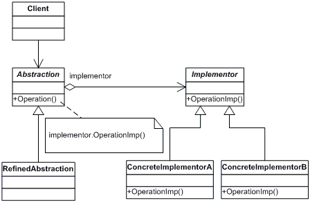

# C# Bridge Design Pattern

> **分類**：Structural Patterns（結構型模式）  
> **使用頻率 (Frequency of use)**：中低 (Medium-Low)  
> **原文連結**：[https://www.dofactory.com/net/bridge-design-pattern](https://www.dofactory.com/net/bridge-design-pattern)

---

## 定義與概述 (Definition)

**Bridge** Design Pattern 將抽象（Abstraction）與其實作（Implementation）解耦（Decouples），使這兩者可以獨立地變化。

**Bridge** Design Pattern 的 C# 程式碼範例除了提供 Dofactory 原版的 3 種形式外，亦額外補充針對 **.NET 11 / C# 15** 的現代化實務優化版本：
- [結構化程式碼 (Structural code)](#structural-code-in-c-結構化程式碼)
- [真實世界程式碼 (Real-world code)](#real-world-code-in-c-真實世界程式碼)
- [.NET 最佳化程式碼 (.NET optimized code)](#net-optimized-code-in-c-net-最佳化程式碼)
- [🚀 .NET 11 / C# 15 現代化實務優化 (Modern .NET 11 & C# 15)](#net-11--c-15-現代化實務優化-modern-net-11--c-15)

---

## UML 類別圖 (UML Class Diagram)

以下是參與此 Pattern 的類別與物件之視覺化關係圖：



---

## 參與者 (Participants)

參與此 Pattern 的類別與物件包括：

- **Abstraction** (`BusinessObject`)
  - 定義抽象概念的介面。
  - 維護一個指向 `Implementor` 型別物件的參考（Reference）。
- **RefinedAbstraction** (`CustomersBusinessObject`)
  - 擴充由 `Abstraction` 所定義的介面。
- **Implementor** (`DataObject`)
  - 定義實作類別（Implementation Classes）的介面。這個介面不需要與 `Abstraction` 的介面完全對應；事實上，這兩個介面可以完全不同。通常 `Implementor` 介面只提供基本（Primitive）操作，而 `Abstraction` 則根據這些基本操作來定義更高階的操作。
- **ConcreteImplementor** (`CustomersDataObject`)
  - 實作 `Implementor` 介面並定義其具體實作。

---

## Structural code in C# (結構化程式碼)

這段結構化（Structural）程式碼示範了 Bridge Pattern 如何將介面與其實作分離（解耦）。實作可以獨立演進，而無須修改使用該物件抽象概念的用戶端（Clients）。

```csharp
using System;

namespace Bridge.Structural
{
    /// <summary>
    /// Bridge Design Pattern
    /// </summary>

    public class Program
    {
        public static void Main(string[] args)
        {
            Abstraction ab = new RefinedAbstraction();

            // Set implementation and call

            ab.Implementor = new ConcreteImplementorA();
            ab.Operation();

            // Change implemention and call

            ab.Implementor = new ConcreteImplementorB();
            ab.Operation();

            // Wait for user

            Console.ReadKey();
        }
    }

    /// <summary>
    /// The 'Abstraction' class
    /// </summary>

    public class Abstraction
    {
        protected Implementor implementor;

        public Implementor Implementor
        {
            set { implementor = value; }
        }

        public virtual void Operation()
        {
            implementor.Operation();
        }
    }

    /// <summary>
    /// The 'Implementor' abstract class
    /// </summary>

    public abstract class Implementor
    {
        public abstract void Operation();
    }

    /// <summary>
    /// The 'RefinedAbstraction' class
    /// </summary>

    public class RefinedAbstraction : Abstraction
    {
        public override void Operation()
        {
            implementor.Operation();
        }
    }

    /// <summary>
    /// The 'ConcreteImplementorA' class
    /// </summary>

    public class ConcreteImplementorA : Implementor
    {
        public override void Operation()
        {
            Console.WriteLine("ConcreteImplementorA Operation");
        }
    }

    /// <summary>
    /// The 'ConcreteImplementorB' class
    /// </summary>

    public class ConcreteImplementorB : Implementor
    {
        public override void Operation()
        {
            Console.WriteLine("ConcreteImplementorB Operation");
        }
    }
}
```

### 輸出結果 (Output)

```text
ConcreteImplementorA Operation

  ConcreteImplementorB Operation
```

---

## Real-world code in C# (真實世界程式碼)

這段真實世界（Real-world）程式碼示範了 Bridge Pattern 如何將 `BusinessObject`（商業物件）抽象概念與 `DataObject`（資料物件）中的實作解耦。`DataObject` 的實作可以動態演進，而不需要變更任何用戶端程式碼。

```csharp
using System;
using System.Collections.Generic;

namespace Bridge.RealWorld
{
    /// <summary>
    /// Bridge Design Pattern
    /// </summary>

    public class Program
    {
        public static void Main(string[] args)
        {
            // Create RefinedAbstraction

            var customers = new Customers();

            // Set ConcreteImplementor

            customers.Data = new CustomersData("Chicago");

            // Exercise the bridge

            customers.Show();
            customers.Next();
            customers.Show();
            customers.Next();
            customers.Show();
            customers.Add("Henry Velasquez");

            customers.ShowAll();

            // Wait for user

            Console.ReadKey();
        }
    }
    /// <summary>
    /// The 'Abstraction' class
    /// </summary>

    public class CustomersBase
    {
        private DataObject dataObject;

        public DataObject Data
        {
            set { dataObject = value; }
            get { return dataObject; }
        }

        public virtual void Next()
        {
            dataObject.NextRecord();
        }

        public virtual void Prior()
        {
            dataObject.PriorRecord();
        }

        public virtual void Add(string customer)
        {
            dataObject.AddRecord(customer);
        }

        public virtual void Delete(string customer)
        {
            dataObject.DeleteRecord(customer);
        }

        public virtual void Show()
        {
            dataObject.ShowRecord();
        }

        public virtual void ShowAll()
        {
            dataObject.ShowAllRecords();
        }
    }

    /// <summary>
    /// The 'RefinedAbstraction' class
    /// </summary>

    public class Customers : CustomersBase
    {
        public override void ShowAll()
        {
            // Add separator lines

            Console.WriteLine();
            Console.WriteLine("------------------------");
            base.ShowAll();
            Console.WriteLine("------------------------");
        }
    }

    /// <summary>
    /// The 'Implementor' abstract class
    /// </summary>

    public abstract class DataObject
    {
        public abstract void NextRecord();
        public abstract void PriorRecord();
        public abstract void AddRecord(string name);
        public abstract void DeleteRecord(string name);
        public abstract string GetCurrentRecord();
        public abstract void ShowRecord();
        public abstract void ShowAllRecords();
    }

    /// <summary>
    /// The 'ConcreteImplementor' class
    /// </summary>

    public class CustomersData : DataObject
    {
        private readonly List<string> customers = new List<string>();
        private int current = 0;
        private string city;

        public CustomersData(string city)
        {
            this.city = city;

            // Loaded from a database 

            customers.Add("Jim Jones");
            customers.Add("Samual Jackson");
            customers.Add("Allen Good");
            customers.Add("Ann Stills");
            customers.Add("Lisa Giolani");
        }

        public override void NextRecord()
        {
            if (current <= customers.Count - 1)
            {
                current++;
            }
        }

        public override void PriorRecord()
        {
            if (current > 0)
            {
                current--;
            }
        }

        public override void AddRecord(string customer)
        {
            customers.Add(customer);
        }

        public override void DeleteRecord(string customer)
        {
            customers.Remove(customer);
        }

        public override string GetCurrentRecord()
        {
            return customers[current];
        }

        public override void ShowRecord()
        {
            Console.WriteLine(customers[current]);
        }

        public override void ShowAllRecords()
        {
            Console.WriteLine("Customer City: " + city);

            foreach (string customer in customers)
            {
                Console.WriteLine(" " + customer);
            }
        }
    }
}
```

### 輸出結果 (Output)

```text
Jim Jones

  Samual Jackson

  Allen Good

  

  ------------------------

  Customer Group: Chicago

  Jim Jones

  Samual Jackson

  Allen Good

  Ann Stills

  Lisa Giolani

  Henry Velasquez

  ------------------------
```

---

## .NET Optimized code in C# (.NET 最佳化程式碼)

這段 .NET 最佳化（.NET Optimized）程式碼示範了與上述相同的邏輯，但採用了更現代化的 C# 與 .NET 功能（例如 Primary Constructors 與介面 `IDataObject<T>`）。這是一個優雅的 C# Bridge 解決方案。

```csharp
namespace Bridge.NetOptimized;

using static System.Console;

/// <summary>
/// Bridge Design Pattern
/// </summary>
public class Program
{
    public static void Main()
    {
        // Create RefinedAbstraction and
        // set ConcreteImplementor
        var customers = new Customers(
            new CustomersData("Chicago"));

        // Exercise the bridge
        customers.Show();
        customers.Next();
        customers.Show();
        customers.Next();
        customers.Show();

        customers.Add("Henry Velasquez");
        customers.ShowAll();

        // Wait for user
        ReadKey();
    }
}

/// <summary>
/// The 'Abstraction' class
/// </summary>
public class CustomersBase(IDataObject<string> dataObject)
{
    public virtual void Next() => dataObject.NextRecord();
    public virtual void Prior() => dataObject.PriorRecord();
    public virtual void Add(string name) => dataObject.AddRecord(name);
    public virtual void Delete(string name) => dataObject.DeleteRecord(name);
    public virtual void Show() => dataObject.ShowRecord();
    public virtual void ShowAll() => dataObject.ShowAllRecords();
}

/// <summary>
/// The 'RefinedAbstraction' class
/// </summary>
public class Customers(IDataObject<string> dataObject) : CustomersBase(dataObject)
{
    public override void ShowAll()
    {
        // Add separator lines
        WriteLine();
        WriteLine("------------------------");
        base.ShowAll();
        WriteLine("------------------------");
    }
}

/// <summary>
/// The 'Implementor' interface
/// </summary>
public interface IDataObject<T>
{
    void NextRecord();
    void PriorRecord();
    void AddRecord(T t);
    void DeleteRecord(T t);
    T GetCurrentRecord();
    void ShowRecord();
    void ShowAllRecords();
}

/// <summary>
/// The 'ConcreteImplementor' class
/// </summary>
public class CustomersData : IDataObject<string>
{
    private readonly string city;
    private readonly List<string> customers;
    private int current = 0;

    // Constructor
    public CustomersData(string city)
    {
        this.city = city;

        // Simulate loading from database
        customers =
              ["Jim Jones", "Samual Jackson", "Allan Good",
                "Ann Stills", "Lisa Giolani" ];
    }

    public void NextRecord()
    {
        if (current <= customers.Count - 1)
        {
            current++;
        }
    }

    public void PriorRecord()
    {
        if (current > 0)
        {
            current--;
        }
    }

    public void AddRecord(string customer) =>
        customers.Add(customer);

    public void DeleteRecord(string customer) =>
        customers.Remove(customer);

    public string GetCurrentRecord() =>
        customers[current];

    public void ShowRecord() =>
        WriteLine(customers[current]);

    public void ShowAllRecords()
    {
        WriteLine("Customer Group: " + city);
        customers.ForEach(customer =>
            WriteLine(" " + customer));
    }
}
```

### 輸出結果 (Output)

```text
Jim Jones

    Samual Jackson

    Allen Good

    

    ------------------------

    Customer Group: Chicago

    Jim Jones

    Samual Jackson

    Allen Good

    Ann Stills

    Lisa Giolani

    Henry Velasquez

    ------------------------
```

---

## .NET 11 / C# 15 現代化實務優化 (Modern .NET 11 & C# 15)

### 原版範例的限制與盲點

- **Dofactory `.NET Optimized` 範例已經相當接近現代寫法**：它使用了 Primary Constructors `CustomersBase(IDataObject<string> dataObject)` 將 Abstraction 與 Implementor 解耦。
- **可進一步強化的細節**：在 `CustomersData` 中管理游標（`current`）邊界時，可利用 **`Math.Clamp`** 與 **C# 15 Collection Expression Arguments (`[with(capacity: ...)]`)**，讓程式碼更精煉且安全。

### C# 15 / .NET 11 優化重點

- **C# 15 Collection Expression Arguments (`[with(capacity: ...)]`)**：初始化內部清單時同時指定預留容量。
- **`Math.Clamp`**：一行程式碼取代繁瑣的 `if (current > 0)` / `if (current < customers.Count - 1)` 邊界檢查。

### 現代化 C# 15 / .NET 11 程式碼範例

```csharp
namespace Bridge.ModernNet11;

using static System.Console;

public static class Program
{
    public static void Main()
    {
        var customers = new Customers(new CustomersData("Chicago"));

        customers.Show();
        customers.Next();
        customers.Show();
        customers.Add("Henry Velasquez");
        customers.ShowAll();
    }
}

public class CustomersBase(IDataObject<string> dataObject)
{
    public virtual void Next() => dataObject.NextRecord();
    public virtual void Prior() => dataObject.PriorRecord();
    public virtual void Add(string name) => dataObject.AddRecord(name);
    public virtual void Delete(string name) => dataObject.DeleteRecord(name);
    public virtual void Show() => dataObject.ShowRecord();
    public virtual void ShowAll() => dataObject.ShowAllRecords();
}

public sealed class Customers(IDataObject<string> dataObject) : CustomersBase(dataObject)
{
    public override void ShowAll()
    {
        WriteLine("\n------------------------");
        base.ShowAll();
        WriteLine("------------------------");
    }
}

public interface IDataObject<T>
{
    void NextRecord();
    void PriorRecord();
    void AddRecord(T record);
    void DeleteRecord(T record);
    T GetCurrentRecord();
    void ShowRecord();
    void ShowAllRecords();
}

public sealed class CustomersData(string city) : IDataObject<string>
{
    // C# 15 Collection Expression Arguments: 預先配置容量並填入初始元素
    private readonly List<string> _customers =
    [
        with(capacity: 8),
        "Jim Jones", "Samual Jackson", "Allen Good", "Ann Stills", "Lisa Giolani"
    ];

    private int _current;

    public void NextRecord() => _current = Math.Clamp(_current + 1, 0, _customers.Count - 1);
    public void PriorRecord() => _current = Math.Clamp(_current - 1, 0, _customers.Count - 1);
    public void AddRecord(string customer) => _customers.Add(customer);
    public void DeleteRecord(string customer) => _customers.Remove(customer);
    public string GetCurrentRecord() => _customers[_current];
    public void ShowRecord() => WriteLine(_customers[_current]);

    public void ShowAllRecords()
    {
        WriteLine($"Customer Group: {city}");
        _customers.ForEach(customer => WriteLine($" {customer}"));
    }
}
```

---

## 導覽 (Navigation)

| 上一篇 | 總覽 | 下一篇 |
| :--- | :---: | ---: |
| [← 上一篇：Adapter](Adapter.md) | [🏠 C# Design Patterns 總覽](Index.md) | [下一篇：Composite →](Composite.md) |
