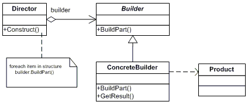

# C# Builder Design Pattern

> **分類**：Creational Patterns（建立型模式）  
> **使用頻率 (Frequency of use)**：中低 (Medium-Low)  
> **原文連結**：[https://www.dofactory.com/net/builder-design-pattern](https://www.dofactory.com/net/builder-design-pattern)

---

## 定義與概述 (Definition)

**Builder** Design Pattern 將複雜物件的建構過程與其表示方式（Representation）分離，讓相同的建構過程可以建立不同的表示方式。

本篇分成兩個部分：

- **[現代 C# 實作](#現代-c-實作-net-11--c-15)**：可以直接建置與執行的範例專案，建議由此開始閱讀。
- **[附錄：Dofactory 原版範例](#附錄dofactory-原版範例)**：Structural、Real-world、.NET Optimized 三種原版程式碼，作為對照。

---

## 問題情境 (Problem)

一輛車有車架、引擎、輪子與車門。如果全部交給一個建構函式，呼叫端會長這樣：

```csharp
// 示意：參數一多，就看不出每個值代表什麼，也很容易傳錯順序
var car = new Vehicle("Car", "Car Frame", "2500 cc", 4, 4);
var scooter = new Vehicle("Scooter", "Scooter Frame", "50 cc", 2, 0);
```

- 相同型別的參數排在一起，順序寫錯了編譯器也不會發現（輪子數與車門數對調）。
- 沒有的零件只能傳 `0` 或 `null` 佔位。
- 如果改成「先 `new` 一個空物件，再一個一個設定屬性」，程式的其他部分就可能拿到組到一半的物件。

Builder 把「逐步收集零件」的工作交給另一個物件，等所有步驟完成、檢查通過後，才一次交出完整的成品。

---

## UML 類別圖 (UML Class Diagram)

以下是參與此 Pattern 的類別與物件之視覺化關係圖：



---

## 參與者 (Participants)

參與此 Pattern 的類別與物件包括：

> 括號內是 Dofactory 原版範例（見附錄）使用的類別名稱。現代 C# 實作中各角色對應的型別，請見下一節開頭的「角色對照」。

- **Builder** (`VehicleBuilder`)
  - 指定一個抽象介面，用於建立 `Product` 物件的各個組件（Parts）。
- **ConcreteBuilder** (`MotorCycleBuilder`, `CarBuilder`, `ScooterBuilder`)
  - 透過實作 `Builder` 介面來建構並組裝產品的各個組件。
  - 定義並追蹤它所建立的表示方式（Representation）。
  - 提供一個用於取得產品的介面。
- **Director** (`Shop`)
  - 使用 `Builder` 介面來建構一個物件。
- **Product** (`Vehicle`)
  - 代表正在被建構的複雜物件。`ConcreteBuilder` 會建立該產品的內部表示方式，並定義其組裝過程。
  - 包含定義組成組件的類別，以及將這些組件組裝為最終結果的介面。

---

## 現代 C# 實作 (.NET 11 / C# 15)

> **範例專案**：[samples/Builder](samples/Builder)  
> **執行方式**：`dotnet run --project samples/Builder`

**角色對照**：Builder = `VehicleBuilder`；Director = `VehicleShop`；Product = `Vehicle`。

<!-- sample:Builder/Program.cs -->
```csharp
// Builder：把「一步一步組裝」和「最後的成品」分開，成品一旦建好就不再改變。

// 透過 Director 使用現成的配方
Vehicle scooter = VehicleShop.BuildScooter(new VehicleBuilder());
Vehicle car = VehicleShop.BuildCar(new VehicleBuilder());
Console.WriteLine(scooter);
Console.WriteLine(car);

// 也可以不透過 Director，自己決定每一個步驟
Vehicle trike = new VehicleBuilder()
    .OfType("Trike")
    .WithFrame("Trike Frame")
    .WithEngine("125 cc")
    .WithWheels(3)
    .Build();
Console.WriteLine(trike);

// 少了必要步驟時，Build() 會立刻說明缺了什麼，而不是等到使用成品時才出錯
try
{
    new VehicleBuilder().OfType("Broken").WithWheels(2).Build();
}
catch (InvalidOperationException ex)
{
    Console.WriteLine($"Build failed: {ex.Message}");
}

// ---- Product：不可變的成品 ----
public sealed record Vehicle(string Type, string Frame, string Engine, int Wheels, int Doors)
{
    public override string ToString() =>
        $"{Type}: frame={Frame}, engine={Engine}, wheels={Wheels}, doors={Doors}";
}

// ---- Builder：負責收集零件，並在 Build() 檢查成品是否完整 ----
public sealed class VehicleBuilder
{
    private string? _type;
    private string? _frame;
    private string? _engine;
    private int _wheels;
    private int _doors;

    // 每個步驟都回傳 this，呼叫端才能用「.」一路串下去（Fluent API）
    public VehicleBuilder OfType(string type) { _type = type; return this; }
    public VehicleBuilder WithFrame(string frame) { _frame = frame; return this; }
    public VehicleBuilder WithEngine(string engine) { _engine = engine; return this; }
    public VehicleBuilder WithWheels(int wheels) { _wheels = wheels; return this; }
    public VehicleBuilder WithDoors(int doors) { _doors = doors; return this; }

    public Vehicle Build()
    {
        if (_type is null) throw new InvalidOperationException("Type is required.");
        if (_frame is null) throw new InvalidOperationException("Frame is required.");
        if (_engine is null) throw new InvalidOperationException("Engine is required.");
        if (_wheels <= 0) throw new InvalidOperationException("Wheels must be greater than zero.");

        return new Vehicle(_type, _frame, _engine, _wheels, _doors);
    }
}

// ---- Director：知道「標準車款要哪些步驟」，但不知道成品內部長什麼樣子 ----
public static class VehicleShop
{
    public static Vehicle BuildScooter(VehicleBuilder builder) => builder
        .OfType("Scooter")
        .WithFrame("Scooter Frame")
        .WithEngine("50 cc")
        .WithWheels(2)
        .Build();

    public static Vehicle BuildCar(VehicleBuilder builder) => builder
        .OfType("Car")
        .WithFrame("Car Frame")
        .WithEngine("2500 cc")
        .WithWheels(4)
        .WithDoors(4)
        .Build();
}
```
<!-- /sample -->

### 輸出結果 (Output)

<!-- output:Builder -->
```text
Scooter: frame=Scooter Frame, engine=50 cc, wheels=2, doors=0
Car: frame=Car Frame, engine=2500 cc, wheels=4, doors=4
Trike: frame=Trike Frame, engine=125 cc, wheels=3, doors=0
Build failed: Frame is required.
```
<!-- /output -->

### 重點解說

- **Fluent API**：每個步驟都回傳 `this`，呼叫端可以用 `.` 一路串下去，每個值代表什麼一目了然。
- **成品不可變**：`Vehicle` 是 `record`，建好之後不能再修改；所有「還在變動」的狀態只存在於 Builder 裡。
- **`Build()` 是唯一的檢查點**：少了必要零件會立刻丟出例外並說明缺了什麼（輸出最後一行）。
- **Director 是選用的**：`VehicleShop` 把常用的配方包成方法；需要客製時，呼叫端可以直接操作 Builder。

---

## 與 Dofactory 原版的差異

- 原版每種車都有一個 Builder 子類別（`MotorCycleBuilder`、`CarBuilder`、`ScooterBuilder`），彼此只差在零件的字串值。本版只有一個 `VehicleBuilder`，不同車款的配方改由 Director 的方法表達。
- 原版的 `Vehicle` 以字串索引子儲存零件（`vehicle["frame"] = ...`），鍵打錯字要到執行期才會發現。本版改用具名的屬性。
- 原版沒有檢查步驟是否完整。本版在 `Build()` 統一驗證。

---

## .NET 中的對應 (In .NET)

- **`StringBuilder`、`UriBuilder`**：逐步累積內容，最後以 `ToString()` 或 `Uri` 屬性取得成品。
- **`WebApplication.CreateBuilder(args)`**：先在 builder 上設定服務與組態，再呼叫 `builder.Build()` 取得應用程式；`HostApplicationBuilder`、`ConfigurationBuilder` 也是相同的形式。
- **物件初始設定式搭配 `required` 與 `init`**：如果只是想讓初始化的程式碼好讀，沒有驗證規則也沒有步驟順序，這樣就夠了，不需要另外寫 Builder。

---

## 何時該用、何時不該用

**適合使用**

- 建構參數很多，而且多數是選擇性的。
- 建立過程需要驗證，或必須分成多個步驟。
- 同一套步驟要產生多種不同的成品。

**不適合使用**

- 只有兩三個必要參數：用建構函式最直接。
- 單純的資料物件：用 `record`，或 `required` 加 `init` 屬性。

---

## 練習題

1. 加上 `WithColor(string color)` 步驟，沒有指定時預設為 `"White"`。
2. 在 `VehicleShop` 新增 `BuildMotorCycle`（500 cc、2 個輪子）。
3. `Build()` 之後繼續呼叫同一個 Builder 的方法，再 `Build()` 一次，會得到什麼？先前建好的 `Vehicle` 會受影響嗎？為什麼？

---

## 附錄：Dofactory 原版範例

> 以下保留 Dofactory 網站的三種原版程式碼作為對照，點選標題即可展開。  
> 輸出結果是實際編譯並執行這些程式碼所得（執行時移除了會等待按鍵的 `Console.ReadKey()`，文化特性為 en-US）。  
> 原版使用較舊的 C# 寫法，撰寫新程式時請以上方的「現代 C# 實作」為準。

<details>
<summary><b>Structural code（結構化程式碼）</b></summary>

這段結構化（Structural）程式碼示範了 Builder Pattern 如何以循序漸進（Step-by-step）的方式建立複雜物件。建構過程可以建立不同的物件表示方式，並對物件的組裝提供高度的控制。

```csharp
using System;
using System.Collections.Generic;

namespace DoFactory.GangOfFour.Builder.Structural
{
    /// <summary>
    /// MainApp startup class for Structural
    /// Builder Design Pattern.
    /// </summary>

    public class MainApp
    {
        /// <summary>
        /// Entry point into console application.
        /// </summary>

        public static void Main()
        {
            // Create director and builders

            Director director = new Director();

            Builder b1 = new ConcreteBuilder1();
            Builder b2 = new ConcreteBuilder2();

            // Construct two products

            director.Construct(b1);
            Product p1 = b1.GetResult();
            p1.Show();

            director.Construct(b2);
            Product p2 = b2.GetResult();
            p2.Show();

            // Wait for user

            Console.ReadKey();
        }
    }

    /// <summary>
    /// The 'Director' class
    /// </summary>

    class Director
    {
        // Builder uses a complex series of steps

        public void Construct(Builder builder)
        {
            builder.BuildPartA();
            builder.BuildPartB();
        }
    }

    /// <summary>
    /// The 'Builder' abstract class
    /// </summary>

    abstract class Builder
    {
        public abstract void BuildPartA();
        public abstract void BuildPartB();
        public abstract Product GetResult();
    }

    /// <summary>
    /// The 'ConcreteBuilder1' class
    /// </summary>

    class ConcreteBuilder1 : Builder
    {
        private Product _product = new Product();

        public override void BuildPartA()
        {
            _product.Add("PartA");
        }

        public override void BuildPartB()
        {
            _product.Add("PartB");
        }

        public override Product GetResult()
        {
            return _product;
        }
    }

    /// <summary>
    /// The 'ConcreteBuilder2' class
    /// </summary>

    class ConcreteBuilder2 : Builder
    {
        private Product _product = new Product();

        public override void BuildPartA()
        {
            _product.Add("PartX");
        }

        public override void BuildPartB()
        {
            _product.Add("PartY");
        }

        public override Product GetResult()
        {
            return _product;
        }
    }

    /// <summary>
    /// The 'Product' class
    /// </summary>

    class Product
    {
        private List<string> _parts = new List<string>();

        public void Add(string part)
        {
            _parts.Add(part);
        }

        public void Show()
        {
            Console.WriteLine("\nProduct Parts -------");
            foreach (string part in _parts)
                Console.WriteLine(part);
        }
    }
}
```

**輸出結果 (Output)**

```text
Product Parts -------
PartA
PartB

Product Parts -------
PartX
PartY
```

</details>

<details>
<summary><b>Real-world code（真實世界程式碼）</b></summary>

這段真實世界（Real-world）程式碼示範了 Builder Pattern 如何以循序漸進的方式組裝不同的交通工具（Vehicles）。`Shop`（車廠）使用 `VehicleBuilder` 透過一系列連續的步驟來建構各種 `Vehicle`。

```csharp
using System;
using System.Collections.Generic;

namespace DoFactory.GangOfFour.Builder.RealWorld
{
    /// <summary>
    /// MainApp startup class for Real-World 
    /// Builder Design Pattern.
    /// </summary>

    public class MainApp
    {
        /// <summary>
        /// Entry point into console application.
        /// </summary>

        public static void Main()
        {
            VehicleBuilder builder;

            // Create shop with vehicle builders

            Shop shop = new Shop();

            // Construct and display vehicles

            builder = new ScooterBuilder();
            shop.Construct(builder);
            builder.Vehicle.Show();

            builder = new CarBuilder();
            shop.Construct(builder);
            builder.Vehicle.Show();

            builder = new MotorCycleBuilder();
            shop.Construct(builder);
            builder.Vehicle.Show();

            // Wait for user

            Console.ReadKey();
        }
    }

    /// <summary>
    /// The 'Director' class
    /// </summary>

    class Shop
    {
        // Builder uses a complex series of steps

        public void Construct(VehicleBuilder vehicleBuilder)
        {
            vehicleBuilder.BuildFrame();
            vehicleBuilder.BuildEngine();
            vehicleBuilder.BuildWheels();
            vehicleBuilder.BuildDoors();
        }
    }

    /// <summary>
    /// The 'Builder' abstract class
    /// </summary>

    abstract class VehicleBuilder
    {
        protected Vehicle vehicle;

        // Gets vehicle instance

        public Vehicle Vehicle
        {
            get { return vehicle; }
        }

        // Abstract build methods

        public abstract void BuildFrame();
        public abstract void BuildEngine();
        public abstract void BuildWheels();
        public abstract void BuildDoors();
    }

    /// <summary>
    /// The 'ConcreteBuilder1' class
    /// </summary>

    class MotorCycleBuilder : VehicleBuilder
    {
        public MotorCycleBuilder()
        {
            vehicle = new Vehicle("MotorCycle");
        }

        public override void BuildFrame()
        {
            vehicle["frame"] = "MotorCycle Frame";
        }

        public override void BuildEngine()
        {
            vehicle["engine"] = "500 cc";
        }

        public override void BuildWheels()
        {
            vehicle["wheels"] = "2";
        }

        public override void BuildDoors()
        {
            vehicle["doors"] = "0";
        }
    }

    /// <summary>
    /// The 'ConcreteBuilder2' class
    /// </summary>

    class CarBuilder : VehicleBuilder
    {
        public CarBuilder()
        {
            vehicle = new Vehicle("Car");
        }

        public override void BuildFrame()
        {
            vehicle["frame"] = "Car Frame";
        }

        public override void BuildEngine()
        {
            vehicle["engine"] = "2500 cc";
        }

        public override void BuildWheels()
        {
            vehicle["wheels"] = "4";
        }

        public override void BuildDoors()
        {
            vehicle["doors"] = "4";
        }
    }

    /// <summary>
    /// The 'ConcreteBuilder3' class
    /// </summary>

    class ScooterBuilder : VehicleBuilder
    {
        public ScooterBuilder()
        {
            vehicle = new Vehicle("Scooter");
        }

        public override void BuildFrame()
        {
            vehicle["frame"] = "Scooter Frame";
        }

        public override void BuildEngine()
        {
            vehicle["engine"] = "50 cc";
        }

        public override void BuildWheels()
        {
            vehicle["wheels"] = "2";
        }

        public override void BuildDoors()
        {
            vehicle["doors"] = "0";
        }
    }

    /// <summary>
    /// The 'Product' class
    /// </summary>

    class Vehicle
    {
        private string _vehicleType;
        private Dictionary<string, string> _parts =
          new Dictionary<string, string>();

        // Constructor

        public Vehicle(string vehicleType)
        {
            this._vehicleType = vehicleType;
        }

        // Indexer

        public string this[string key]
        {
            get { return _parts[key]; }
            set { _parts[key] = value; }
        }

        public void Show()
        {
            Console.WriteLine("\n---------------------------");
            Console.WriteLine("Vehicle Type: {0}", _vehicleType);
            Console.WriteLine(" Frame : {0}", _parts["frame"]);
            Console.WriteLine(" Engine : {0}", _parts["engine"]);
            Console.WriteLine(" #Wheels: {0}", _parts["wheels"]);
            Console.WriteLine(" #Doors : {0}", _parts["doors"]);
        }
    }
}
```

**輸出結果 (Output)**

```text
---------------------------
Vehicle Type: Scooter
 Frame : Scooter Frame
 Engine : 50 cc
 #Wheels: 2
 #Doors : 0

---------------------------
Vehicle Type: Car
 Frame : Car Frame
 Engine : 2500 cc
 #Wheels: 4
 #Doors : 4

---------------------------
Vehicle Type: MotorCycle
 Frame : MotorCycle Frame
 Engine : 500 cc
 #Wheels: 2
 #Doors : 0
```

</details>

<details>
<summary><b>.NET Optimized code（.NET 最佳化程式碼）</b></summary>

這段 .NET 最佳化（.NET Optimized）程式碼示範了與上述相同的邏輯，但採用了更現代化的 C# 與 .NET 功能（例如 Primary Constructors、列舉型別 `PartType` 與索引子）。此版本的實作細節與限制，請見上方的〈與 Dofactory 原版的差異〉。

```csharp
namespace Builder.NetOptimized;

using static System.Console;

/// <summary>
/// Builder Design Pattern
/// </summary>
public class Program
{
    public static void Main()
    {
        // Create shop
        var shop = new Shop();

        // Construct and display vehicles
        shop.Construct(new ScooterBuilder());
        shop.ShowVehicle();

        shop.Construct(new CarBuilder());
        shop.ShowVehicle();

        shop.Construct(new MotorCycleBuilder());
        shop.ShowVehicle();

        // Wait for user
        ReadKey();
    }
}
/// <summary>
/// The 'Director' class
/// </summary>
public class Shop
{
    private VehicleBuilder? builder;

    // Builder uses a complex series of steps
    public void Construct(VehicleBuilder vehicleBuilder)
    {
        builder = vehicleBuilder;

        builder.BuildFrame();
        builder.BuildEngine();
        builder.BuildWheels();
        builder.BuildDoors();
    }

    public void ShowVehicle()
    {
        builder?.Vehicle.Show();
    }
}

/// <summary>
/// The 'Builder' abstract class
/// </summary>
public abstract class VehicleBuilder(VehicleType vehicleType)
{
    public Vehicle Vehicle { get; private set; } = new Vehicle(vehicleType);

    public abstract void BuildFrame();
    public abstract void BuildEngine();
    public abstract void BuildWheels();
    public abstract void BuildDoors();
}

/// <summary>
/// The 'ConcreteBuilder1' class
/// </summary>
public class MotorCycleBuilder : VehicleBuilder
{
    // Invoke base class constructor
    public MotorCycleBuilder() : base(VehicleType.MotorCycle)
    {
    }

    public override void BuildFrame() => Vehicle[PartType.Frame] = "MotorCycle Frame";
    public override void BuildEngine() => Vehicle[PartType.Engine] = "500 cc";
    public override void BuildWheels() => Vehicle[PartType.Wheel] = "2";
    public override void BuildDoors() => Vehicle[PartType.Door] = "0";
}

/// <summary>
/// The 'ConcreteBuilder2' class
/// </summary>
public class CarBuilder : VehicleBuilder
{
    // Invoke base class constructor
    public CarBuilder() : base(VehicleType.Car)
    {
    }

    public override void BuildFrame() => Vehicle[PartType.Frame] = "Car Frame";
    public override void BuildEngine() => Vehicle[PartType.Engine] = "2500 cc";
    public override void BuildWheels() => Vehicle[PartType.Wheel] = "4";
    public override void BuildDoors() => Vehicle[PartType.Door] = "4";
}

/// <summary>
/// The 'ConcreteBuilder3' class
/// </summary>
public class ScooterBuilder : VehicleBuilder
{
    // Invoke base class constructor
    public ScooterBuilder() : base(VehicleType.Scooter)
    {
    }

    public override void BuildFrame() => Vehicle[PartType.Frame] = "Scooter Frame";
    public override void BuildEngine() => Vehicle[PartType.Engine] = "50 cc";
    public override void BuildWheels() => Vehicle[PartType.Wheel] = "2";
    public override void BuildDoors() => Vehicle[PartType.Door] = "0";
}

/// <summary>
/// The 'Product' class
/// </summary>
public class Vehicle(VehicleType vehicleType)
{
    private readonly Dictionary<PartType, string> parts = [];
    private readonly VehicleType vehicleType = vehicleType;

    public string this[PartType key]
    {
        get => parts[key];
        set => parts[key] = value; 
    }

    public void Show()
    {
        WriteLine("\n---------------------------");
        WriteLine($"Vehicle Type: {vehicleType}");
        WriteLine($" Frame  : {this[PartType.Frame]}");
        WriteLine($" Engine : {this[PartType.Engine]}");
        WriteLine($" #Wheels: {this[PartType.Wheel]}");
        WriteLine($" #Doors : {this[PartType.Door]}");
    }
}

/// <summary>
/// Part type enumeration
/// </summary>
public enum PartType
{
    Frame,
    Engine,
    Wheel,
    Door
}

/// <summary>
/// Vehicle type enumeration
/// </summary>
public enum VehicleType
{
    Car,
    Scooter,
    MotorCycle
}
```

**輸出結果 (Output)**

```text
---------------------------
Vehicle Type: Scooter
 Frame  : Scooter Frame
 Engine : 50 cc
 #Wheels: 2
 #Doors : 0

---------------------------
Vehicle Type: Car
 Frame  : Car Frame
 Engine : 2500 cc
 #Wheels: 4
 #Doors : 4

---------------------------
Vehicle Type: MotorCycle
 Frame  : MotorCycle Frame
 Engine : 500 cc
 #Wheels: 2
 #Doors : 0
```

</details>

---

## 導覽 (Navigation)

| 上一篇 | 總覽 | 下一篇 |
| :--- | :---: | ---: |
| [← 上一篇：Abstract Factory](AbstractFactory.md) | [🏠 C# Design Patterns 總覽](README.md) | [下一篇：Factory Method →](FactoryMethod.md) |
