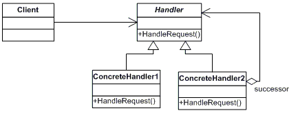

# C# Chain of Responsibility Design Pattern

> **分類**：Behavioral Patterns（行為型模式）  
> **使用頻率 (Frequency of use)**：中低 (Medium-Low)  
> **原文連結**：[https://www.dofactory.com/net/chain-of-responsibility-design-pattern](https://www.dofactory.com/net/chain-of-responsibility-design-pattern)

---

## 定義與概述 (Definition)

**Chain of Responsibility** Design Pattern 藉由給予多個物件處理請求的機會，避免將請求的發送者（Sender）與接收者（Receiver）耦合在一起。此 Pattern 會將接收物件串連成一條鏈（Chain），並沿著這條鏈傳遞請求，直到有一個物件處理它為止。

本篇分成兩個部分：

- **[現代 C# 實作](#現代-c-實作-net-11--c-15)**：可以直接建置與執行的範例專案，建議由此開始閱讀。
- **[附錄：Dofactory 原版範例](#附錄dofactory-原版範例)**：Structural、Real-world、.NET Optimized 三種原版程式碼，作為對照。

---

## 問題情境 (Problem)

採購單依金額由不同層級的主管核准。把規則直接寫成條件判斷，會是這樣：

```csharp
// 示意：所有核准規則寫在同一個方法裡，新增一級主管就要回來改這裡
if (purchase.Amount < 10_000m) director.Approve(purchase);
else if (purchase.Amount < 25_000m) vicePresident.Approve(purchase);
else if (purchase.Amount < 100_000m) president.Approve(purchase);
else ScheduleExecutiveMeeting(purchase);
```

- 送出採購單的程式碼必須認識每一級主管與他們的額度。
- 調整核准層級（新增一級、調換順序）就要修改這段程式碼。

Chain of Responsibility 把每個處理者變成一個物件並串成一條鏈。送出請求的人只需要交給第一個人；每個處理者自己決定要處理還是往下傳。

---

## UML 類別圖 (UML Class Diagram)

以下是參與此 Pattern 的類別與物件之視覺化關係圖：



---

## 參與者 (Participants)

參與此 Pattern 的類別與物件包括：

> 括號內是 Dofactory 原版範例（見附錄）使用的類別名稱。現代 C# 實作中各角色對應的型別，請見下一節開頭的「角色對照」。

- **Handler** (`Approver`)
  - 定義一個用於處理請求的介面。
  - （選用）實作指向後繼者（Successor）的連結。
- **ConcreteHandler** (`Director`, `VicePresident`, `President`)
  - 處理它所負責的請求。
  - 可以存取它的後繼者（Successor）。
  - 如果 `ConcreteHandler` 可以處理該請求，它就會直接處理；否則它會將請求轉發（Forwards）給它的後繼者。
- **Client** (`ChainApp`)
  - 向鏈（Chain）上的某個 `ConcreteHandler` 物件發起請求。

---

## 現代 C# 實作 (.NET 11 / C# 15)

> **範例專案**：[samples/ChainOfResponsibility](samples/ChainOfResponsibility)  
> **執行方式**：`dotnet run --project samples/ChainOfResponsibility`

**角色對照**：Handler = `PurchaseHandler`；ConcreteHandler = `Approver`、`ExecutiveMeeting`；Client = 最上方的迴圈。

<!-- sample:ChainOfResponsibility/Program.cs -->
```csharp
// Chain of Responsibility：把處理者串成一條鏈，請求沿著鏈往下傳，直到有人處理為止。

// 組裝責任鏈：Director -> Vice President -> President -> 高層會議
PurchaseHandler chain = new Approver("Director", limit: 10_000m);
chain.SetNext(new Approver("Vice President", limit: 25_000m))
     .SetNext(new Approver("President", limit: 100_000m))
     .SetNext(new ExecutiveMeeting());

Purchase[] purchases =
[
    new(2034, 350.00m, "Supplies"),
    new(2035, 32_590.10m, "Project X"),
    new(2036, 122_100.00m, "Project Y"),
];

// 發出請求的人只認得鏈的第一個人，不必知道最後是誰核准
foreach (Purchase purchase in purchases)
{
    chain.Handle(purchase);
}

public sealed record Purchase(int Number, decimal Amount, string Purpose);

// ---- Handler：「處理不了就往下傳」的邏輯只寫在這裡一次 ----
public abstract class PurchaseHandler
{
    private PurchaseHandler? _next;

    // 回傳 next，組裝時才能一路 .SetNext(...).SetNext(...) 串下去
    public PurchaseHandler SetNext(PurchaseHandler next)
    {
        _next = next;
        return next;
    }

    public void Handle(Purchase purchase)
    {
        if (TryHandle(purchase))
        {
            return;
        }

        if (_next is null)
        {
            Console.WriteLine($"Request #{purchase.Number} could not be handled by anyone.");
            return;
        }

        _next.Handle(purchase);
    }

    // 子類別只需要回答：這個請求我能不能處理？
    protected abstract bool TryHandle(Purchase purchase);
}

// ---- ConcreteHandler：各級主管只差在職稱與核准上限，用建構函式參數表達即可 ----
public sealed class Approver(string title, decimal limit) : PurchaseHandler
{
    protected override bool TryHandle(Purchase purchase)
    {
        if (purchase.Amount >= limit)
        {
            return false;
        }

        Console.WriteLine($"{title} approved request #{purchase.Number} ({purchase.Purpose}, ${purchase.Amount:N2})");
        return true;
    }
}

// ---- ConcreteHandler：鏈的最後一關，行為和主管完全不同 ----
public sealed class ExecutiveMeeting : PurchaseHandler
{
    protected override bool TryHandle(Purchase purchase)
    {
        Console.WriteLine($"Request #{purchase.Number} (${purchase.Amount:N2}) requires an executive meeting!");
        return true;
    }
}
```
<!-- /sample -->

### 輸出結果 (Output)

<!-- output:ChainOfResponsibility -->
```text
Director approved request #2034 (Supplies, $350.00)
President approved request #2035 (Project X, $32,590.10)
Request #2036 ($122,100.00) requires an executive meeting!
```
<!-- /output -->

### 重點解說

- **「處理不了就往下傳」只寫一次**：`Handle` 是基底類別的公開方法，負責傳遞；子類別只需要實作 `TryHandle` 回答「我能不能處理」。這樣子類別不可能忘記往下傳。
- **`SetNext` 回傳下一個處理者**：組裝時才能用 `.SetNext(...).SetNext(...)` 一路串下去。
- **鏈的順序在組裝時決定**：沒有任何一個處理者類別知道自己的下一關是誰。
- **沒有人處理的情況有明確的結果**：鏈走到盡頭時會印出訊息，而不是默默結束。

---

## 與 Dofactory 原版的差異

- 原版的 `Director`、`VicePresident`、`President` 三個類別幾乎一模一樣，只差在金額上限。本版合併成一個 `Approver`，以建構函式參數區分。
- 原版的每個處理者都要自己寫「不符合就呼叫 successor」。本版把傳遞邏輯集中在基底類別的 `Handle`。
- 原版 .NET Optimized 另外用 `event` 把處理方法包了一層，並沒有讓結構更清楚。本版不採用。
- 原版以 `double` 表示金額。本版改用 `decimal`。

---

## .NET 中的對應 (In .NET)

- **ASP.NET Core Middleware**：`app.Use(async (context, next) => { ...; await next(context); })`。每個中介軟體決定要自己回應，還是呼叫 `next` 交給下一個。
- **`DelegatingHandler`**：`HttpClient` 的訊息處理常式管線，每個處理常式呼叫 `base.SendAsync` 往下傳。

---

## 何時該用、何時不該用

**適合使用**

- 可能的處理者有好幾個，而且成員與順序需要能夠調整。
- 送出請求的一方不應該知道最後由誰處理。

**不適合使用**

- 規則固定而且簡單：`if` 或 `switch` 最清楚。
- 每個請求都必須經過「所有」處理者：那是管線（Pipeline）或 Observer。
- 鏈很長的時候，要追蹤一個請求最後被誰處理會變得困難。

---

## 練習題

1. 在 Director 與 Vice President 之間插入一位核准上限為 15,000 的 Manager。確認只需要修改組裝的那幾行。
2. 把鏈改成只有 Director 一關，觀察採購單 #2035 的輸出。
3. 讓 `Handle` 回傳 `bool` 表示請求是否有被處理，並在迴圈中統計未處理的數量。

---

## 附錄：Dofactory 原版範例

> 以下保留 Dofactory 網站的三種原版程式碼作為對照，點選標題即可展開。  
> 輸出結果是實際編譯並執行這些程式碼所得（執行時移除了會等待按鍵的 `Console.ReadKey()`，文化特性為 en-US）。  
> 原版使用較舊的 C# 寫法，撰寫新程式時請以上方的「現代 C# 實作」為準。

<details>
<summary><b>Structural code（結構化程式碼）</b></summary>

這段結構化（Structural）程式碼示範了 Chain of Responsibility Pattern 如何讓數個串連在一起的物件（即責任鏈，Chain）都有機會回應請求，或是將請求轉交給鏈上的下一個物件。

```csharp
using System;

namespace Chain.Structural
{
    /// <summary>
    /// Chain of Responsibility Design Pattern
    /// </summary>

    public class Program
    {
        public static void Main(string[] args)
        {
            // Setup Chain of Responsibility

            Handler h1 = new ConcreteHandler1();
            Handler h2 = new ConcreteHandler2();
            Handler h3 = new ConcreteHandler3();
            h1.SetSuccessor(h2);
            h2.SetSuccessor(h3);

            // Generate and process request

            int[] requests = { 2, 5, 14, 22, 18, 3, 27, 20 };

            foreach (int request in requests)
            {
                h1.HandleRequest(request);
            }

            // Wait for user

            Console.ReadKey();
        }
    }
    /// <summary>
    /// The 'Handler' abstract class
    /// </summary>

    public abstract class Handler
    {
        protected Handler successor;

        public void SetSuccessor(Handler successor)
        {
            this.successor = successor;
        }

        public abstract void HandleRequest(int request);
    }

    /// <summary>
    /// The 'ConcreteHandler1' class
    /// </summary>

    public class ConcreteHandler1 : Handler
    {
        public override void HandleRequest(int request)
        {
            if (request >= 0 && request < 10)
            {
                Console.WriteLine("{0} handled request {1}",
                    this.GetType().Name, request);
            }
            else if (successor != null)
            {
                successor.HandleRequest(request);
            }
        }
    }

    /// <summary>
    /// The 'ConcreteHandler2' class
    /// </summary>

    public class ConcreteHandler2 : Handler
    {
        public override void HandleRequest(int request)
        {
            if (request >= 10 && request < 20)
            {
                Console.WriteLine("{0} handled request {1}",
                    this.GetType().Name, request);
            }
            else if (successor != null)
            {
                successor.HandleRequest(request);
            }
        }
    }

    /// <summary>
    /// The 'ConcreteHandler3' class
    /// </summary>

    public class ConcreteHandler3 : Handler
    {
        public override void HandleRequest(int request)
        {
            if (request >= 20 && request < 30)
            {
                Console.WriteLine("{0} handled request {1}",
                    this.GetType().Name, request);
            }
            else if (successor != null)
            {
                successor.HandleRequest(request);
            }
        }
    }
}
```

**輸出結果 (Output)**

```text
ConcreteHandler1 handled request 2
ConcreteHandler1 handled request 5
ConcreteHandler2 handled request 14
ConcreteHandler3 handled request 22
ConcreteHandler2 handled request 18
ConcreteHandler1 handled request 3
ConcreteHandler3 handled request 27
ConcreteHandler3 handled request 20
```

</details>

<details>
<summary><b>Real-world code（真實世界程式碼）</b></summary>

這段真實世界（Real-world）程式碼示範了 Chain of Responsibility Pattern 如何讓數個串連在一起的經理與高階主管回應採購請求（`Purchase`），或是將請求轉交給上級主管。每個職位都可以擁有自己的一套規則，決定他們可以核准哪些採購單。

```csharp
using System;

namespace Chain.RealWorld
{
    /// <summary>
    /// Chain of Responsibility Design Pattern
    /// </summary>

    public class Program
    {
        public static void Main(string[] args)
        {
            // Setup Chain of Responsibility

            Approver larry = new Director();
            Approver sam = new VicePresident();
            Approver tammy = new President();

            larry.SetSuccessor(sam);
            sam.SetSuccessor(tammy);

            // Generate and process purchase requests

            Purchase p = new Purchase(2034, 350.00, "Supplies");
            larry.ProcessRequest(p);

            p = new Purchase(2035, 32590.10, "Project X");
            larry.ProcessRequest(p);

            p = new Purchase(2036, 122100.00, "Project Y");
            larry.ProcessRequest(p);

            // Wait for user

            Console.ReadKey();
        }
    }
    /// <summary>
    /// The 'Handler' abstract class
    /// </summary>

    public abstract class Approver
    {
        protected Approver successor;

        public void SetSuccessor(Approver successor)
        {
            this.successor = successor;
        }

        public abstract void ProcessRequest(Purchase purchase);
    }

    /// <summary>
    /// The 'ConcreteHandler' class
    /// </summary>

    public class Director : Approver
    {
        public override void ProcessRequest(Purchase purchase)
        {
            if (purchase.Amount < 10000.0)
            {
                Console.WriteLine("{0} approved request# {1}",
                    this.GetType().Name, purchase.Number);
            }
            else if (successor != null)
            {
                successor.ProcessRequest(purchase);
            }
        }
    }

    /// <summary>
    /// The 'ConcreteHandler' class
    /// </summary>

    public class VicePresident : Approver
    {
        public override void ProcessRequest(Purchase purchase)
        {
            if (purchase.Amount < 25000.0)
            {
                Console.WriteLine("{0} approved request# {1}",
                    this.GetType().Name, purchase.Number);
            }
            else if (successor != null)
            {
                successor.ProcessRequest(purchase);
            }
        }
    }

    /// <summary>
    /// The 'ConcreteHandler' class
    /// </summary>

    public class President : Approver
    {
        public override void ProcessRequest(Purchase purchase)
        {
            if (purchase.Amount < 100000.0)
            {
                Console.WriteLine("{0} approved request# {1}",
                    this.GetType().Name, purchase.Number);
            }
            else
            {
                Console.WriteLine(
                    "Request# {0} requires an executive meeting!",
                    purchase.Number);
            }
        }
    }

    /// <summary>
    /// Class holding request details
    /// </summary>

    public class Purchase
    {
        int number;
        double amount;
        string purpose;

        // Constructor

        public Purchase(int number, double amount, string purpose)
        {
            this.number = number;
            this.amount = amount;
            this.purpose = purpose;
        }

        // Gets or sets purchase number

        public int Number
        {
            get { return number; }
            set { number = value; }
        }

        // Gets or sets purchase amount

        public double Amount
        {
            get { return amount; }
            set { amount = value; }
        }

        // Gets or sets purchase purpose

        public string Purpose
        {
            get { return purpose; }
            set { purpose = value; }
        }
    }
}
```

**輸出結果 (Output)**

```text
Director approved request# 2034
President approved request# 2035
Request# 2036 requires an executive meeting!
```

</details>

<details>
<summary><b>.NET Optimized code（.NET 最佳化程式碼）</b></summary>

這段 .NET 最佳化（.NET Optimized）程式碼示範了與上述相同的邏輯，但採用了更現代化的 C# 與 .NET 功能（例如 `record` 型別與簡潔的屬性宣告）。此版本的實作細節與限制，請見上方的〈與 Dofactory 原版的差異〉。

```csharp
namespace Chain.NetOptimized;

using static System.Console;

using System;

/// <summary>
/// Chain of Responsibility Design Pattern
/// </summary>
public class Program
{
    public static void Main()
    {
        // Setup Chain of Responsibility
        var larry = new Director();
        var sam = new VicePresident();
        var tammy = new President();

        larry.Successor = sam;
        sam.Successor = tammy;

        // Generate and process purchase requests
        var purchase = new Purchase { Number = 2034, Amount = 350.00, Purpose = "Supplies" };
        larry.ProcessRequest(purchase);

        purchase = new Purchase { Number = 2035, Amount = 32590.10, Purpose = "Project X" };
        larry.ProcessRequest(purchase);

        purchase = new Purchase { Number = 2036, Amount = 122100.00, Purpose = "Project Y" };
        larry.ProcessRequest(purchase);

        // Wait for user
        ReadKey();
    }
}
// Purchase event argument holds purchase info
public class PurchaseEventArgs : EventArgs
{
    internal Purchase Purchase { get; init; } = null!;
}

/// <summary>
/// The 'Handler' abstract class
/// </summary>
public abstract class Approver
{
    // Purchase event 
    public EventHandler<PurchaseEventArgs> Purchase;

    // Purchase event handler
    public abstract void PurchaseHandler(object sender, PurchaseEventArgs e);

    // Constructor
    public Approver()
    {
        Purchase += PurchaseHandler!;
    }

    public void ProcessRequest(Purchase purchase)
    {
        OnPurchase(new PurchaseEventArgs { Purchase = purchase });
    }

    // Invoke the Purchase event
    public virtual void OnPurchase(PurchaseEventArgs e)
    {
        Purchase?.Invoke(this, e);
    }

    // Sets or gets the next approver
    public Approver Successor { get; set; } = null!;
}

/// <summary>
/// The 'ConcreteHandler' class
/// </summary>
public class Director : Approver
{
    public override void PurchaseHandler(object sender, PurchaseEventArgs e)
    {
        if (e.Purchase.Amount < 10000.0)
        {
            WriteLine("{0} approved request# {1}",
                this.GetType().Name, e.Purchase.Number);
        }
        else
        {
            Successor?.PurchaseHandler(this, e);
        }
    }
}

/// <summary>
/// The 'ConcreteHandler' class
/// </summary>
public class VicePresident : Approver
{
    public override void PurchaseHandler(object sender, PurchaseEventArgs e)
    {
        if (e.Purchase.Amount < 25000.0)
        {
            WriteLine("{0} approved request# {1}",
                this.GetType().Name, e.Purchase.Number);
        }
        else
        {
            Successor?.PurchaseHandler(this, e);
        }
    }
}

/// <summary>
/// The 'ConcreteHandler' clas
/// </summary>
public class President : Approver
{
    public override void PurchaseHandler(object sender, PurchaseEventArgs e)
    {
        if (e.Purchase.Amount < 100000.0)
        {
            WriteLine("{0} approved request# {1}",
                sender.GetType().Name, e.Purchase.Number);
        }
        else if (Successor != null)
        {
            Successor.PurchaseHandler(this, e);
        }
        else
        {
            WriteLine(
                "Request# {0} requires an executive meeting!",
                e.Purchase.Number);
        }
    }
}

/// <summary>
/// Record with request details
/// </summary>
public record Purchase
{
    public required double Amount { get; init; }
    public required string Purpose { get; init; }
    public required int Number { get; init; }
}
```

**輸出結果 (Output)**

```text
Director approved request# 2034
VicePresident approved request# 2035
Request# 2036 requires an executive meeting!
```

</details>

---

## 導覽 (Navigation)

| 上一篇 | 總覽 | 下一篇 |
| :--- | :---: | ---: |
| [← 上一篇：Proxy](Proxy.md) | [🏠 C# Design Patterns 總覽](README.md) | [下一篇：Command →](Command.md) |
