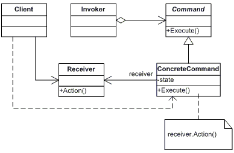

# C# Command Design Pattern

> **分類**：Behavioral Patterns（行為型模式）  
> **使用頻率 (Frequency of use)**：中高 (Medium-High)  
> **原文連結**：[https://www.dofactory.com/net/command-design-pattern](https://www.dofactory.com/net/command-design-pattern)

---

## 定義與概述 (Definition)

**Command** Design Pattern 將請求封裝為一個物件，從而讓你可以用不同的請求來參數化（Parameterize）用戶端、將請求排入佇列（Queue）或記錄日誌（Log），以及支援可復原（Undoable）的操作。

本篇分成兩個部分：

- **[現代 C# 實作](#現代-c-實作-net-11--c-15)**：可以直接建置與執行的範例專案，建議由此開始閱讀。
- **[附錄：Dofactory 原版範例](#附錄dofactory-原版範例)**：Structural、Real-world、.NET Optimized 三種原版程式碼，作為對照。

---

## 問題情境 (Problem)

計算機要支援「復原」與「重做」。如果每個運算都是直接呼叫方法，做完之後不會留下任何紀錄：

```csharp
// 示意：直接呼叫，做完就沒有留下紀錄，無從復原
calculator.Apply('+', 100);
calculator.Apply('-', 50);
```

要復原，就必須記得「剛才做了什麼」。

Command 把每一個操作包成一個物件，物件裡記錄了對象、動作與參數，並且知道如何執行與如何復原。操作一旦成為物件，就可以被存進集合、排隊、延後執行、復原與重做。

---

## UML 類別圖 (UML Class Diagram)

以下是參與此 Pattern 的類別與物件之視覺化關係圖：



---

## 參與者 (Participants)

參與此 Pattern 的類別與物件包括：

> 括號內是 Dofactory 原版範例（見附錄）使用的類別名稱。現代 C# 實作中各角色對應的型別，請見下一節開頭的「角色對照」。

- **Command** (`Command`)
  - 宣告一個用於執行操作的介面。
- **ConcreteCommand** (`CalculatorCommand`)
  - 定義接收者（`Receiver`）物件與動作之間的綁定（Binding）。
  - 透過呼叫 `Receiver` 上對應的操作來實作 `Execute`。
- **Client** (`CommandApp`)
  - 建立一個 `ConcreteCommand` 物件並設定其接收者（Receiver）。
- **Invoker** (`User`)
  - 要求該命令（Command）執行請求。
- **Receiver** (`Calculator`)
  - 知道如何執行與完成該請求相關的各種操作。

---

## 現代 C# 實作 (.NET 11 / C# 15)

> **範例專案**：[samples/Command](samples/Command)  
> **執行方式**：`dotnet run --project samples/Command`

**角色對照**：Command = `ICommand`；ConcreteCommand = `CalculatorCommand`；Receiver = `Calculator`；Invoker = `CommandHistory`；Client = 最上方的程式碼。

<!-- sample:Command/Program.cs -->
```csharp
// Command：把「一個操作」包成物件，於是操作可以被保存、排隊、復原與重做。

var calculator = new Calculator();
var history = new CommandHistory();

history.Execute(new CalculatorCommand(calculator, '+', 100));
history.Execute(new CalculatorCommand(calculator, '-', 50));
history.Execute(new CalculatorCommand(calculator, '*', 10));
history.Execute(new CalculatorCommand(calculator, '/', 2));

history.Undo(levels: 4);
history.Redo(levels: 3);

// ---- Command ----
public interface ICommand
{
    void Execute();
    void Undo();
}

// ---- ConcreteCommand：不可變，記住「對誰、做什麼、用什麼參數」 ----
public sealed record CalculatorCommand(Calculator Calculator, char Operator, decimal Operand) : ICommand
{
    public void Execute() => Calculator.Apply(Operator, Operand);

    // 復原 = 執行相反的運算
    public void Undo() => Calculator.Apply(Inverse(Operator), Operand);

    private static char Inverse(char @operator) => @operator switch
    {
        '+' => '-',
        '-' => '+',
        '*' => '/',
        '/' => '*',
        _ => throw new ArgumentOutOfRangeException(nameof(@operator), @operator, "Unknown operator"),
    };
}

// ---- Receiver：真正執行工作的物件，不知道 Command 的存在 ----
public sealed class Calculator
{
    public decimal Value { get; private set; }

    public void Apply(char @operator, decimal operand)
    {
        Value = @operator switch
        {
            '+' => Value + operand,
            '-' => Value - operand,
            '*' => Value * operand,
            '/' => Value / operand,
            _ => throw new ArgumentOutOfRangeException(nameof(@operator), @operator, "Unknown operator"),
        };

        Console.WriteLine($"Value = {Value,5} (after {@operator} {operand})");
    }
}

// ---- Invoker：只負責執行與保存命令，不知道命令的內容 ----
public sealed class CommandHistory
{
    private readonly Stack<ICommand> _undoStack = new();
    private readonly Stack<ICommand> _redoStack = new();

    public void Execute(ICommand command)
    {
        command.Execute();
        _undoStack.Push(command);
        _redoStack.Clear();   // 執行新命令後，先前被復原的命令就不能再重做
    }

    public void Undo(int levels)
    {
        Console.WriteLine($"---- Undo {levels} levels");
        while (levels-- > 0 && _undoStack.TryPop(out ICommand? command))
        {
            command.Undo();
            _redoStack.Push(command);
        }
    }

    public void Redo(int levels)
    {
        Console.WriteLine($"---- Redo {levels} levels");
        while (levels-- > 0 && _redoStack.TryPop(out ICommand? command))
        {
            command.Execute();
            _undoStack.Push(command);
        }
    }
}
```
<!-- /sample -->

### 輸出結果 (Output)

<!-- output:Command -->
```text
Value =   100 (after + 100)
Value =    50 (after - 50)
Value =   500 (after * 10)
Value =   250 (after / 2)
---- Undo 4 levels
Value =   500 (after * 2)
Value =    50 (after / 10)
Value =   100 (after + 50)
Value =     0 (after - 100)
---- Redo 3 levels
Value =   100 (after + 100)
Value =    50 (after - 50)
Value =   500 (after * 10)
```
<!-- /output -->

### 重點解說

- **命令是不可變的 `record`**：建立之後內容不會改變，所以放進歷史紀錄、重複執行都是安全的。
- **兩個 `Stack`**：一個存可以復原的命令，一個存可以重做的命令。執行新命令時清空重做堆疊，行為與一般編輯器相同。
- **Invoker 不知道命令的內容**：`CommandHistory` 只呼叫 `Execute` 與 `Undo`，新增其他種類的命令不需要修改它。
- **`@operator`**：`operator` 是 C# 關鍵字，前面加上 `@` 才能當作變數名稱。
- **`switch` 的 `_ =>` 分支丟出例外**：遇到不認識的運算子時立刻讓問題浮現，而不是默默略過。

---

## 與 Dofactory 原版的差異

- 原版以一個 `List` 加上索引 `current` 管理復原與重做，邊界條件容易寫錯。本版改用兩個 `Stack`。
- 原版的 `Calculator.Operation` 遇到不認識的運算子時不做任何事。本版丟出例外。
- 原版的命令類別有可以修改的 `Operator` 與 `Operand` 屬性。本版的命令不可變。
- 原版以 `int` 計算，整數除法會捨去小數，無法用乘法還原。本版改用 `decimal`（仍有極限，見練習 2）。

---

## .NET 中的對應 (In .NET)

- **`System.Windows.Input.ICommand`**：WPF 與 .NET MAUI 用它把按鈕繫結到 ViewModel 的操作（`Execute` 與 `CanExecute`）。
- **`Action` 與 `Func<Task>` 委派**：不需要復原時，一個委派就是最輕量的命令。
- **CQRS**：命令是一個 `record`，由對應的處理常式執行，例如 MediatR 或 Wolverine。
- **背景工作佇列**：把要做的工作包成物件放進 `Channel<T>`，由背景服務依序取出執行。

---

## 何時該用、何時不該用

**適合使用**

- 需要復原與重做、排程、佇列、重試或稽核紀錄。
- 發出請求與實際執行的時間或地點不同。

**不適合使用**

- 只是要立刻呼叫一個方法：直接呼叫，或傳入委派。
- 每個小操作都包成類別，會讓類別數量大幅增加。

---

## 練習題

1. 新增 `ClearCommand`：`Execute` 把值歸零，`Undo` 還原成歸零之前的值。命令必須記住執行前的值，此時它還能是不可變的嗎？
2. 依序執行 `+ 10`、`/ 3`，然後復原兩次。值會回到 0 嗎？為什麼「用相反的運算來復原」不一定可靠？有什麼替代做法？
3. 新增 `MacroCommand`，它包含一串命令：`Execute` 依序執行，`Undo` 反向復原。

---

## 附錄：Dofactory 原版範例

> 以下保留 Dofactory 網站的三種原版程式碼作為對照，點選標題即可展開。  
> 輸出結果是實際編譯並執行這些程式碼所得（執行時移除了會等待按鍵的 `Console.ReadKey()`，文化特性為 en-US）。  
> 原版使用較舊的 C# 寫法，撰寫新程式時請以上方的「現代 C# 實作」為準。

<details>
<summary><b>Structural code（結構化程式碼）</b></summary>

這段結構化（Structural）程式碼示範了 Command Pattern 如何將請求儲存為物件，讓用戶端（Clients）能夠執行或重播（Playback）這些請求。

```csharp
using System;

namespace Command.Structural
{
    /// <summary>
    /// Command Design Pattern
    /// </summary>

    public class Program
    {
        public static void Main(string[] args)
        {
            // Create receiver, command, and invoker

            Receiver receiver = new Receiver();
            Command command = new ConcreteCommand(receiver);
            Invoker invoker = new Invoker();

            // Set and execute command

            invoker.SetCommand(command);
            invoker.ExecuteCommand();

            // Wait for user

            Console.ReadKey();
        }
    }

    /// <summary>
    /// The 'Command' abstract class
    /// </summary>

    public abstract class Command
    {
        protected Receiver receiver;

        // Constructor

        public Command(Receiver receiver)
        {
            this.receiver = receiver;
        }

        public abstract void Execute();
    }

    /// <summary>
    /// The 'ConcreteCommand' class
    /// </summary>

    public class ConcreteCommand : Command
    {
        // Constructor

        public ConcreteCommand(Receiver receiver) :
            base(receiver)
        {
        }

        public override void Execute()
        {
            receiver.Action();
        }
    }

    /// <summary>
    /// The 'Receiver' class
    /// </summary>

    public class Receiver
    {
        public void Action()
        {
            Console.WriteLine("Called Receiver.Action()");
        }
    }

    /// <summary>
    /// The 'Invoker' class
    /// </summary>

    public class Invoker
    {
        Command command;

        public void SetCommand(Command command)
        {
            this.command = command;
        }

        public void ExecuteCommand()
        {
            command.Execute();
        }
    }
}
```

**輸出結果 (Output)**

```text
Called Receiver.Action()
```

</details>

<details>
<summary><b>Real-world code（真實世界程式碼）</b></summary>

這段真實世界（Real-world）程式碼示範了應用於簡易計算機的 Command Pattern，並支援無限次數的復原（Undo）與重做（Redo）。請注意，在 C# 中 `operator` 是保留關鍵字，在其前方加上 `@` 前綴（即 `@operator`）即可將其作為識別字（Identifier）使用。

```csharp
using System;
using System.Collections.Generic;

namespace Command.RealWorld
{
    /// <summary>
    /// Command Design Pattern
    /// </summary>

    public class Program
    {
        public static void Main(string[] args)
        {
            // Create user and let her compute

            User user = new User();

            // User presses calculator buttons

            user.Compute('+', 100);
            user.Compute('-', 50);
            user.Compute('*', 10);
            user.Compute('/', 2);

            // Undo 4 commands

            user.Undo(4);

            // Redo 3 commands

            user.Redo(3);

            // Wait for user

            Console.ReadKey();
        }
    }

    /// <summary>
    /// The 'Command' abstract class
    /// </summary>

    public abstract class Command
    {
        public abstract void Execute();
        public abstract void UnExecute();
    }

    /// <summary>
    /// The 'ConcreteCommand' class
    /// </summary>

    public class CalculatorCommand : Command
    {
        char @operator;
        int operand;
        Calculator calculator;

        // Constructor

        public CalculatorCommand(Calculator calculator,
            char @operator, int operand)
        {
            this.calculator = calculator;
            this.@operator = @operator;
            this.operand = operand;
        }

        // Gets operator

        public char Operator
        {
            set { @operator = value; }
        }

        // Get operand

        public int Operand
        {
            set { operand = value; }
        }

        // Execute new command

        public override void Execute()
        {
            calculator.Operation(@operator, operand);
        }

        // Unexecute last command

        public override void UnExecute()
        {
            calculator.Operation(Undo(@operator), operand);
        }

        // Returns opposite operator for given operator

        private char Undo(char @operator)
        {
            switch (@operator)
            {
                case '+': return '-';
                case '-': return '+';
                case '*': return '/';
                case '/': return '*';
                default:
                    throw new
             ArgumentException("@operator");
            }
        }
    }

    /// <summary>
    /// The 'Receiver' class
    /// </summary>

    public class Calculator
    {
        int curr = 0;

        public void Operation(char @operator, int operand)
        {
            switch (@operator)
            {
                case '+': curr += operand; break;
                case '-': curr -= operand; break;
                case '*': curr *= operand; break;
                case '/': curr /= operand; break;
            }
            Console.WriteLine(
                "Current value = {0,3} (following {1} {2})",
                curr, @operator, operand);
        }
    }

    /// <summary>
    /// The 'Invoker' class
    /// </summary>

    public class User
    {
        // Initializers

        Calculator calculator = new Calculator();
        List<Command> commands = new List<Command>();
        int current = 0;

        public void Redo(int levels)
        {
            Console.WriteLine("\n---- Redo {0} levels ", levels);
            // Perform redo operations
            for (int i = 0; i < levels; i++)
            {
                if (current < commands.Count - 1)
                {
                    Command command = commands[current++];
                    command.Execute();
                }
            }
        }

        public void Undo(int levels)
        {
            Console.WriteLine("\n---- Undo {0} levels ", levels);
            
            // Perform undo operations

            for (int i = 0; i < levels; i++)
            {
                if (current > 0)
                {
                    Command command = commands[--current] as Command;
                    command.UnExecute();
                }
            }
        }

        public void Compute(char @operator, int operand)
        {
            // Create command operation and execute it

            Command command = new CalculatorCommand(calculator, @operator, operand);
            command.Execute();

            // Add command to undo list

            commands.Add(command);
            current++;
        }
    }
}
```

**輸出結果 (Output)**

```text
Current value = 100 (following + 100)
Current value =  50 (following - 50)
Current value = 500 (following * 10)
Current value = 250 (following / 2)

---- Undo 4 levels
Current value = 500 (following * 2)
Current value =  50 (following / 10)
Current value = 100 (following + 50)
Current value =   0 (following - 100)

---- Redo 3 levels
Current value = 100 (following + 100)
Current value =  50 (following - 50)
Current value = 500 (following * 10)
```

</details>

<details>
<summary><b>.NET Optimized code（.NET 最佳化程式碼）</b></summary>

這段 .NET 最佳化（.NET Optimized）程式碼示範了與上述相同的邏輯，但採用了更現代化的 C# 與 .NET 功能（例如 Primary Constructors 與 `switch` 運算式）。此版本的實作細節與限制，請見上方的〈與 Dofactory 原版的差異〉。

```csharp
namespace Command.NetOptimized;

using static System.Console;

using System;
using System.Collections.Generic;

/// <summary>
/// Command Design Pattern
/// </summary>
public class Program
{
    public static void Main()
    {
        // Create user and let her compute
        var user = new User();

        // Issue several compute commands
        user.Compute('+', 100);
        user.Compute('-', 50);
        user.Compute('*', 10);
        user.Compute('/', 2);

        // Undo 4 commands
        user.Undo(4);

        // Redo 3 commands
        user.Redo(3);

        // Wait for user
        ReadKey();
    }
}

/// <summary>
/// The 'Command' interface
/// </summary>
public interface ICommand
{
    void Execute();
    void UnExecute();
}

/// <summary>
/// The 'ConcreteCommand' class
/// </summary>
public class CalculatorCommand( Calculator calculator, 
                                char @operator, 
                                int operand) : ICommand
{

    // Sets operator
    public char Operator { set => @operator = value; }

    // Sets operand
    public int Operand { set => operand = value; }

    // Execute command
    public void Execute()
    {
        calculator.Operation(@operator, operand);
    }

    // Unexecute command
    public void UnExecute()
    {
        calculator.Operation(Undo(@operator), operand);
    }

    // Return opposite operator for given operator
    private static char Undo(char @operator)
    {
        return @operator switch
        {
            '+' => '-',
            '-' => '+',
            '*' => '/',
            '/' => '*',
            _ => throw new ArgumentException("@operator"),
        };
    }
}

/// <summary>
/// The 'Receiver' class
/// </summary>
public class Calculator
{
    private int current = 0;

    // Perform operation for given operator and operand
    public void Operation(char @operator, int operand)
    {
        switch (@operator)
        {
            case '+': current += operand; break;
            case '-': current -= operand; break;
            case '*': current *= operand; break;
            case '/': current /= operand; break;
        }
        WriteLine(
            "Current value = {0,3} (following {1} {2})",
            current, @operator, operand);
    }
}

/// <summary>
/// The 'Invoker' class
/// </summary>
public class User
{
    private readonly Calculator calculator = new();
    private readonly List<ICommand> commands = [];
    private int current = 0;

    // Redo original commands
    public void Redo(int levels)
    {
        WriteLine($"\n---- Redo {levels} levels ");

        // Perform redo operations
        for (int i = 0; i < levels; i++)
        {
            if (current < commands.Count - 1)
            {
                commands[current++].Execute();
            }
        }
    }

    // Undo prior commands
    public void Undo(int levels)
    {
        WriteLine($"\n---- Undo {levels} levels ");

        // Perform undo operations
        for (int i = 0; i < levels; i++)
        {
            if (current > 0)
            {
                commands[--current].UnExecute();
            }
        }
    }

    // Compute new value given operator and operand
    public void Compute(char @operator, int operand)
    {
        // Create command operation and execute it
        var command = new CalculatorCommand(calculator, @operator, operand);
        command.Execute();

        // Add command to undo list
        commands.Add(command);
        current++;
    }
}
```

**輸出結果 (Output)**

```text
Current value = 100 (following + 100)
Current value =  50 (following - 50)
Current value = 500 (following * 10)
Current value = 250 (following / 2)

---- Undo 4 levels
Current value = 500 (following * 2)
Current value =  50 (following / 10)
Current value = 100 (following + 50)
Current value =   0 (following - 100)

---- Redo 3 levels
Current value = 100 (following + 100)
Current value =  50 (following - 50)
Current value = 500 (following * 10)
```

</details>

---

## 導覽 (Navigation)

| 上一篇 | 總覽 | 下一篇 |
| :--- | :---: | ---: |
| [← 上一篇：Chain of Responsibility](ChainOfResponsibility.md) | [🏠 C# Design Patterns 總覽](README.md) | [下一篇：Interpreter →](Interpreter.md) |
