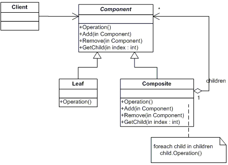

# C# Composite Design Pattern

> **分類**：Structural Patterns（結構型模式）  
> **使用頻率 (Frequency of use)**：中高 (Medium-High)  
> **原文連結**：[https://www.dofactory.com/net/composite-design-pattern](https://www.dofactory.com/net/composite-design-pattern)

---

## 定義與概述 (Definition)

**Composite** Design Pattern 將物件組合成樹狀結構（Tree Structures），以表示「部分－整體」（Part-Whole）的階層關係。此 Pattern 讓用戶端（Clients）可以用一致的方式來對待個別物件與物件的組合（Compositions）。

**Composite** Design Pattern 的 C# 程式碼範例提供以下 3 種形式：
- [結構化程式碼 (Structural code)](#structural-code-in-c-結構化程式碼)
- [真實世界程式碼 (Real-world code)](#real-world-code-in-c-真實世界程式碼)
- [.NET 最佳化程式碼 (.NET optimized code)](#net-optimized-code-in-c-net-最佳化程式碼)

---

## UML 類別圖 (UML Class Diagram)

以下是參與此 Pattern 的類別與物件之視覺化關係圖：



---

## 參與者 (Participants)

參與此 Pattern 的類別與物件包括：

- **Component** (`DrawingElement`)
  - 為組合（Composition）中的物件宣告介面。
  - 在適當情況下，實作所有類別共用的介面預設行為。
  - 宣告用於存取及管理其子組件（Child Components）的介面。
  - （選用）定義一個在遞迴結構中存取組件之父節點（Parent）的介面，並在適當時實作它。
- **Leaf** (`PrimitiveElement`)
  - 代表組合中的葉節點（Leaf）物件。葉節點沒有任何子節點。
  - 定義組合中基本（Primitive）物件的行為。
- **Composite** (`CompositeElement`)
  - 定義擁有子節點之組件的行為。
  - 儲存子組件（Child Components）。
  - 實作 `Component` 介面中與子節點相關的操作。
- **Client** (`CompositeApp`)
  - 透過 `Component` 介面來操作組合中的物件。

---

## Structural code in C# (結構化程式碼)

這段結構化（Structural）程式碼示範了 Composite Pattern 如何允許建立樹狀結構，在該結構中，無論個別節點是葉節點（Leaf Nodes）還是分支（Composite）節點，都能以一致的方式進行存取。

```csharp
using System;
using System.Collections.Generic;

namespace Composite.Structural
{
    /// <summary>
    /// Composite Design Pattern
    /// </summary>

    public class Program
    {
        public static void Main(string[] args)
        {
            // Create a tree structure

            Composite root = new Composite("root");
            root.Add(new Leaf("Leaf A"));
            root.Add(new Leaf("Leaf B"));

            Composite comp = new Composite("Composite X");
            comp.Add(new Leaf("Leaf XA"));
            comp.Add(new Leaf("Leaf XB"));

            root.Add(comp);
            root.Add(new Leaf("Leaf C"));

            // Add and remove a leaf

            Leaf leaf = new Leaf("Leaf D");
            root.Add(leaf);
            root.Remove(leaf);

            // Recursively display tree

            root.Display(1);

            // Wait for user

            Console.ReadKey();
        }
    }

    /// <summary>
    /// The 'Component' abstract class
    /// </summary>

    public abstract class Component
    {
        protected string name;

        // Constructor

        public Component(string name)
        {
            this.name = name;
        }

        public abstract void Add(Component c);
        public abstract void Remove(Component c);
        public abstract void Display(int depth);
    }

    /// <summary>
    /// The 'Composite' class
    /// </summary>

    public class Composite : Component
    {
        List<Component> children = new List<Component>();

        // Constructor

        public Composite(string name)
            : base(name)
        {
        }

        public override void Add(Component component)
        {
            children.Add(component);
        }

        public override void Remove(Component component)
        {
            children.Remove(component);
        }

        public override void Display(int depth)
        {
            Console.WriteLine(new String('-', depth) + name);

            // Recursively display child nodes

            foreach (Component component in children)
            {
                component.Display(depth + 2);
            }
        }
    }

    /// <summary>
    /// The 'Leaf' class
    /// </summary>

    public class Leaf : Component
    {
        // Constructor

        public Leaf(string name)
            : base(name)
        {
        }

        public override void Add(Component c)
        {
            Console.WriteLine("Cannot add to a leaf");
        }

        public override void Remove(Component c)
        {
            Console.WriteLine("Cannot remove from a leaf");
        }

        public override void Display(int depth)
        {
            Console.WriteLine(new String('-', depth) + name);
        }
    }
}
```

### 輸出結果 (Output)

```text
-root

  ---Leaf A

  ---Leaf B

  ---Composite X

  -----Leaf XA

  -----Leaf XB

  ---Leaf C
```

---

## Real-world code in C# (真實世界程式碼)

這段真實世界（Real-world）程式碼示範了如何使用 Composite Pattern 來建立一個圖形樹狀結構，該結構由基本節點（線條、圓形等）與組合節點（構成更複雜元素的繪圖元素群組）所組成。

```csharp
using System;
using System.Collections.Generic;

namespace Composite.RealWorld
{
    /// <summary>
    /// Composite Design Pattern
    /// </summary>

    public class Program
    {
        public static void Main(string[] args)
        {
            // Create a tree structure 

            CompositeElement root = new CompositeElement("Picture");
            root.Add(new PrimitiveElement("Red Line"));
            root.Add(new PrimitiveElement("Blue Circle"));
            root.Add(new PrimitiveElement("Green Box"));

            // Create a branch

            CompositeElement comp = new CompositeElement("Two Circles");
            comp.Add(new PrimitiveElement("Black Circle"));
            comp.Add(new PrimitiveElement("White Circle"));
            root.Add(comp);

            // Add and remove a PrimitiveElement

            PrimitiveElement pe = new PrimitiveElement("Yellow Line");
            root.Add(pe);
            root.Remove(pe);

            // Recursively display nodes

            root.Display(1);

            // Wait for user

            Console.ReadKey();
        }
    }

    /// <summary>
    /// The 'Component' Treenode
    /// </summary>

    public abstract class DrawingElement
    {
        protected string name;

        // Constructor

        public DrawingElement(string name)
        {
            this.name = name;
        }

        public abstract void Add(DrawingElement d);
        public abstract void Remove(DrawingElement d);
        public abstract void Display(int indent);
    }

    /// <summary>
    /// The 'Leaf' class
    /// </summary>

    public class PrimitiveElement : DrawingElement
    {
        // Constructor

        public PrimitiveElement(string name)
            : base(name)
        {
        }

        public override void Add(DrawingElement c)
        {
            Console.WriteLine(
                "Cannot add to a PrimitiveElement");
        }

        public override void Remove(DrawingElement c)
        {
            Console.WriteLine(
                "Cannot remove from a PrimitiveElement");
        }

        public override void Display(int indent)
        {
            Console.WriteLine(
                new String('-', indent) + " " + name);
        }
    }

    /// <summary>
    /// The 'Composite' class
    /// </summary>

    public class CompositeElement : DrawingElement
    {
        List<DrawingElement> elements = new List<DrawingElement>();

        // Constructor

        public CompositeElement(string name)
            : base(name)
        {
        }

        public override void Add(DrawingElement d)
        {
            elements.Add(d);
        }

        public override void Remove(DrawingElement d)
        {
            elements.Remove(d);
        }

        public override void Display(int indent)
        {
            Console.WriteLine(new String('-', indent) +
                "+ " + name);

            // Display each child element on this node

            foreach (DrawingElement d in elements)
            {
                d.Display(indent + 2);
            }
        }
    }
}
```

### 輸出結果 (Output)

```text
-+ Picture

  --- Red Line

  --- Blue Circle

  --- Green Box

  ---+ Two Circles

  ----- Black Circle

  ----- White Circle
```

---

## .NET Optimized code in C# (.NET 最佳化程式碼)

這段 .NET 最佳化（.NET Optimized）程式碼示範了與上述相同的邏輯，但採用了更現代化的 C# 與 .NET 功能（例如泛型 `TreeNode<T>` 與 `IComparable<T>`）。這是一個優雅的 C# Composite 解決方案。

```csharp
namespace Composite.NetOptimized;

using static System.Console;

using System;
using System.Collections.Generic;

/// <summary>
/// Composite Design Pattern
/// </summary>
public class Program
{
    public static void Main()
    {
        // Build a tree of shapes
        var root = new TreeNode<Shape> { Node = new ("Picture") };

        root.Add(new ("Red Line"));
        root.Add(new ("Blue Circle"));
        root.Add(new ("Green Box"));

        var branch = root.Add(new Shape("Two Circles"));
        branch.Add(new ("Black Circle"));
        branch.Add(new ("White Circle"));

        // Add, remove, and add a shape
        var shape = new Shape("Yellow Line");
        root.Add(shape);
        root.Remove(shape);
        root.Add(shape);

        // Display tree using static method
        TreeNode<Shape>.Display(root, 1);

        ReadKey();
    }
}

/// <summary>
/// Generic tree node class
/// </summary>
/// <typeparam name="T">Node type</typeparam>
public class TreeNode<T> where T : IComparable<T>
{

    // Add a child tree node
    public TreeNode<T> Add(T child)
    {
        var newNode = new TreeNode<T> { Node = child };
        Children.Add(newNode);
        return newNode;
    }

    // Remove a child tree node
    public void Remove(T child)
    {
        foreach (var treeNode in Children)
        {
            if (treeNode.Node.CompareTo(child) == 0)
            {
                Children.Remove(treeNode);
                return;
            }
        }
    }

    // Gets or sets the node
    public T Node { get; set; } = default!;

    // Gets treenode children
    public List<TreeNode<T>> Children { get; } = [];

    // Recursively displays node and its children 
    public static void Display(TreeNode<T> node, int indentation)
    {
        var line = new string('-', indentation);
        WriteLine(line + " " + node.Node);

        node.Children.ForEach(n => Display(n, indentation + 1));
    }
}

/// <summary>
/// Shape class
/// <remarks>
/// Implements generic IComparable interface
/// </remarks>
/// </summary>
public class Shape(string name) : IComparable<Shape>
{
    public override string ToString() => name;

    // IComparable<Shape> Member
    public int CompareTo(Shape? other) => (this == other) ? 0 : -1;
}
```

### 輸出結果 (Output)

```text
-+ Picture

    --- Red Line

    --- Blue Circle

    --- Green Box

    ---+ Two Circles

    ----- Black Circle

    ----- White Circle
```

---

## 導覽 (Navigation)

| 上一篇 | 總覽 | 下一篇 |
| :--- | :---: | ---: |
| [← 上一篇：Bridge](Bridge.md) | [🏠 C# Design Patterns 總覽](Index.md) | [下一篇：Decorator →](Decorator.md) |
