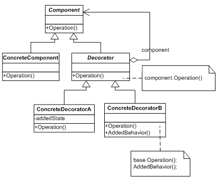

# C# Decorator Design Pattern

> **分類**：Structural Patterns（結構型模式）  
> **使用頻率 (Frequency of use)**：中 (Medium)  
> **原文連結**：[https://www.dofactory.com/net/decorator-design-pattern](https://www.dofactory.com/net/decorator-design-pattern)

---

## 定義與概述 (Definition)

**Decorator** Design Pattern 可以動態地將額外的職責（Responsibilities）附加到物件上。對於擴充功能而言，此 Pattern 提供了比繼承子類別（Subclassing）更具彈性的替代方案。

本篇分成兩個部分：

- **[現代 C# 實作](#現代-c-實作-net-11--c-15)**：可以直接建置與執行的範例專案，建議由此開始閱讀。
- **[附錄：Dofactory 原版範例](#附錄dofactory-原版範例)**：Structural、Real-world、.NET Optimized 三種原版程式碼，作為對照。

---

## 問題情境 (Problem)

圖書館的館藏有書與影片。現在想讓某些館藏「可以借閱」，之後還會有「本月推薦」「可以預約」等功能。如果每種功能組合都用繼承來做，類別會是：

```text
BorrowableBook    BorrowableVideo    FeaturedBook    FeaturedVideo
FeaturedBorrowableBook    FeaturedBorrowableVideo    ...
```

類別數量是「館藏種類 × 功能組合」，每新增一種功能就翻倍。而且功能是在編譯期綁死在類別上，無法在執行期對某一部影片臨時加上或拿掉。

Decorator 把每個功能寫成一個「包裝」類別：它和被包裝的物件實作同一個介面，在轉交呼叫的前後加上自己的行為。

---

## UML 類別圖 (UML Class Diagram)

以下是參與此 Pattern 的類別與物件之視覺化關係圖：



---

## 參與者 (Participants)

參與此 Pattern 的類別與物件包括：

> 括號內是 Dofactory 原版範例（見附錄）使用的類別名稱。現代 C# 實作中各角色對應的型別，請見下一節開頭的「角色對照」。

- **Component** (`LibraryItem`)
  - 為可以動態加上職責的物件定義介面。
- **ConcreteComponent** (`Book`, `Video`)
  - 定義一個可以附加額外職責的具體物件。
- **Decorator** (`Decorator`)
  - 維護一個指向 `Component` 物件的參考，並定義一個符合 `Component` 介面的介面。
- **ConcreteDecorator** (`Borrowable`)
  - 向組件（Component）加入額外的職責。

---

## 現代 C# 實作 (.NET 11 / C# 15)

> **範例專案**：[samples/Decorator](samples/Decorator)  
> **執行方式**：`dotnet run --project samples/Decorator`

**角色對照**：Component = `ILibraryItem`；ConcreteComponent = `Book`、`Video`；Decorator = `LibraryItemDecorator`；ConcreteDecorator = `Borrowable`、`Featured`。

<!-- sample:Decorator/Program.cs -->
```csharp
// Decorator：用「包一層」的方式替物件加上功能，不必修改原類別，也不必為每種組合建立子類別。

ILibraryItem book = new Book("Inside ASP.NET", "Worley", copies: 10);
book.Display();

ILibraryItem video = new Video("Jaws", "Spielberg", copies: 23, playTimeMinutes: 92);
video.Display();

// 包一層 Borrowable：影片本身的類別完全沒有改動
var borrowable = new Borrowable(video);
borrowable.Borrow("Customer #1");
borrowable.Borrow("Customer #2");
borrowable.Display();

// 裝飾者也實作同一個介面，所以可以一層再包一層
ILibraryItem featured = new Featured(borrowable);
featured.Display();

// ---- Component ----
public interface ILibraryItem
{
    string Title { get; }
    int AvailableCopies { get; }
    void Display();
}

// ---- ConcreteComponent ----
public sealed class Book(string title, string author, int copies) : ILibraryItem
{
    public string Title => title;
    public int AvailableCopies => copies;

    public void Display()
    {
        Console.WriteLine();
        Console.WriteLine($"Book: {title}");
        Console.WriteLine($"  Author: {author}");
        Console.WriteLine($"  Copies: {copies}");
    }
}

public sealed class Video(string title, string director, int copies, int playTimeMinutes) : ILibraryItem
{
    public string Title => title;
    public int AvailableCopies => copies;

    public void Display()
    {
        Console.WriteLine();
        Console.WriteLine($"Video: {title}");
        Console.WriteLine($"  Director: {director}");
        Console.WriteLine($"  Copies: {copies}");
        Console.WriteLine($"  Playtime: {playTimeMinutes} min");
    }
}

// ---- Decorator：預設把所有呼叫原封不動轉給內層 ----
public abstract class LibraryItemDecorator(ILibraryItem inner) : ILibraryItem
{
    public virtual string Title => inner.Title;
    public virtual int AvailableCopies => inner.AvailableCopies;
    public virtual void Display() => inner.Display();
}

// ---- ConcreteDecorator：加上「可借閱」的行為 ----
public sealed class Borrowable(ILibraryItem inner) : LibraryItemDecorator(inner)
{
    private readonly List<string> _borrowers = [];

    // 借閱紀錄存在裝飾者自己身上，不去修改內層物件的狀態
    public override int AvailableCopies => base.AvailableCopies - _borrowers.Count;

    public void Borrow(string customer)
    {
        if (AvailableCopies == 0)
        {
            throw new InvalidOperationException($"No copies of '{Title}' left.");
        }

        _borrowers.Add(customer);
    }

    public void Return(string customer) => _borrowers.Remove(customer);

    public override void Display()
    {
        base.Display();
        Console.WriteLine($"  Available: {AvailableCopies}");
        foreach (string borrower in _borrowers)
        {
            Console.WriteLine($"  Borrower: {borrower}");
        }
    }
}

// ---- ConcreteDecorator：加上「本月推薦」的標示 ----
public sealed class Featured(ILibraryItem inner) : LibraryItemDecorator(inner)
{
    public override void Display()
    {
        base.Display();
        Console.WriteLine("  ** Staff pick of the month **");
    }
}
```
<!-- /sample -->

### 輸出結果 (Output)

<!-- output:Decorator -->
```text

Book: Inside ASP.NET
  Author: Worley
  Copies: 10

Video: Jaws
  Director: Spielberg
  Copies: 23
  Playtime: 92 min

Video: Jaws
  Director: Spielberg
  Copies: 23
  Playtime: 92 min
  Available: 21
  Borrower: Customer #1
  Borrower: Customer #2

Video: Jaws
  Director: Spielberg
  Copies: 23
  Playtime: 92 min
  Available: 21
  Borrower: Customer #1
  Borrower: Customer #2
  ** Staff pick of the month **
```
<!-- /output -->

### 重點解說

- **裝飾者與被裝飾者實作同一個介面**：所以 `Featured` 可以包住 `Borrowable`，`Borrowable` 再包住 `Video`，層數沒有限制。
- **基底裝飾者負責「原封不動轉交」**：`LibraryItemDecorator` 把所有成員轉給內層，具體的裝飾者只需要覆寫想改變的部分。
- **不修改內層物件**：`Borrowable` 把借閱名單存在自己身上，`AvailableCopies` 是用「內層的數量減掉借出的數量」算出來的。
- **一個限制**：`Borrow()` 不在 `ILibraryItem` 介面上，物件被 `Featured` 包住之後就呼叫不到，所以範例保留了 `borrowable` 變數。Decorator 適合改變既有方法的行為；要新增方法時就會遇到這個限制。

---

## 與 Dofactory 原版的差異

- 原版 .NET Optimized 在 `LibraryItem<T>` 宣告了 `static int NumCopies`。靜態成員屬於型別而不是物件，所以所有的 `Video` 會共用同一個庫存數字，建立第二部影片就會蓋掉第一部的數量。原版範例只建立了一本書與一部影片，所以輸出看不出這個問題。本版的每個物件各自保存數量。
- 原版 Real-world 的 `Borrowable` 直接遞減內層物件的 `NumCopies`，也就是修改了被裝飾的物件。本版把借閱紀錄留在裝飾者自己身上。
- 原版只有一個 ConcreteDecorator，看不出裝飾者可以層層疊加。本版加入第二個裝飾者 `Featured`。

---

## .NET 中的對應 (In .NET)

- **`Stream`**：`new GZipStream(new BufferedStream(new FileStream(...)))`，每一層都是 `Stream`，各自加上壓縮、緩衝的功能。
- **`DelegatingHandler`**：在 `HttpClient` 送出請求的前後加上重試、記錄、驗證。
- **DI 註冊**：`services.AddSingleton<IRepository>(sp => new CachingRepository(sp.GetRequiredService<SqlRepository>()))`，或使用 Scrutor 套件的 `Decorate`。

---

## 何時該用、何時不該用

**適合使用**

- 要為物件加上可以自由組合的附加功能，例如快取、記錄、重試、壓縮。
- 不能或不想修改原本的類別。

**不適合使用**

- 功能只有一種，而且永遠都需要：直接寫進類別。
- 需要的是「新增方法」而不是「改變既有方法的行為」。
- 層數多到難以追蹤呼叫順序。

---

## 練習題

1. 新增 `Reservable` 裝飾者，記錄預約名單並在 `Display` 顯示。試著讓它與 `Borrowable` 以不同順序組合。
2. 建立一部只有 1 份的影片並借閱兩次，確認第二次會丟出例外。
3. 把 `new Featured(borrowable)` 的包裝順序反過來，改成 `new Borrowable(new Featured(video))`。輸出的順序有什麼不同？為什麼？

---

## 附錄：Dofactory 原版範例

> 以下保留 Dofactory 網站的三種原版程式碼作為對照，點選標題即可展開。  
> 輸出結果是實際編譯並執行這些程式碼所得（執行時移除了會等待按鍵的 `Console.ReadKey()`，文化特性為 en-US）。  
> 原版使用較舊的 C# 寫法，撰寫新程式時請以上方的「現代 C# 實作」為準。

<details>
<summary><b>Structural code（結構化程式碼）</b></summary>

這段結構化（Structural）程式碼示範了 Decorator Pattern 如何動態地為既有物件加上額外的功能。

```csharp
using System;

namespace Decorator.Structural
{
    /// <summary>
    /// Decorator Design Pattern
    /// </summary>

    public class Program
    {
        public static void Main(string[] args)
        {
            // Create ConcreteComponent and two Decorators

            ConcreteComponent c = new ConcreteComponent();
            ConcreteDecoratorA d1 = new ConcreteDecoratorA();
            ConcreteDecoratorB d2 = new ConcreteDecoratorB();

            // Link decorators

            d1.SetComponent(c);
            d2.SetComponent(d1);

            d2.Operation();

            // Wait for user

            Console.ReadKey();
        }
    }

    /// <summary>
    /// The 'Component' abstract class
    /// </summary>

    public abstract class Component
    {
        public abstract void Operation();
    }

    /// <summary>
    /// The 'ConcreteComponent' class
    /// </summary>

    public class ConcreteComponent : Component
    {
        public override void Operation()
        {
            Console.WriteLine("ConcreteComponent.Operation()");
        }
    }

    /// <summary>
    /// The 'Decorator' abstract class
    /// </summary>

    public abstract class Decorator : Component
    {
        protected Component component;

        public void SetComponent(Component component)
        {
            this.component = component;
        }

        public override void Operation()
        {
            if (component != null)
            {
                component.Operation();
            }
        }
    }

    /// <summary>
    /// The 'ConcreteDecoratorA' class
    /// </summary>

    public class ConcreteDecoratorA : Decorator
    {
        public override void Operation()
        {
            base.Operation();
            Console.WriteLine("ConcreteDecoratorA.Operation()");
        }
    }

    /// <summary>
    /// The 'ConcreteDecoratorB' class
    /// </summary>

    public class ConcreteDecoratorB : Decorator
    {
        public override void Operation()
        {
            base.Operation();
            AddedBehavior();
            Console.WriteLine("ConcreteDecoratorB.Operation()");
        }

        void AddedBehavior()
        {
        }
    }
}
```

**輸出結果 (Output)**

```text
ConcreteComponent.Operation()
ConcreteDecoratorA.Operation()
ConcreteDecoratorB.Operation()
```

</details>

<details>
<summary><b>Real-world code（真實世界程式碼）</b></summary>

這段真實世界（Real-world）程式碼示範了 Decorator Pattern 如何將「可借閱」（`Borrowable`）的功能動態加入到既有的圖書館館藏項目（書籍 `Book` 與影片 `Video`）中。

```csharp
using System;
using System.Collections.Generic;

namespace Decorator.RealWorld
{
    /// <summary>
    /// Decorator Design Pattern
    /// </summary>

    public class Program
    {
        public static void Main(string[] args)
        {
            // Create book

            Book book = new Book("Worley", "Inside ASP.NET", 10);
            book.Display();

            // Create video

            Video video = new Video("Spielberg", "Jaws", 23, 92);
            video.Display();

            // Make video borrowable, then borrow and display

            Console.WriteLine("\nMaking video borrowable:");

            Borrowable borrowvideo = new Borrowable(video);
            borrowvideo.BorrowItem("Customer #1");
            borrowvideo.BorrowItem("Customer #2");

            borrowvideo.Display();

            // Wait for user

            Console.ReadKey();
        }
    }
    /// <summary>
    /// The 'Component' abstract class
    /// </summary>

    public abstract class LibraryItem
    {
        private int numCopies;

        public int NumCopies
        {
            get { return numCopies; }
            set { numCopies = value; }
        }

        public abstract void Display();
    }

    /// <summary>
    /// The 'ConcreteComponent' class
    /// </summary>

    public class Book : LibraryItem
    {
        private string author;
        private string title;

        // Constructor

        public Book(string author, string title, int numCopies)
        {
            this.author = author;
            this.title = title;
            this.NumCopies = numCopies;
        }

        public override void Display()
        {
            Console.WriteLine("\nBook ------ ");
            Console.WriteLine(" Author: {0}", author);
            Console.WriteLine(" Title: {0}", title);
            Console.WriteLine(" # Copies: {0}", NumCopies);
        }
    }

    /// <summary>
    /// The 'ConcreteComponent' class
    /// </summary>

    public class Video : LibraryItem
    {
        private string director;
        private string title;
        private int playTime;

        // Constructor

        public Video(string director, string title, int numCopies, int playTime)
        {
            this.director = director;
            this.title = title;
            this.NumCopies = numCopies;
            this.playTime = playTime;
        }

        public override void Display()
        {
            Console.WriteLine("\nVideo ----- ");
            Console.WriteLine(" Director: {0}", director);
            Console.WriteLine(" Title: {0}", title);
            Console.WriteLine(" # Copies: {0}", NumCopies);
            Console.WriteLine(" Playtime: {0}\n", playTime);
        }
    }

    /// <summary>
    /// The 'Decorator' abstract class
    /// </summary>

    public abstract class Decorator : LibraryItem
    {
        protected LibraryItem libraryItem;

        // Constructor

        public Decorator(LibraryItem libraryItem)
        {
            this.libraryItem = libraryItem;
        }

        public override void Display()
        {
            libraryItem.Display();
        }
    }

    /// <summary>
    /// The 'ConcreteDecorator' class
    /// </summary>

    public class Borrowable : Decorator
    {
        protected readonly List<string> borrowers = new List<string>();

        // Constructor

        public Borrowable(LibraryItem libraryItem)
            : base(libraryItem)
        {
        }

        public void BorrowItem(string name)
        {
            borrowers.Add(name);
            libraryItem.NumCopies--;
        }

        public void ReturnItem(string name)
        {
            borrowers.Remove(name);
            libraryItem.NumCopies++;
        }

        public override void Display()
        {
            base.Display();

            foreach (string borrower in borrowers)
            {
                Console.WriteLine(" borrower: " + borrower);
            }
        }
    }
}
```

**輸出結果 (Output)**

```text
Book ------
 Author: Worley
 Title: Inside ASP.NET
 # Copies: 10

Video -----
 Director: Spielberg
 Title: Jaws
 # Copies: 23
 Playtime: 92


Making video borrowable:

Video -----
 Director: Spielberg
 Title: Jaws
 # Copies: 21
 Playtime: 92

 borrower: Customer #1
 borrower: Customer #2
```

</details>

<details>
<summary><b>.NET Optimized code（.NET 最佳化程式碼）</b></summary>

這段 .NET 最佳化（.NET Optimized）程式碼示範了與上述相同的邏輯，但採用了更現代化的 C# 與 .NET 功能（例如 Primary Constructors 與泛型 `Decorator<T>` / `Borrowable<T>`）。此版本的實作細節與限制，請見上方的〈與 Dofactory 原版的差異〉。

```csharp
namespace Decorator.NetOptimized;

using static System.Console;

/// <summary>
/// Decorator Design Pattern
/// </summary>
public class Program
{
    public static void Main()
    {
        // Create book
        var book = new Book("Worley", "Inside ASP.NET", 10);
        book.Display();

        // Create video
        var video = new Video("Spielberg", "Jaws", 23, 92);
        video.Display();

        // Make video borrowable, then borrow and display
        WriteLine("\nMaking video borrowable:");

        var borrow = new Borrowable<Video>(video);
        borrow.BorrowItem("Customer #1");
        borrow.BorrowItem("Customer #2");

        borrow.Display();

        // Wait for user
        ReadKey();
    }
}

/// <summary>
/// The 'Component' abstract class
/// </summary>
public abstract class LibraryItem<T>
{
    // Each T has its own NumCopies
    public static int NumCopies { get; set; }

    public abstract void Display();
}

/// <summary>
/// The 'ConcreteComponent' class
/// </summary>
public class Book : LibraryItem<Book>
{
    private readonly string author;
    private readonly string title;

    // Constructor
    public Book(string author, string title, int numCopies)
    {
        this.author = author;
        this.title = title;
        NumCopies = numCopies;
    }

    public override void Display()
    {
        WriteLine("\nBook ------ ");
        WriteLine($" Author: {author}");
        WriteLine($" Title: {title}");
        WriteLine($" # Copies: {NumCopies}");
    }
}

/// <summary>
/// The 'ConcreteComponent' class
/// </summary>
public class Video : LibraryItem<Video>
{
    private readonly string director;
    private readonly string title;
    private readonly int playTime;

    // Constructor
    public Video(string director, string title,
        int numCopies, int playTime)
    {
        this.director = director;
        this.title = title;
        NumCopies = numCopies;
        this.playTime = playTime;
    }

    public override void Display()
    {
        WriteLine("\nVideo ----- ");
        WriteLine($" Director: {director}");
        WriteLine($" Title: {title}");
        WriteLine($" # Copies: {NumCopies}");
        WriteLine($" Playtime: {playTime}\n");
    }
}

/// <summary>
/// The 'Decorator' abstract class
/// </summary>
public abstract class Decorator<T>(LibraryItem<T> libraryItem) : LibraryItem<T>
{
    public override void Display() => libraryItem.Display();

}

/// <summary>
/// The 'ConcreteDecorator' class
/// </summary>
public class Borrowable<T> : Decorator<T>
{
    private readonly List<string> borrowers = [];

    // Constructor
    public Borrowable(LibraryItem<T> libraryItem)
        : base(libraryItem)
    {
    }

    public void BorrowItem(string name)
    {
        borrowers.Add(name);
        NumCopies--;
    }

    public void ReturnItem(string name)
    {
        borrowers.Remove(name);
        NumCopies++;
    }

    public override void Display()
    {
        base.Display();
        borrowers.ForEach(b => WriteLine(" borrower: " + b));
    }
}
```

**輸出結果 (Output)**

```text
Book ------
 Author: Worley
 Title: Inside ASP.NET
 # Copies: 10

Video -----
 Director: Spielberg
 Title: Jaws
 # Copies: 23
 Playtime: 92


Making video borrowable:

Video -----
 Director: Spielberg
 Title: Jaws
 # Copies: 21
 Playtime: 92

 borrower: Customer #1
 borrower: Customer #2
```

</details>

---

## 導覽 (Navigation)

| 上一篇 | 總覽 | 下一篇 |
| :--- | :---: | ---: |
| [← 上一篇：Composite](Composite.md) | [🏠 C# Design Patterns 總覽](Index.md) | [下一篇：Facade →](Facade.md) |
