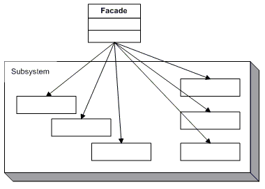

# C# Facade Design Pattern

> **分類**：Structural Patterns（結構型模式）  
> **使用頻率 (Frequency of use)**：高 (High)  
> **原文連結**：[https://www.dofactory.com/net/facade-design-pattern](https://www.dofactory.com/net/facade-design-pattern)

---

## 定義與概述 (Definition)

**Facade** Design Pattern 為子系統（Subsystem）中的一組介面提供一個統一的介面。此 Pattern 定義了一個更高階的介面，讓該子系統更容易被使用。

本篇分成兩個部分：

- **[現代 C# 實作](#現代-c-實作-net-11--c-15)**：可以直接建置與執行的範例專案，建議由此開始閱讀。
- **[附錄：Dofactory 原版範例](#附錄dofactory-原版範例)**：Structural、Real-world、.NET Optimized 三種原版程式碼，作為對照。

---

## 問題情境 (Problem)

審核房貸要查三個地方：銀行存款、信用評分、貸款紀錄。如果沒有統一的入口，每個需要審核的地方都得自己處理：

```csharp
// 示意：呼叫端必須認識三個子系統，還要知道檢查的順序與規則
var bank = new Bank();
var creditBureau = new CreditBureau();
var loanRegistry = new LoanRegistry();

bool approved = bank.HasSufficientSavings(customer, amount)
             && creditBureau.HasGoodCredit(customer)
             && !loanRegistry.HasBadLoans(customer);
```

- 同樣的審核流程會在好幾個地方重複。
- 新增第四項檢查時，每個呼叫的地方都要修改。
- 呼叫端與三個子系統類別都綁在一起。

Facade 提供一個簡單的入口，把「要呼叫哪些子系統、依什麼順序」收在裡面。

---

## UML 類別圖 (UML Class Diagram)

以下是參與此 Pattern 的類別與物件之視覺化關係圖：



---

## 參與者 (Participants)

參與此 Pattern 的類別與物件包括：

> 括號內是 Dofactory 原版範例（見附錄）使用的類別名稱。現代 C# 實作中各角色對應的型別，請見下一節開頭的「角色對照」。

- **Facade** (`MortgageApplication`)
  - 知道哪些子系統類別負責處理哪個請求。
  - 將用戶端（Client）的請求委派（Delegates）給適當的子系統物件。
- **Subsystem classes** (`Bank`, `Credit`, `Loan`)
  - 實作子系統的功能。
  - 處理由 `Facade` 物件所指派的工作。
  - 對 `Facade` 一無所知，且不保留任何指向它的參考（Reference）。

---

## 現代 C# 實作 (.NET 11 / C# 15)

> **範例專案**：[samples/Facade](samples/Facade)  
> **執行方式**：`dotnet run --project samples/Facade`

**角色對照**：Facade = `MortgageService`；Subsystem = `Bank`、`CreditBureau`、`LoanRegistry`；Client = 最上方的程式碼。

<!-- sample:Facade/Program.cs -->
```csharp
// Facade：替一組複雜的子系統提供一個簡單的入口，呼叫端只需要認識這個入口。

// 子系統由外部傳入（建構函式注入），測試時可以換成假的實作
var mortgage = new MortgageService(new Bank(), new CreditBureau(), new LoanRegistry());

Customer ann = new("Ann McKinsey", Savings: 40_000m, CreditScore: 720, HasBadLoans: false);
Customer bob = new("Bob Miller", Savings: 5_000m, CreditScore: 700, HasBadLoans: false);

// 呼叫端只做一件事：申請。三個子系統的檢查細節都藏在 Facade 後面
Console.WriteLine(mortgage.Apply(ann, amount: 125_000m));
Console.WriteLine();
Console.WriteLine(mortgage.Apply(bob, amount: 125_000m));

public sealed record Customer(string Name, decimal Savings, int CreditScore, bool HasBadLoans);

public sealed record MortgageDecision(string CustomerName, bool Approved, string Reason)
{
    public override string ToString() =>
        $"{CustomerName} has been {(Approved ? "Approved" : "Rejected")}: {Reason}";
}

// ---- Facade ----
public sealed class MortgageService(Bank bank, CreditBureau creditBureau, LoanRegistry loanRegistry)
{
    public MortgageDecision Apply(Customer customer, decimal amount)
    {
        Console.WriteLine($"{customer.Name} applies for a ${amount:N2} loan");

        if (!bank.HasSufficientSavings(customer, amount))
        {
            return new(customer.Name, Approved: false, "insufficient savings");
        }

        if (!creditBureau.HasGoodCredit(customer))
        {
            return new(customer.Name, Approved: false, "credit score too low");
        }

        if (loanRegistry.HasBadLoans(customer))
        {
            return new(customer.Name, Approved: false, "existing bad loans");
        }

        return new(customer.Name, Approved: true, "all checks passed");
    }
}

// ---- Subsystem：各自獨立，完全不知道 Facade 的存在 ----
public sealed class Bank
{
    // 自備款至少要有貸款金額的 20%
    public bool HasSufficientSavings(Customer customer, decimal amount)
    {
        Console.WriteLine($"  Check bank savings for {customer.Name}");
        return customer.Savings >= amount * 0.20m;
    }
}

public sealed class CreditBureau
{
    public bool HasGoodCredit(Customer customer)
    {
        Console.WriteLine($"  Check credit score for {customer.Name}");
        return customer.CreditScore >= 650;
    }
}

public sealed class LoanRegistry
{
    public bool HasBadLoans(Customer customer)
    {
        Console.WriteLine($"  Check loan history for {customer.Name}");
        return customer.HasBadLoans;
    }
}
```
<!-- /sample -->

### 輸出結果 (Output)

<!-- output:Facade -->
```text
Ann McKinsey applies for a $125,000.00 loan
  Check bank savings for Ann McKinsey
  Check credit score for Ann McKinsey
  Check loan history for Ann McKinsey
Ann McKinsey has been Approved: all checks passed

Bob Miller applies for a $125,000.00 loan
  Check bank savings for Bob Miller
Bob Miller has been Rejected: insufficient savings
```
<!-- /output -->

### 重點解說

- **呼叫端只做一件事**：`mortgage.Apply(customer, amount)`。三個子系統的存在與檢查順序都被隱藏起來。
- **回傳有意義的結果**：`MortgageDecision` 是包含原因的 `record`，比單純回傳 `bool` 更有用。
- **提早返回**：Bob 在第一關就沒通過，後面兩個子系統不會被呼叫（對照輸出）。
- **子系統由建構函式傳入**：`MortgageService` 不自己 `new` 子系統，測試時可以傳入替代的實作。
- **金額使用 `decimal`**：`double` 是二進位浮點數，無法精確表示 0.1 這類十進位小數，不適合用來計算金額。

---

## 與 Dofactory 原版的差異

- 原版的 `Mortgage` 在類別內部自己 `new Bank()`、`new Loan()`、`new Credit()`，測試時無法替換。本版改由建構函式傳入。
- 原版的三個子系統一律回傳 `true`，所以申請永遠核准，看不出 Facade 協調了什麼。本版加上簡單的規則與一個被拒絕的案例。
- 原版只回傳 `bool`。本版回傳包含原因的結果物件。

---

## .NET 中的對應 (In .NET)

- **`File.ReadAllText(path)`**：一行呼叫的背後是開啟 `FileStream`、建立 `StreamReader`、偵測編碼、讀取、關閉檔案。
- **`HttpClient.GetStringAsync(url)`**：把建立請求、傳送、檢查狀態碼、讀取內容包成一個方法。
- **`WebApplication`**：把主機、組態、記錄、路由、中介軟體整合成一個入口。
- **Application Service**：分層架構中，Controller 呼叫的「使用案例」類別通常就是協調多個領域物件的 Facade。

---

## 何時該用、何時不該用

**適合使用**

- 一項常見的工作需要依序呼叫多個類別。
- 想降低呼叫端與子系統之間的相依。
- 要替結構雜亂的舊系統提供一個比較乾淨的入口。

**不適合使用**

- 子系統本來就只有一個簡單的類別。
- Facade 越長越大，變成什麼都做的類別：請依用途拆成多個 Facade。

Facade 是提供便利，不是禁止直接使用子系統。有進階需求的呼叫端仍然可以直接使用 `Bank`。

---

## 練習題

1. 新增第四項檢查 `EmploymentRegistry.IsEmployed`。確認最上方的呼叫端程式碼不需要修改。
2. 讓 `Apply` 收集「所有」不通過的原因，而不是遇到第一個就返回。`MortgageDecision` 要怎麼調整？
3. 為 `Bank`、`CreditBureau`、`LoanRegistry` 各抽出一個介面，讓 `MortgageService` 相依介面。這樣做對測試有什麼幫助？

---

## 附錄：Dofactory 原版範例

> 以下保留 Dofactory 網站的三種原版程式碼作為對照，點選標題即可展開。  
> 輸出結果是實際編譯並執行這些程式碼所得（執行時移除了會等待按鍵的 `Console.ReadKey()`，文化特性為 en-US）。  
> 原版使用較舊的 C# 寫法，撰寫新程式時請以上方的「現代 C# 實作」為準。

<details>
<summary><b>Structural code（結構化程式碼）</b></summary>

這段結構化（Structural）程式碼示範了 Facade Pattern 如何為龐大的類別子系統提供一個簡化且一致的介面。

```csharp
using System;

namespace Facade.Structural
{
    /// <summary>
    /// Facade Design Pattern
    /// </summary>

    public class Program
    {
        public static void Main(string[] args)
        {
            Facade facade = new Facade();

            facade.MethodA();
            facade.MethodB();

            // Wait for user

            Console.ReadKey();
        }
    }

    /// <summary>
    /// The 'Subsystem ClassA' class
    /// </summary>

    public class SubSystemOne
    {
        public void MethodOne()
        {
            Console.WriteLine(" SubSystemOne Method");
        }
    }

    /// <summary>
    /// The 'Subsystem ClassB' class
    /// </summary>

    public class SubSystemTwo
    {
        public void MethodTwo()
        {
            Console.WriteLine(" SubSystemTwo Method");
        }
    }

    /// <summary>
    /// The 'Subsystem ClassC' class
    /// </summary>

    public class SubSystemThree
    {
        public void MethodThree()
        {
            Console.WriteLine(" SubSystemThree Method");
        }
    }

    /// <summary>
    /// The 'Subsystem ClassD' class
    /// </summary>

    public class SubSystemFour
    {
        public void MethodFour()
        {
            Console.WriteLine(" SubSystemFour Method");
        }
    }

    /// <summary>
    /// The 'Facade' class
    /// </summary>

    public class Facade
    {
        SubSystemOne one;
        SubSystemTwo two;
        SubSystemThree three;
        SubSystemFour four;

        public Facade()
        {
            one = new SubSystemOne();
            two = new SubSystemTwo();
            three = new SubSystemThree();
            four = new SubSystemFour();
        }

        public void MethodA()
        {
            Console.WriteLine("\nMethodA() ---- ");
            one.MethodOne();
            two.MethodTwo();
            four.MethodFour();
        }

        public void MethodB()
        {
            Console.WriteLine("\nMethodB() ---- ");
            two.MethodTwo();
            three.MethodThree();
        }
    }
}
```

**輸出結果 (Output)**

```text
MethodA() ----
 SubSystemOne Method
 SubSystemTwo Method
 SubSystemFour Method

MethodB() ----
 SubSystemTwo Method
 SubSystemThree Method
```

</details>

<details>
<summary><b>Real-world code（真實世界程式碼）</b></summary>

這段真實世界（Real-world）程式碼將 Facade Pattern 示範為一個房貸申請（`Mortgage`）物件，它為用來評估申請人信用狀況的龐大類別子系統（包含 `Bank`、`Credit`、`Loan`）提供了一個簡化的介面。

```csharp
using System;

namespace Facade.RealWorld
{
    /// <summary>
    /// Facade Design Pattern
    /// </summary>

    public class Program
    {
        public static void Main(string[] args)
        {
            // Facade

            Mortgage mortgage = new Mortgage();

            // Evaluate mortgage eligibility for customer

            Customer customer = new Customer("Ann McKinsey");
            bool eligible = mortgage.IsEligible(customer, 125000);

            Console.WriteLine("\n" + customer.Name +
                    " has been " + (eligible ? "Approved" : "Rejected"));

            // Wait for user

            Console.ReadKey();
        }
    }

    /// <summary>
    /// The 'Subsystem ClassA' class
    /// </summary>

    public class Bank
    {
        public bool HasSufficientSavings(Customer c, int amount)
        {
            Console.WriteLine("Check bank for " + c.Name);
            return true;
        }
    }

    /// <summary>
    /// The 'Subsystem ClassB' class
    /// </summary>

    public class Credit
    {
        public bool HasGoodCredit(Customer c)
        {
            Console.WriteLine("Check credit for " + c.Name);
            return true;
        }
    }

    /// <summary>
    /// The 'Subsystem ClassC' class
    /// </summary>

    public class Loan
    {
        public bool HasNoBadLoans(Customer c)
        {
            Console.WriteLine("Check loans for " + c.Name);
            return true;
        }
    }

    /// <summary>
    /// Customer class
    /// </summary>

    public class Customer
    {
        private string name;

        // Constructor

        public Customer(string name)
        {
            this.name = name;
        }

        public string Name
        {
            get { return name; }
        }
    }

    /// <summary>
    /// The 'Facade' class
    /// </summary>

    public class Mortgage
    {
        Bank bank = new Bank();
        Loan loan = new Loan();
        Credit credit = new Credit();

        public bool IsEligible(Customer cust, int amount)
        {
            Console.WriteLine("{0} applies for {1:C} loan\n",
                cust.Name, amount);

            bool eligible = true;

            // Check creditworthyness of applicant

            if (!bank.HasSufficientSavings(cust, amount))
            {
                eligible = false;
            }
            else if (!loan.HasNoBadLoans(cust))
            {
                eligible = false;
            }
            else if (!credit.HasGoodCredit(cust))
            {
                eligible = false;
            }

            return eligible;
        }
    }
}
```

**輸出結果 (Output)**

```text
Ann McKinsey applies for $125,000.00 loan

Check bank for Ann McKinsey
Check loans for Ann McKinsey
Check credit for Ann McKinsey

Ann McKinsey has been Approved
```

</details>

<details>
<summary><b>.NET Optimized code（.NET 最佳化程式碼）</b></summary>

這段 .NET 最佳化（.NET Optimized）程式碼示範了與上述相同的邏輯，但採用了更現代化的 C# 與 .NET 功能（例如 `record` 型別與簡潔的運算式語法）。此版本的實作細節與限制，請見上方的〈與 Dofactory 原版的差異〉。

```csharp
namespace Facade.NetOptimized;

using static System.Console;

/// <summary>
/// Facade Design Pattern
/// </summary>
public class Program
{
    static void Main()
    {
        // Facade
        var mortgage = new Mortgage();

        // Evaluate mortgage eligibility for customer
        var customer = new Customer("Ann McKinsey");
        bool eligible = mortgage.IsEligible(customer, 125000);

        string result = eligible ? "Approved" : "Rejected";
        WriteLine($"\n{customer.Name} has been {result}");


        // Wait for user
        ReadKey();
    }
}

/// <summary>
/// The 'Subsystem ClassA' class
/// </summary>
public class Bank
{
    public bool HasSufficientSavings(Customer c, int amount)
    {
        WriteLine($"Check bank for {c.Name}");
        return true;
    }
}

/// <summary>
/// The 'Subsystem ClassB' class
/// </summary>
public class Credit
{
    public bool HasGoodCredit(Customer c)
    {
        WriteLine($"Check credit for {c.Name}");
        return true;
    }
}

/// <summary>
/// The 'Subsystem ClassC' class
/// </summary>
public class Loan
{
    public bool HasNoBadLoans(Customer c)
    {
        WriteLine($"Check loans for {c.Name}");
        return true;
    }
}

/// <summary>
/// The 'Facade' class
/// </summary>
public class Mortgage
{
    private readonly Bank bank = new();
    private readonly Loan loan = new();
    private readonly Credit credit = new();

    public bool IsEligible(Customer cust, int amount)
    {
        WriteLine("{0} applies for {1:C} loan\n",
            cust.Name, amount);

        bool eligible = true;

        // Check creditworthyness of applicant
        if (!bank.HasSufficientSavings(cust, amount))
        {
            eligible = false;
        }
        else if (!loan.HasNoBadLoans(cust))
        {
            eligible = false;
        }
        else if (!credit.HasGoodCredit(cust))
        {
            eligible = false;
        }

        return eligible;
    }
}

/// <summary>
/// Customer class
/// </summary>
public record Customer(string Name);
```

**輸出結果 (Output)**

```text
Ann McKinsey applies for $125,000.00 loan

Check bank for Ann McKinsey
Check loans for Ann McKinsey
Check credit for Ann McKinsey

Ann McKinsey has been Approved
```

</details>

---

## 導覽 (Navigation)

| 上一篇 | 總覽 | 下一篇 |
| :--- | :---: | ---: |
| [← 上一篇：Decorator](Decorator.md) | [🏠 C# Design Patterns 總覽](README.md) | [下一篇：Flyweight →](Flyweight.md) |
