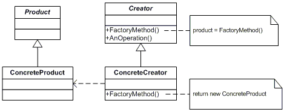

# C# Factory Method Design Pattern

> **分類**：Creational Patterns（建立型模式）  
> **使用頻率 (Frequency of use)**：高 (High)  
> **原文連結**：[https://www.dofactory.com/net/factory-method-design-pattern](https://www.dofactory.com/net/factory-method-design-pattern)

---

## 定義與概述 (Definition)

**Factory Method** Design Pattern 定義了一個用於建立物件的介面，但讓子類別（Subclasses）決定要實例化（Instantiate）哪一個類別。此 Pattern 讓類別將實例化的動作推遲到子類別中執行。

**Factory Method** Design Pattern 的 C# 程式碼範例除了提供 Dofactory 原版的 3 種形式外，亦額外補充針對 **.NET 11 / C# 15** 的現代化實務優化版本：
- [結構化程式碼 (Structural code)](#structural-code-in-c-結構化程式碼)
- [真實世界程式碼 (Real-world code)](#real-world-code-in-c-真實世界程式碼)
- [.NET 最佳化程式碼 (.NET optimized code)](#net-optimized-code-in-c-net-最佳化程式碼)
- [🚀 .NET 11 / C# 15 現代化實務優化 (Modern .NET 11 & C# 15)](#net-11--c-15-現代化實務優化-modern-net-11--c-15)

---

## UML 類別圖 (UML Class Diagram)

以下是參與此 Pattern 的類別與物件之視覺化關係圖：



---

## 參與者 (Participants)

參與此 Pattern 的類別與物件包括：

- **Product** (`Page`)
  - 定義由 Factory Method 所建立之物件的介面。
- **ConcreteProduct** (`SkillsPage`, `EducationPage`, `ExperiencePage`)
  - 實作 `Product` 介面。
- **Creator** (`Document`)
  - 宣告 Factory Method，該方法會回傳 `Product` 型別的物件。`Creator` 也可以定義 Factory Method 的預設實作，以回傳預設的 `ConcreteProduct` 物件。
  - 可以呼叫 Factory Method 來建立 `Product` 物件。
- **ConcreteCreator** (`Report`, `Resume`)
  - 覆寫（Override）Factory Method，以回傳 `ConcreteProduct` 的實例（Instance）。

---

## Structural code in C# (結構化程式碼)

這段結構化（Structural）程式碼示範了 Factory Method Pattern 在建立不同物件時所提供的極大彈性。抽象類別可以提供預設物件，但每個子類別都能實例化該物件的擴充版本。

```csharp
using System;

namespace DoFactory.GangOfFour.Factory.Structural
{
    /// <summary>
    /// MainApp startup class for Structural 
    /// Factory Method Design Pattern.
    /// </summary>

    class MainApp
    {
        /// <summary>
        /// Entry point into console application.
        /// </summary>

        static void Main()
        {
            // An array of creators

            Creator[] creators = new Creator[2];

            creators[0] = new ConcreteCreatorA();
            creators[1] = new ConcreteCreatorB();

            // Iterate over creators and create products

            foreach (Creator creator in creators)
            {
                Product product = creator.FactoryMethod();
                Console.WriteLine("Created {0}",
                  product.GetType().Name);
            }

            // Wait for user

            Console.ReadKey();
        }
    }

    /// <summary>
    /// The 'Product' abstract class
    /// </summary>

    abstract class Product
    {
    }

    /// <summary>
    /// A 'ConcreteProduct' class
    /// </summary>

    class ConcreteProductA : Product
    {
    }

    /// <summary>
    /// A 'ConcreteProduct' class
    /// </summary>

    class ConcreteProductB : Product
    {
    }

    /// <summary>
    /// The 'Creator' abstract class
    /// </summary>

    abstract class Creator
    {
        public abstract Product FactoryMethod();
    }

    /// <summary>
    /// A 'ConcreteCreator' class
    /// </summary>

    class ConcreteCreatorA : Creator
    {
        public override Product FactoryMethod()
        {
            return new ConcreteProductA();
        }
    }

    /// <summary>
    /// A 'ConcreteCreator' class
    /// </summary>

    class ConcreteCreatorB : Creator
    {
        public override Product FactoryMethod()
        {
            return new ConcreteProductB();
        }
    }
}
```

### 輸出結果 (Output)

```text
Created ConcreteProductA

  Created ConcreteProductB
```

---

## Real-world code in C# (真實世界程式碼)

這段真實世界（Real-world）程式碼示範了 Factory Method Pattern 在建立不同文件（Documents）時所提供的彈性。衍生自 `Document` 的 `Report` 與 `Resume` 類別會實例化 `Document` 類別的擴充頁面版本。在此範例中，Factory Method 是在 `Document` 基底類別（Base Class）的建構函式（Constructor）中被呼叫的。

```csharp
using System;
using System.Collections.Generic;

namespace DoFactory.GangOfFour.Factory.RealWorld
{
    /// <summary>
    /// MainApp startup class for Real-World 
    /// Factory Method Design Pattern.
    /// </summary>

    class MainApp
    {
        /// <summary>
        /// Entry point into console application.
        /// </summary>

        static void Main()
        {
            // Note: constructors call Factory Method

            Document[] documents = new Document[2];

            documents[0] = new Resume();
            documents[1] = new Report();

            // Display document pages

            foreach (Document document in documents)
            {
                Console.WriteLine("\n" + document.GetType().Name + "--");
                foreach (Page page in document.Pages)
                {
                    Console.WriteLine(" " + page.GetType().Name);
                }
            }

            // Wait for user

            Console.ReadKey();
        }
    }

    /// <summary>
    /// The 'Product' abstract class
    /// </summary>

    abstract class Page
    {
    }

    /// <summary>
    /// A 'ConcreteProduct' class
    /// </summary>

    class SkillsPage : Page
    {
    }

    /// <summary>
    /// A 'ConcreteProduct' class
    /// </summary>

    class EducationPage : Page
    {
    }

    /// <summary>
    /// A 'ConcreteProduct' class
    /// </summary>

    class ExperiencePage : Page
    {
    }

    /// <summary>
    /// A 'ConcreteProduct' class
    /// </summary>

    class IntroductionPage : Page
    {
    }

    /// <summary>
    /// A 'ConcreteProduct' class
    /// </summary>

    class ResultsPage : Page
    {
    }

    /// <summary>
    /// A 'ConcreteProduct' class
    /// </summary>

    class ConclusionPage : Page
    {
    }

    /// <summary>
    /// A 'ConcreteProduct' class
    /// </summary>

    class SummaryPage : Page
    {
    }

    /// <summary>
    /// A 'ConcreteProduct' class
    /// </summary>

    class BibliographyPage : Page
    {
    }

    /// <summary>
    /// The 'Creator' abstract class
    /// </summary>

    abstract class Document
    {
        private List<Page> _pages = new List<Page>();

        // Constructor calls abstract Factory method

        public Document()
        {
            this.CreatePages();
        }

        public List<Page> Pages
        {
            get { return _pages; }
        }

        // Factory Method

        public abstract void CreatePages();
    }

    /// <summary>
    /// A 'ConcreteCreator' class
    /// </summary>

    class Resume : Document
    {
        // Factory Method implementation

        public override void CreatePages()
        {
            Pages.Add(new SkillsPage());
            Pages.Add(new EducationPage());
            Pages.Add(new ExperiencePage());
        }
    }

    /// <summary>
    /// A 'ConcreteCreator' class
    /// </summary>

    class Report : Document
    {
        // Factory Method implementation

        public override void CreatePages()
        {
            Pages.Add(new IntroductionPage());
            Pages.Add(new ResultsPage());
            Pages.Add(new ConclusionPage());
            Pages.Add(new SummaryPage());
            Pages.Add(new BibliographyPage());
        }
    }
}
```

### 輸出結果 (Output)

```text
Resume -------

   SkillsPage

   EducationPage

   ExperiencePage

  

  Report -------

   IntroductionPage

   ResultsPage

   ConclusionPage

   SummaryPage

   BibliographyPage
```

---

## .NET Optimized code in C# (.NET 最佳化程式碼)

這段 .NET 最佳化（.NET Optimized）程式碼示範了與上述相同的邏輯，但採用了更現代化的 C# 與 .NET 功能（例如集合運算式 `[]` 與簡潔的屬性語法）。這是一個優雅的 C# Factory Method 解決方案。

```csharp
namespace Factory.NetOptimized;

using static System.Console;

/// <summary>
/// Factory Design Pattern
/// </summary>
public class Program
{
    public static void Main()
    {
        // Document constructors call Factory Method
        List<Document> documents = [new Resume(), new Report()];

        // Display document pages
        foreach (var document in documents)
        {
            document.CreatePages();  // Factory method

            WriteLine($"{document} --");
            foreach (var page in document.Pages) WriteLine($" {page}");
            WriteLine();
        }

        // Wait for user
        ReadKey();
    }
}

/// <summary>
/// The 'Product' abstract class
/// </summary>
public abstract class Page
{
    // Override. Display class name
    public override string ToString() => GetType().Name;
}

/// <summary>
/// A 'ConcreteProduct' class
/// </summary>
public class SkillsPage : Page
{
}

/// <summary>
/// A 'ConcreteProduct' class
/// </summary>
public class EducationPage : Page
{
}

/// <summary>
/// A 'ConcreteProduct' class
/// </summary>
public class ExperiencePage : Page
{
}

/// <summary>
/// A 'ConcreteProduct' class
/// </summary>
public class IntroductionPage : Page
{
}

/// <summary>
/// A 'ConcreteProduct' class
/// </summary>    
public class ResultsPage : Page
{
}

/// <summary>
/// A 'ConcreteProduct' class
/// </summary>
public class ConclusionPage : Page
{
}

/// <summary>
/// A 'ConcreteProduct' class
/// </summary>
public class SummaryPage : Page
{
}

/// <summary>
/// A 'ConcreteProduct' class
/// </summary>
public class BibliographyPage : Page
{
}

/// <summary>
/// The 'Creator' abstract class
/// </summary>
public abstract class Document
{
    // Gets list of document pages
    public List<Page> Pages { get; protected set; } = null!;

    // Factory Method
    public abstract void CreatePages();

    // Override
    public override string ToString() => GetType().Name;
}

/// <summary>
/// A 'ConcreteCreator' class
/// </summary>
public class Resume : Document
{
    // Factory Method implementation
    public override void CreatePages()
    {
        Pages =
        [
            new SkillsPage(),
            new EducationPage(),
            new ExperiencePage()
        ];
    }
}

/// <summary>
/// A 'ConcreteCreator' class
/// </summary>
public class Report : Document
{
    // Factory Method implementation
    public override void CreatePages()
    {
        Pages =
        [
            new IntroductionPage(),
            new ResultsPage(),
            new ConclusionPage(),
            new SummaryPage(),
            new BibliographyPage()
        ];
    }
}
```

### 輸出結果 (Output)

```text
Resume -------

     SkillsPage

     EducationPage

     ExperiencePage

    

    Report -------

     IntroductionPage

     ResultsPage

     ConclusionPage

     SummaryPage

     BibliographyPage
```

---

## .NET 11 / C# 15 現代化實務優化 (Modern .NET 11 & C# 15)

### 原版範例的限制與盲點

- **在抽象基底類別建構函式中呼叫 `virtual`/`abstract` 方法（反模式 Anti-pattern）**：Dofactory 的 `Document` 在建構函式中直接呼叫 `this.CreatePages()`。在 C# 中，當基底類別建構函式執行時，衍生類別的欄位與 Primary Constructor 參數尚未完成初始化，這在實務上極易引發 `NullReferenceException`（編譯器與 SonarQube 皆會發出警告 CA2214）。

### C# 15 / .NET 11 優化重點

- **移除建構函式中的虛擬呼叫**：改用延遲初始化或由工廠屬性 / 集合運算式直接定義頁面配置。
- **C# 15 `closed` 階層與 Collection Expressions `with(...)`**：使用 `closed abstract record Page` 明確封閉頁面型別，並使用集合運算式直接宣告文件結構。

### 現代化 C# 15 / .NET 11 程式碼範例

```csharp
namespace FactoryMethod.ModernNet11;

using static System.Console;

public static class Program
{
    public static void Main()
    {
        ReadOnlySpan<Document> documents = [new Resume(), new Report()];

        foreach (var doc in documents)
        {
            WriteLine($"\n{doc.GetType().Name} --");
            foreach (var page in doc.Pages)
            {
                WriteLine($" {page.GetType().Name}");
            }
        }
    }
}

// C# 15 closed 修飾詞：限制 Page 只能在此組件內被繼承
public closed abstract record Page;
public sealed record SkillsPage : Page;
public sealed record EducationPage : Page;
public sealed record ExperiencePage : Page;
public sealed record IntroductionPage : Page;
public sealed record ResultsPage : Page;
public sealed record ConclusionPage : Page;
public sealed record SummaryPage : Page;
public sealed record BibliographyPage : Page;

public abstract class Document
{
    private List<Page>? _pages;

    // 避免在基底建構函式呼叫虛擬方法，改由首次存取時安全地呼叫 Factory Method
    public IReadOnlyList<Page> Pages => _pages ??= CreatePages();

    // Factory Method
    protected abstract List<Page> CreatePages();
}

public sealed class Resume : Document
{
    // 使用 C# 15 Collection Expression Arguments 預先指定容量
    protected override List<Page> CreatePages() =>
        [with(capacity: 3), new SkillsPage(), new EducationPage(), new ExperiencePage()];
}

public sealed class Report : Document
{
    protected override List<Page> CreatePages() =>
        [
            with(capacity: 5),
            new IntroductionPage(),
            new ResultsPage(),
            new ConclusionPage(),
            new SummaryPage(),
            new BibliographyPage()
        ];
}
```

---

## 導覽 (Navigation)

| 上一篇 | 總覽 | 下一篇 |
| :--- | :---: | ---: |
| [← 上一篇：Builder](Builder.md) | [🏠 C# Design Patterns 總覽](Index.md) | [下一篇：Prototype →](Prototype.md) |
