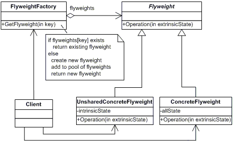

# C# Flyweight Design Pattern

> **分類**：Structural Patterns（結構型模式）  
> **使用頻率 (Frequency of use)**：低 (Low)  
> **原文連結**：[https://www.dofactory.com/net/flyweight-design-pattern](https://www.dofactory.com/net/flyweight-design-pattern)

---

## 定義與概述 (Definition)

**Flyweight** Design Pattern 使用共享（Sharing）技術來有效率地支援大量的細粒度（Fine-grained）物件。

本篇分成兩個部分：

- **[現代 C# 實作](#現代-c-實作-net-11--c-15)**：可以直接建置與執行的範例專案，建議由此開始閱讀。
- **[附錄：Dofactory 原版範例](#附錄dofactory-原版範例)**：Structural、Real-world、.NET Optimized 三種原版程式碼，作為對照。

---

## 問題情境 (Problem)

文書處理程式裡，一份文件可能有幾十萬個字元。如果每個字元都是一個獨立的物件，各自帶著自己的字形資料（寬度、高度、筆畫輪廓），記憶體很快就會被用完。

但仔細看這些資料：文件裡所有的 `A`，字形資料完全相同；每個 `A` 之間不同的只有位置與字級。

Flyweight 把物件的資料分成兩類：

- **內部狀態（Intrinsic State）**：每個相同物件都一樣的資料，存在共用的物件裡。
- **外部狀態（Extrinsic State）**：每次使用都可能不同的資料，由呼叫端在使用時傳入。

於是幾十萬個字元只需要幾十個共用的字形物件。

---

## UML 類別圖 (UML Class Diagram)

以下是參與此 Pattern 的類別與物件之視覺化關係圖：



---

## 參與者 (Participants)

參與此 Pattern 的類別與物件包括：

> 括號內是 Dofactory 原版範例（見附錄）使用的類別名稱。現代 C# 實作中各角色對應的型別，請見下一節開頭的「角色對照」。

- **Flyweight** (`Character`)
  - 宣告一個介面，讓 Flyweight 物件可以透過此介面接收並處理外部狀態（Extrinsic State）。
- **ConcreteFlyweight** (`CharacterA`, `CharacterB`, ..., `CharacterZ`)
  - 實作 `Flyweight` 介面，並為內部狀態（Intrinsic State，如果有的話）提供儲存空間。`ConcreteFlyweight` 物件必須是可共享的。它所儲存的任何狀態都必須是內部的（Intrinsic），也就是說，它必須獨立於 `ConcreteFlyweight` 物件的脈絡（Context）之外。
- **UnsharedConcreteFlyweight** （未使用）
  - 並非所有的 `Flyweight` 子類別都需要被共享。`Flyweight` 介面「允許」共享，但並不強制要求共享。在 Flyweight 物件結構的某些層級中，`UnsharedConcreteFlyweight` 物件通常會將 `ConcreteFlyweight` 物件作為其子節點（就像 `Row` 與 `Column` 類別一樣）。
- **FlyweightFactory** (`CharacterFactory`)
  - 建立並管理 Flyweight 物件。
  - 確保 Flyweight 物件被適當地共享。當用戶端請求一個 Flyweight 時，`FlyweightFactory` 物件會提供一個既有的實例，若不存在則建立一個新的實例。
- **Client** (`FlyweightApp`)
  - 維護指向一個或多個 Flyweight 的參考。
  - 計算或儲存 Flyweight 的外部狀態（Extrinsic State）。

---

## 現代 C# 實作 (.NET 11 / C# 15)

> **範例專案**：[samples/Flyweight](samples/Flyweight)  
> **執行方式**：`dotnet run --project samples/Flyweight`

**角色對照**：Flyweight = `Glyph`；FlyweightFactory = `GlyphFactory`；內部狀態 = 符號、寬度、高度；外部狀態 = `pointSize`；Client = 最上方的迴圈。

<!-- sample:Flyweight/Program.cs -->
```csharp
// Flyweight：大量物件有相同的內容時，共用同一個實例；會變動的部分由呼叫端傳入。

const string document = "AAZZBBZB";
var factory = new GlyphFactory();

int pointSize = 10;
foreach (char symbol in document)
{
    Glyph glyph = factory.Get(symbol);
    glyph.Draw(++pointSize);
}

Console.WriteLine($"Characters drawn: {document.Length}, glyph objects created: {factory.Count}");
Console.WriteLine($"Same instance reused: {ReferenceEquals(factory.Get('A'), factory.Get('A'))}");

// ---- Flyweight：只保存「內部狀態」（每個 'A' 都相同的資料），建立後不可變，所以能安全共用 ----
public sealed class Glyph(char symbol, int width, int height)
{
    public char Symbol => symbol;

    // pointSize 是「外部狀態」（每次使用都可能不同），由呼叫端傳入，不存進共用物件
    public void Draw(int pointSize) =>
        Console.WriteLine($"{symbol} (pointsize {pointSize}, glyph {width}x{height})");
}

// ---- FlyweightFactory：同一個符號只建立一次 ----
public sealed class GlyphFactory
{
    private readonly Dictionary<char, Glyph> _glyphs = new();

    public int Count => _glyphs.Count;

    public Glyph Get(char symbol)
    {
        if (!_glyphs.TryGetValue(symbol, out Glyph? glyph))
        {
            glyph = new Glyph(symbol, width: 100, height: 120);
            _glyphs[symbol] = glyph;
        }

        return glyph;
    }
}
```
<!-- /sample -->

### 輸出結果 (Output)

<!-- output:Flyweight -->
```text
A (pointsize 11, glyph 100x120)
A (pointsize 12, glyph 100x120)
Z (pointsize 13, glyph 100x120)
Z (pointsize 14, glyph 100x120)
B (pointsize 15, glyph 100x120)
B (pointsize 16, glyph 100x120)
Z (pointsize 17, glyph 100x120)
B (pointsize 18, glyph 100x120)
Characters drawn: 8, glyph objects created: 3
Same instance reused: True
```
<!-- /output -->

### 重點解說

- **畫了 8 個字元，只建立 3 個物件**（輸出倒數第 2 行）：相同的符號共用同一個 `Glyph`。
- **能共用的前提是不可變**：`Glyph` 沒有任何可以修改的成員，所以不論被多少地方共用，都不會互相影響。
- **外部狀態經由參數傳入**：`pointSize` 是 `Draw` 的參數，不會被存進共用的物件。
- **工廠負責「同一個符號只建立一次」**：`TryGetValue` 一次完成「查詢是否存在」與「取出」。
- **這個工廠不是執行緒安全的**：多個執行緒同時使用時，請改用 `ConcurrentDictionary<TKey, TValue>` 的 `GetOrAdd`。

---

## 與 Dofactory 原版的差異

- 原版 Real-world 的 `Character` 有一個 `pointSize` 欄位，`Display(int pointSize)` 會把參數寫進這個欄位，等於把外部狀態存進了共用的物件。所有使用同一個 `CharacterA` 的地方會互相覆蓋對方的字級，多執行緒時更會發生資料競爭。本版完全不儲存 `pointSize`。
- 原版每個字母都是一個子類別（`CharacterA`、`CharacterB`、`CharacterZ`），彼此只差在欄位的值。本版只用一個 `Glyph` 類別。
- 本版會印出實際建立的物件數量，直接呈現這個模式的效果。

---

## .NET 中的對應 (In .NET)

- **字串集區**：程式碼裡內容相同的字串常值會共用同一個物件；`string.Intern` 可以把執行期產生的字串加入集區。
- **不可變的共用實例**：`Array.Empty<T>()`、`Task.CompletedTask`、`EventArgs.Empty`、`Encoding.UTF8`。
- **`ArrayPool<T>.Shared`**：這是物件集區（借出、使用、歸還），目的同樣是減少配置，但集區裡的物件是可變的，而且同一時間只有一個使用者，與 Flyweight 不同。

---

## 何時該用、何時不該用

**適合使用**

- 物件數量非常多（數萬個以上），而且大部分的資料是重複的。
- 重複的那部分資料可以做成不可變。

**不適合使用**

- 物件數量不多：省下的記憶體不值得多出來的複雜度。
- 每個物件的資料幾乎都不相同。
- 還沒有實際量測過記憶體用量就先做最佳化。

---

## 練習題

1. 把 `GlyphFactory` 改用 `ConcurrentDictionary<char, Glyph>` 與 `GetOrAdd`。
2. 在 `Glyph` 加上 `public int LastPointSize { get; set; }`，並在 `Draw` 裡寫入它。當兩段文字共用同一個 `'A'` 時，這個屬性代表的是誰的字級？
3. 把 `document` 換成一段 1,000 個字元的英文文字，觀察建立的物件數量。

---

## 附錄：Dofactory 原版範例

> 以下保留 Dofactory 網站的三種原版程式碼作為對照，點選標題即可展開。  
> 輸出結果是實際編譯並執行這些程式碼所得（執行時移除了會等待按鍵的 `Console.ReadKey()`，文化特性為 en-US）。  
> 原版使用較舊的 C# 寫法，撰寫新程式時請以上方的「現代 C# 實作」為準。

<details>
<summary><b>Structural code（結構化程式碼）</b></summary>

這段結構化（Structural）程式碼示範了 Flyweight Pattern 如何讓少量的物件能夠被不同的用戶端（Clients）重複共享多次。

```csharp
using System;
using System.Collections.Generic;

namespace Flyweight.Structural
{
    /// <summary>
    /// Flyweight Design Pattern
    /// </summary>

    public class Program
    {
        public static void Main(string[] args)
        {
            // Arbitrary extrinsic state

            int extrinsicstate = 22;

            FlyweightFactory factory = new FlyweightFactory();

            // Work with different flyweight instances

            Flyweight fx = factory.GetFlyweight("X");
            fx.Operation(--extrinsicstate);

            Flyweight fy = factory.GetFlyweight("Y");
            fy.Operation(--extrinsicstate);

            Flyweight fz = factory.GetFlyweight("Z");
            fz.Operation(--extrinsicstate);

            UnsharedConcreteFlyweight fu = new
                UnsharedConcreteFlyweight();

            fu.Operation(--extrinsicstate);

            // Wait for user

            Console.ReadKey();
        }
    }
    /// <summary>
    /// The 'FlyweightFactory' class
    /// </summary>

    public class FlyweightFactory
    {
        private Dictionary<string, Flyweight> flyweights { get; set; } = new Dictionary<string, Flyweight>();

        // Constructor

        public FlyweightFactory()
        {
            flyweights.Add("X", new ConcreteFlyweight());
            flyweights.Add("Y", new ConcreteFlyweight());
            flyweights.Add("Z", new ConcreteFlyweight());
        }

        public Flyweight GetFlyweight(string key)
        {
            return ((Flyweight)flyweights[key]);
        }
    }

    /// <summary>
    /// The 'Flyweight' abstract class
    /// </summary>

    public abstract class Flyweight
    {
        public abstract void Operation(int extrinsicstate);
    }

    /// <summary>
    /// The 'ConcreteFlyweight' class
    /// </summary>

    public class ConcreteFlyweight : Flyweight
    {
        public override void Operation(int extrinsicstate)
        {
            Console.WriteLine("ConcreteFlyweight: " + extrinsicstate);
        }
    }

    /// <summary>
    /// The 'UnsharedConcreteFlyweight' class
    /// </summary>

    public class UnsharedConcreteFlyweight : Flyweight
    {
        public override void Operation(int extrinsicstate)
        {
            Console.WriteLine("UnsharedConcreteFlyweight: " +
                extrinsicstate);
        }
    }
}
```

**輸出結果 (Output)**

```text
ConcreteFlyweight: 21
ConcreteFlyweight: 20
ConcreteFlyweight: 19
UnsharedConcreteFlyweight: 18
```

</details>

<details>
<summary><b>Real-world code（真實世界程式碼）</b></summary>

這段真實世界（Real-world）程式碼示範了 Flyweight Pattern 如何讓少量的字元（`Character`）物件能夠被一份可能包含大量字元的文件重複共享多次。

```csharp
using System;
using System.Collections.Generic;

namespace Flyweight.RealWorld
{
    /// <summary>
    /// Flyweight Design Pattern
    /// </summary>

    public class Program
    {
        public static void Main(string[] args)
        {
            // Build a document with text

            string document = "AAZZBBZB";
            char[] chars = document.ToCharArray();

            CharacterFactory factory = new CharacterFactory();

            // extrinsic state

            int pointSize = 10;

            // For each character use a flyweight object

            foreach (char c in chars)
            {
                pointSize++;
                Character character = factory.GetCharacter(c);
                character.Display(pointSize);
            }

            // Wait for user

            Console.ReadKey();
        }
    }

    /// <summary>
    /// The 'FlyweightFactory' class
    /// </summary>

    public class CharacterFactory
    {
        private Dictionary<char, Character> characters = new Dictionary<char, Character>();

        public Character GetCharacter(char key)
        {
            // Uses "lazy initialization"

            Character character = null;

            if (characters.ContainsKey(key))
            {
                character = characters[key];
            }
            else
            {
                switch (key)
                {
                    case 'A': character = new CharacterA(); break;
                    case 'B': character = new CharacterB(); break;
                    //...
                    case 'Z': character = new CharacterZ(); break;
                }
                characters.Add(key, character);
            }
            return character;
        }
    }

    /// <summary>
    /// The 'Flyweight' abstract class
    /// </summary>

    public abstract class Character
    {
        protected char symbol;
        protected int width;
        protected int height;
        protected int ascent;
        protected int descent;
        protected int pointSize;

        public abstract void Display(int pointSize);
    }

    /// <summary>
    /// A 'ConcreteFlyweight' class
    /// </summary>

    public class CharacterA : Character
    {
        // Constructor
        public CharacterA()
        {
            symbol = 'A';
            height = 100;
            width = 120;
            ascent = 70;
            descent = 0;
        }

        public override void Display(int pointSize)
        {
            this.pointSize = pointSize;
            Console.WriteLine(symbol +
                " (pointsize " + this.pointSize + ")");
        }
    }

    /// <summary>
    /// A 'ConcreteFlyweight' class
    /// </summary>

    public class CharacterB : Character
    {
        // Constructor

        public CharacterB()
        {
            symbol = 'B';
            height = 100;
            width = 140;
            ascent = 72;
            descent = 0;
        }

        public override void Display(int pointSize)
        {
            this.pointSize = pointSize;
            Console.WriteLine(this.symbol +
                " (pointsize " + this.pointSize + ")");
        }

    }

    // ... C, D, E, etc.

    /// <summary>
    /// A 'ConcreteFlyweight' class
    /// </summary>

    public class CharacterZ : Character
    {
        // Constructor

        public CharacterZ()
        {
            symbol = 'Z';
            height = 100;
            width = 100;
            ascent = 68;
            descent = 0;
        }

        public override void Display(int pointSize)
        {
            this.pointSize = pointSize;
            Console.WriteLine(this.symbol +
                " (pointsize " + this.pointSize + ")");
        }
    }
}
```

**輸出結果 (Output)**

```text
A (pointsize 11)
A (pointsize 12)
Z (pointsize 13)
Z (pointsize 14)
B (pointsize 15)
B (pointsize 16)
Z (pointsize 17)
B (pointsize 18)
```

</details>

<details>
<summary><b>.NET Optimized code（.NET 最佳化程式碼）</b></summary>

這段 .NET 最佳化（.NET Optimized）程式碼示範了與上述相同的邏輯，但採用了更現代化的 C# 與 .NET 功能（例如索引子 Indexer、`switch` 運算式與集合初始化）。此版本的實作細節與限制，請見上方的〈與 Dofactory 原版的差異〉。

```csharp
namespace Flyweight.NetOptimized;

using System.Collections.Generic;
using static System.Console;

/// <summary>
/// Flyweight Design Pattern
/// </summary>
public class Program
{
    public static void Main()
    {
        // Build document with text
        var document = "AAZZBBZB";
       
        var factory = new CharacterFactory();

        // extrinsic state
        int pointSize = 10;

        // For each character use a flyweight object
        foreach (char c in document)
        {
            var character = factory.GetCharacter(c);
            character.Display(++pointSize);
        }

        // Wait for user
        ReadKey();
    }
}

/// <summary>
/// The 'FlyweightFactory' class
/// </summary>
public class CharacterFactory
{
    private readonly Dictionary<char, Character> characters = [];

    public Character GetCharacter(char key)
    {
        // Uses "lazy initialization"
        Character character;
        if (characters.TryGetValue(key, out Character? value))
        {
            character = value;
        }
        else
        {
            character = key switch
            {
                'A' => new CharacterA(),
                'B' => new CharacterB(),
                // ...
                'Z' => new CharacterZ(),
                _   => null!
            };
            characters.Add(key, character);
        }
        return character;
    }
}

/// <summary>
/// The 'Flyweight' class
/// </summary>
public class Character
{
    protected char symbol;
    protected int width;
    protected int height;
    protected int ascent;
    protected int descent;

    public void Display(int pointSize) =>
       WriteLine($"{symbol} (pointsize {pointSize})");
}

/// <summary>
/// A 'ConcreteFlyweight' class
/// </summary>
public class CharacterA : Character
{
    // Constructor
    public CharacterA()
    {
        symbol = 'A';
        height = 100;
        width = 120;
        ascent = 70;
        descent = 0;
    }
}

/// <summary>
/// A 'ConcreteFlyweight' class
/// </summary>
public class CharacterB : Character
{
    // Constructor
    public CharacterB()
    {
        symbol = 'B';
        height = 100;
        width = 140;
        ascent = 72;
        descent = 0;
    }
}

// ... C, D, E, etc.

/// <summary>
/// A 'ConcreteFlyweight' class
/// </summary>
public class CharacterZ : Character
{
    // Constructor
    public CharacterZ()
    {
        symbol = 'Z';
        height = 100;
        width = 100;
        ascent = 68;
        descent = 0;
    }
}
```

**輸出結果 (Output)**

```text
A (pointsize 11)
A (pointsize 12)
Z (pointsize 13)
Z (pointsize 14)
B (pointsize 15)
B (pointsize 16)
Z (pointsize 17)
B (pointsize 18)
```

</details>

---

## 導覽 (Navigation)

| 上一篇 | 總覽 | 下一篇 |
| :--- | :---: | ---: |
| [← 上一篇：Facade](Facade.md) | [🏠 C# Design Patterns 總覽](README.md) | [下一篇：Proxy →](Proxy.md) |
