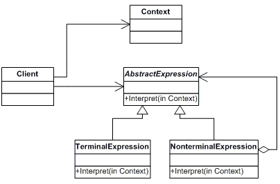

# C# Interpreter Design Pattern

> **分類**：Behavioral Patterns（行為型模式）  
> **使用頻率 (Frequency of use)**：低 (Low)  
> **原文連結**：[https://www.dofactory.com/net/interpreter-design-pattern](https://www.dofactory.com/net/interpreter-design-pattern)

---

## 定義與概述 (Definition)

給定一個語言，**Interpreter** Design Pattern 會定義其文法（Grammar）的表示方式，以及一個使用該表示方式來直譯（Interpret）該語言中句子的直譯器。

本篇分成兩個部分：

- **[現代 C# 實作](#現代-c-實作-net-11--c-15)**：可以直接建置與執行的範例專案，建議由此開始閱讀。
- **[附錄：Dofactory 原版範例](#附錄dofactory-原版範例)**：Structural、Real-world、.NET Optimized 三種原版程式碼，作為對照。

---

## 問題情境 (Problem)

要把羅馬數字（例如 `MCMXXVIII`）轉換成整數。羅馬數字有明確的文法：由千位、百位、十位、個位依序組成，每一個位數都是「9、4、5 其中之一，或是連續幾個 1」的組合，只是使用的符號不同。

這個問題用一個方法也能解決。Interpreter 的想法是：**把每一條文法規則寫成一個物件**，再讓這些物件依序解讀輸入。文法有幾條規則，就有幾個運算式物件；要擴充文法時，新增或調整物件即可。

---

## UML 類別圖 (UML Class Diagram)

以下是參與此 Pattern 的類別與物件之視覺化關係圖：



---

## 參與者 (Participants)

參與此 Pattern 的類別與物件包括：

> 括號內是 Dofactory 原版範例（見附錄）使用的類別名稱。現代 C# 實作中各角色對應的型別，請見下一節開頭的「角色對照」。

- **AbstractExpression** (`Expression`)
  - 宣告一個用於執行直譯（Interpret）操作的介面。
- **TerminalExpression** (`ThousandExpression`, `HundredExpression`, `TenExpression`, `OneExpression`)
  - 實作與文法中之終端符號（Terminal Symbols）相關聯的 `Interpret` 操作。
  - 句子中的每一個終端符號都需要一個對應的實例（Instance）。
- **NonterminalExpression** （未使用）
  - 文法中的每一條規則 `R ::= R1R2...Rn` 都需要一個此類型的類別。
  - 為 `R1` 到 `Rn` 的每個符號維護 `AbstractExpression` 型別的實例變數。
  - 為文法中的非終端符號（Nonterminal Symbols）實作 `Interpret` 操作。`Interpret` 通常會在代表 `R1` 到 `Rn` 的變數上遞迴地呼叫自身。
- **Context** (`Context`)
  - 包含對直譯器而言屬於全域（Global）的資訊。
- **Client** (`InterpreterApp`)
  - 建立（或接收）一個抽象語法樹（Abstract Syntax Tree, AST），用來代表該文法所定義之語言中的某個特定句子。該抽象語法樹是由 `NonterminalExpression` 與 `TerminalExpression` 類別的實例所組裝而成。
  - 呼叫 `Interpret` 操作。

---

## 現代 C# 實作 (.NET 11 / C# 15)

> **範例專案**：[samples/Interpreter](samples/Interpreter)  
> **執行方式**：`dotnet run --project samples/Interpreter`

**角色對照**：AbstractExpression = `IExpression`；TerminalExpression = `DigitExpression`；Context = `Context`；Client = `RomanNumeral.Parse`。

<!-- sample:Interpreter/Program.cs -->
```csharp
// Interpreter：把一個小型語言的每條文法規則寫成一個物件，再由這些物件合力解讀輸入。

string[] samples = ["MCMXXVIII", "MMXXVI", "XLII"];

foreach (string roman in samples)
{
    Console.WriteLine($"{roman} = {RomanNumeral.Parse(roman)}");
}

// ---- Context：解讀過程中共用的資料（還沒讀完的輸入、目前累計的結果） ----
public sealed class Context(string input)
{
    public string Input { get; set; } = input;
    public int Output { get; set; }
}

// ---- AbstractExpression ----
public interface IExpression
{
    void Interpret(Context context);
}

// ---- TerminalExpression：解讀「一個位數」。
// 千、百、十、個位的規則結構完全相同，只有符號與倍率不同，
// 所以用建構函式參數表達差異，而不是寫四個幾乎一樣的子類別。
public sealed class DigitExpression(
    int multiplier, string one, string? four = null, string? five = null, string? nine = null) : IExpression
{
    public void Interpret(Context context)
    {
        // 9 與 4 的後面不會再接同一個位數的符號，所以解讀完就結束
        if (TryConsume(context, nine, value: 9) || TryConsume(context, four, value: 4))
        {
            return;
        }

        // 5 最多出現一次，後面可以再接 0 到 3 個 1（例如 VIII = 5 + 1 + 1 + 1）
        TryConsume(context, five, value: 5);

        while (TryConsume(context, one, value: 1))
        {
            // 重複到開頭不再是這個符號為止
        }
    }

    // 輸入的開頭符合 symbol 時：累加數值、把已解讀的部分從輸入移除，並回傳 true
    private bool TryConsume(Context context, string? symbol, int value)
    {
        if (symbol is null || !context.Input.StartsWith(symbol, StringComparison.Ordinal))
        {
            return false;
        }

        context.Output += value * multiplier;
        context.Input = context.Input[symbol.Length..];
        return true;
    }
}

public static class RomanNumeral
{
    // 文法：由高位到低位依序解讀
    private static readonly IExpression[] Grammar =
    [
        new DigitExpression(1000, one: "M"),
        new DigitExpression(100, one: "C", four: "CD", five: "D", nine: "CM"),
        new DigitExpression(10, one: "X", four: "XL", five: "L", nine: "XC"),
        new DigitExpression(1, one: "I", four: "IV", five: "V", nine: "IX"),
    ];

    public static int Parse(string roman)
    {
        var context = new Context(roman);

        foreach (IExpression expression in Grammar)
        {
            expression.Interpret(context);
        }

        // 所有規則都跑完還有剩下的字元，代表輸入不符合文法
        if (context.Input.Length > 0)
        {
            throw new FormatException($"'{roman}' is not a valid Roman numeral.");
        }

        return context.Output;
    }
}
```
<!-- /sample -->

### 輸出結果 (Output)

<!-- output:Interpreter -->
```text
MCMXXVIII = 1928
MMXXVI = 2026
XLII = 42
```
<!-- /output -->

### 重點解說

- **文法是資料**：`Grammar` 陣列由高位到低位列出四條規則，閱讀這個陣列就能看懂整個文法。
- **每個運算式做同一件事**：檢查輸入的開頭是否符合自己的符號，符合就累加數值，並把已經解讀的部分從輸入移除。
- **範圍運算子**：`context.Input[symbol.Length..]` 的意思是「從這個位置到結尾」。
- **`StringComparison.Ordinal`**：比對字串時明確指定比較方式，結果才不會受到作業系統語系影響。
- **驗證輸入**：所有規則都跑完後如果還有剩下的字元，就代表輸入不合文法，丟出 `FormatException`。

---

## 與 Dofactory 原版的差異

- 原版有四個子類別（`ThousandExpression`、`HundredExpression`、`TenExpression`、`OneExpression`），各自覆寫 `One()`、`Four()`、`Five()`、`Nine()`、`Multiplier()` 回傳常數。四個類別的結構完全相同，本版合併為一個 `DigitExpression`，差異由建構函式參數表達。
- 原版以 `" "`（一個空白）代表「千位沒有 4、5、9」。本版以 `null` 搭配具名引數表達，意圖更清楚。
- 原版不檢查不合法的輸入。本版會丟出 `FormatException`。

---

## .NET 中的對應 (In .NET)

- **`System.Text.RegularExpressions.Regex`**：把規則運算式這種小型語言解讀成比對邏輯。
- **`System.Linq.Expressions`**：以物件樹表示程式碼，並可用 `Compile()` 轉成可執行的委派。
- **剖析器函式庫**：要解析真正的語言時，實務上會使用 ANTLR、Superpower、Pidgin 這類工具，而不是手寫 Interpreter。

---

## 何時該用、何時不該用

**適合使用**

- 文法很小而且穩定，例如簡單的查詢條件、計算式、設定規則。

**不適合使用**

- 文法稍微複雜一點：類別數量與維護成本會快速增加。
- 只是做格式轉換：一個方法或一張對照表更直接。

這是 GoF 23 個模式中，日常開發最少直接用到的一個。認識它的價值主要在於理解「把規則表示成物件」這個想法。

---

## 練習題

1. 目前 `Parse("IIII")` 會回傳 4。修改程式讓它丟出 `FormatException`（提示：同一個符號最多連續出現 3 次）。
2. 寫出反向的 `ToRoman(int number)`，並用 1 到 3999 的每個數字驗證 `Parse(ToRoman(n)) == n`。
3. 不使用 Interpreter，用一個 `Dictionary<char, int>` 與一個迴圈重寫 `Parse`。比較兩種寫法的行數與可讀性。

---

## 附錄：Dofactory 原版範例

> 以下保留 Dofactory 網站的三種原版程式碼作為對照，點選標題即可展開。  
> 輸出結果是實際編譯並執行這些程式碼所得（執行時移除了會等待按鍵的 `Console.ReadKey()`，文化特性為 en-US）。  
> 原版使用較舊的 C# 寫法，撰寫新程式時請以上方的「現代 C# 實作」為準。

<details>
<summary><b>Structural code（結構化程式碼）</b></summary>

這段結構化（Structural）程式碼示範了 Interpreter Pattern 如何利用已定義的文法，提供能夠處理已剖析陳述式（Parsed Statements）的直譯器。

```csharp
using System;
using System.Collections.Generic;

namespace Interpreter.Structural
{
    /// <summary>
    /// Interpreter Design Pattern
    /// </summary>

    public class Program
    {
        public static void Main(string[] args)
        {
            Context context = new Context();

            // Usually a tree 

            List<AbstractExpression> list = new List<AbstractExpression>();

            // Populate 'abstract syntax tree' 

            list.Add(new TerminalExpression());
            list.Add(new NonterminalExpression());
            list.Add(new TerminalExpression());
            list.Add(new TerminalExpression());

            // Interpret

            foreach (AbstractExpression exp in list)
            {
                exp.Interpret(context);
            }

            // Wait for user

            Console.ReadKey();
        }
    }

    /// <summary>
    /// The 'Context' class
    /// </summary>

    public class Context
    {
    }

    /// <summary>
    /// The 'AbstractExpression' abstract class
    /// </summary>

    public abstract class AbstractExpression
    {
        public abstract void Interpret(Context context);
    }

    /// <summary>
    /// The 'TerminalExpression' class
    /// </summary>

    public class TerminalExpression : AbstractExpression
    {
        public override void Interpret(Context context)
        {
            Console.WriteLine("Called Terminal.Interpret()");
        }
    }

    /// <summary>
    /// The 'NonterminalExpression' class
    /// </summary>

    public class NonterminalExpression : AbstractExpression
    {
        public override void Interpret(Context context)
        {
            Console.WriteLine("Called Nonterminal.Interpret()");
        }
    }
}
```

**輸出結果 (Output)**

```text
Called Terminal.Interpret()
Called Nonterminal.Interpret()
Called Terminal.Interpret()
Called Terminal.Interpret()
```

</details>

<details>
<summary><b>Real-world code（真實世界程式碼）</b></summary>

這段真實世界（Real-world）程式碼示範了如何使用 Interpreter Pattern 將羅馬數字（Roman Numeral）轉換為十進位數字（Decimal）。

```csharp
using System;
using System.Collections.Generic;

namespace Interpreter.RealWorld
{
    /// <summary>
    /// Interpreter Design Pattern
    /// </summary>

    public class Program
    {
        public static void Main(string[] args)
        {
            string roman = "MCMXXVIII";
            Context context = new Context(roman);

            // Build the 'parse tree'

            List<Expression> tree = new List<Expression>();
            tree.Add(new ThousandExpression());
            tree.Add(new HundredExpression());
            tree.Add(new TenExpression());
            tree.Add(new OneExpression());

            // Interpret

            foreach (Expression exp in tree)
            {
                exp.Interpret(context);
            }

            Console.WriteLine("{0} = {1}",
                roman, context.Output);

            // Wait for user

            Console.ReadKey();
        }
    }

    /// <summary>
    /// The 'Context' class
    /// </summary>

    public class Context
    {
        string input;
        int output;

        // Constructor

        public Context(string input)
        {
            this.input = input;
        }

        public string Input
        {
            get { return input; }
            set { input = value; }
        }

        public int Output
        {
            get { return output; }
            set { output = value; }
        }
    }

    /// <summary>
    /// The 'AbstractExpression' class
    /// </summary>

    public abstract class Expression
    {
        public void Interpret(Context context)
        {
            if (context.Input.Length == 0)
                return;

            if (context.Input.StartsWith(Nine()))
            {
                context.Output += (9 * Multiplier());
                context.Input = context.Input.Substring(2);
            }
            else if (context.Input.StartsWith(Four()))
            {
                context.Output += (4 * Multiplier());
                context.Input = context.Input.Substring(2);
            }
            else if (context.Input.StartsWith(Five()))
            {
                context.Output += (5 * Multiplier());
                context.Input = context.Input.Substring(1);
            }

            while (context.Input.StartsWith(One()))
            {
                context.Output += (1 * Multiplier());
                context.Input = context.Input.Substring(1);
            }
        }

        public abstract string One();
        public abstract string Four();
        public abstract string Five();
        public abstract string Nine();
        public abstract int Multiplier();
    }

    /// <summary>
    /// A 'TerminalExpression' class
    /// <remarks>
    /// Thousand checks for the Roman Numeral M 
    /// </remarks>
    /// </summary>

    public class ThousandExpression : Expression
    {
        public override string One() { return "M"; }
        public override string Four() { return " "; }
        public override string Five() { return " "; }
        public override string Nine() { return " "; }
        public override int Multiplier() { return 1000; }
    }

    /// <summary>
    /// A 'TerminalExpression' class
    /// <remarks>
    /// Hundred checks C, CD, D or CM
    /// </remarks>
    /// </summary>

    public class HundredExpression : Expression
    {
        public override string One() { return "C"; }
        public override string Four() { return "CD"; }
        public override string Five() { return "D"; }
        public override string Nine() { return "CM"; }
        public override int Multiplier() { return 100; }
    }

    /// <summary>
    /// A 'TerminalExpression' class
    /// <remarks>
    /// Ten checks for X, XL, L and XC
    /// </remarks>
    /// </summary>

    public class TenExpression : Expression
    {
        public override string One() { return "X"; }
        public override string Four() { return "XL"; }
        public override string Five() { return "L"; }
        public override string Nine() { return "XC"; }
        public override int Multiplier() { return 10; }
    }

    /// <summary>
    /// A 'TerminalExpression' class
    /// <remarks>
    /// One checks for I, II, III, IV, V, VI, VI, VII, VIII, IX
    /// </remarks>
    /// </summary>

    public class OneExpression : Expression
    {
        public override string One() { return "I"; }
        public override string Four() { return "IV"; }
        public override string Five() { return "V"; }
        public override string Nine() { return "IX"; }
        public override int Multiplier() { return 1; }
    }
}
```

**輸出結果 (Output)**

```text
MCMXXVIII = 1928
```

</details>

<details>
<summary><b>.NET Optimized code（.NET 最佳化程式碼）</b></summary>

這段 .NET 最佳化（.NET Optimized）程式碼示範了與上述相同的邏輯，但採用了更現代化的 C# 與 .NET 功能（例如 `record` 型別與集合運算式 `[]`）。此版本的實作細節與限制，請見上方的〈與 Dofactory 原版的差異〉。

```csharp
namespace Interpreter.NetOptimized;

using static System.Console;

using System.Collections.Generic;

/// <summary>
/// Interpreter Design Pattern
/// </summary>
public class Program
{
    public static void Main()
    {
        // Construct the 'parse tree'
        List<Expression> tree = [ new ThousandExpression(), new HundredExpression(),
                                  new TenExpression(), new OneExpression() ];

        // Create the context (i.e. roman value)
        var roman = "MCMXXVIII";
        var context = new Context { Input = roman };

        // Interpret
        tree.ForEach(e => e.Interpret(context));

        WriteLine($"{roman} = {context.Output}");

        // Wait for user
        ReadKey();
    }
}

/// <summary>
/// The 'Context' class
/// </summary>
public record Context
{
    public string Input { get; set; } = null!;
    public int Output { get; set; }
}

/// <summary>
/// The 'AbstractExpression' abstract class
/// </summary>
public abstract class Expression
{
    public void Interpret(Context context)
    {
        if (context.Input.Length == 0)
            return;

        if (context.Input.StartsWith(Nine()))
        {
            context.Output += (9 * Multiplier());
            context.Input = context.Input.Substring(2);
        }
        else if (context.Input.StartsWith(Four()))
        {
            context.Output += (4 * Multiplier());
            context.Input = context.Input.Substring(2);
        }
        else if (context.Input.StartsWith(Five()))
        {
            context.Output += (5 * Multiplier());
            context.Input = context.Input.Substring(1);
        }

        while (context.Input.StartsWith(One()))
        {
            context.Output += (1 * Multiplier());
            context.Input = context.Input.Substring(1);
        }
    }

    public abstract string One();
    public abstract string Four();
    public abstract string Five();
    public abstract string Nine();
    public abstract int Multiplier();
}

/// <summary>
/// A 'TerminalExpression' class
/// <remarks>
/// Thousand checks for the Roman Numeral M
/// </remarks>
/// </summary>
public class ThousandExpression : Expression
{
    public override string One() => "M";
    public override string Four() => " ";
    public override string Five() => " ";
    public override string Nine() => " ";
    public override int Multiplier() => 1000;
}

/// <summary>
/// A 'TerminalExpression' class
/// <remarks>
/// Hundred checks C, CD, D or CM
/// </remarks>
/// </summary>
public class HundredExpression : Expression
{
    public override string One() => "C";
    public override string Four() => "CD";
    public override string Five() => "D";
    public override string Nine() => "CM";
    public override int Multiplier() => 100;
}

/// <summary>
/// A 'TerminalExpression' class
/// <remarks>
/// Ten checks for X, XL, L and XC
/// </remarks>
/// </summary>
public class TenExpression : Expression
{
    public override string One() => "X";
    public override string Four() => "XL";
    public override string Five() => "L";
    public override string Nine() => "XC";
    public override int Multiplier() => 10;
}

/// <summary>
/// A 'TerminalExpression' class
/// <remarks>
/// One checks for I, II, III, IV, V, VI, VI, VII, VIII, IX
/// </remarks>
/// </summary>
public class OneExpression : Expression
{
    public override string One() => "I";
    public override string Four() => "IV";
    public override string Five() => "V";
    public override string Nine() => "IX";
    public override int Multiplier() => 1;
}
```

**輸出結果 (Output)**

```text
MCMXXVIII = 1928
```

</details>

---

## 導覽 (Navigation)

| 上一篇 | 總覽 | 下一篇 |
| :--- | :---: | ---: |
| [← 上一篇：Command](Command.md) | [🏠 C# Design Patterns 總覽](Index.md) | [下一篇：Iterator →](Iterator.md) |
