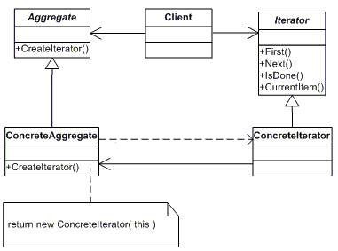

# C# Iterator Design Pattern

> **分類**：Behavioral Patterns（行為型模式）  
> **使用頻率 (Frequency of use)**：高 (High)  
> **原文連結**：[https://www.dofactory.com/net/iterator-design-pattern](https://www.dofactory.com/net/iterator-design-pattern)

---

## 定義與概述 (Definition)

**Iterator** Design Pattern 提供一種方法，可以循序存取聚合（Aggregate）物件中的各個元素，而無須暴露其底層的表示方式（Underlying Representation）。

**Iterator** Design Pattern 的 C# 程式碼範例除了提供 Dofactory 原版的 3 種形式外，亦額外補充針對 **.NET 11 / C# 15** 的現代化實務優化版本：
- [結構化程式碼 (Structural code)](#structural-code-in-c-結構化程式碼)
- [真實世界程式碼 (Real-world code)](#real-world-code-in-c-真實世界程式碼)
- [.NET 最佳化程式碼 (.NET optimized code)](#net-optimized-code-in-c-net-最佳化程式碼)
- [🚀 .NET 11 / C# 15 現代化實務優化 (Modern .NET 11 & C# 15)](#net-11--c-15-現代化實務優化-modern-net-11--c-15)

---

## UML 類別圖 (UML Class Diagram)

以下是參與此 Pattern 的類別與物件之視覺化關係圖：



---

## 參與者 (Participants)

參與此 Pattern 的類別與物件包括：

- **Iterator** (`AbstractIterator`)
  - 定義一個用於存取及走訪（Traversing）元素的介面。
- **ConcreteIterator** (`Iterator`)
  - 實作 `Iterator` 介面。
  - 在走訪聚合物件的過程中，追蹤目前所在的位置。
- **Aggregate** (`AbstractCollection`)
  - 定義一個用於建立 `Iterator` 物件的介面。
- **ConcreteAggregate** (`Collection`)
  - 實作建立 `Iterator` 的介面，以回傳適當之 `ConcreteIterator` 的實例。

---

## Structural code in C# (結構化程式碼)

這段結構化（Structural）程式碼示範了 Iterator Pattern 如何提供一種方法來走訪（疊代，Iterate）項目集合，而無須暴露該集合的底層結構細節。

```csharp
using System;
using System.Collections.Generic;

namespace Iterator.Structural
{
    /// <summary>
    /// Iterator Design Pattern
    /// </summary>

    public class Program
    {
        public static void Main(string[] args)
        {
            ConcreteAggregate a = new ConcreteAggregate();
            a[0] = "Item A";
            a[1] = "Item B";
            a[2] = "Item C";
            a[3] = "Item D";

            // Create Iterator and provide aggregate

            Iterator i = a.CreateIterator();

            Console.WriteLine("Iterating over collection:");

            object item = i.First();

            while (item != null)
            {
                Console.WriteLine(item);
                item = i.Next();
            }

            // Wait for user

            Console.ReadKey();
        }
    }

    /// <summary>
    /// The 'Aggregate' abstract class
    /// </summary>

    public abstract class Aggregate
    {
        public abstract Iterator CreateIterator();
    }

    /// <summary>
    /// The 'ConcreteAggregate' class
    /// </summary>

    public class ConcreteAggregate : Aggregate
    {
        List<object> items = new List<object>();

        public override Iterator CreateIterator()
        {
            return new ConcreteIterator(this);
        }

        // Get item count

        public int Count
        {
            get { return items.Count; }
        }

        // Indexer

        public object this[int index]
        {
            get { return items[index]; }
            set { items.Insert(index, value); }
        }
    }

    /// <summary>
    /// The 'Iterator' abstract class
    /// </summary>

    public abstract class Iterator
    {
        public abstract object First();
        public abstract object Next();
        public abstract bool IsDone();
        public abstract object CurrentItem();
    }

    /// <summary>
    /// The 'ConcreteIterator' class
    /// </summary>

    public class ConcreteIterator : Iterator
    {
        ConcreteAggregate aggregate;
        int current = 0;

        // Constructor

        public ConcreteIterator(ConcreteAggregate aggregate)
        {
            this.aggregate = aggregate;
        }

        // Gets first iteration item

        public override object First()
        {
            return aggregate[0];
        }

        // Gets next iteration item

        public override object Next()
        {
            object ret = null;
            if (current < aggregate.Count - 1)
            {
                ret = aggregate[++current];
            }

            return ret;
        }

        // Gets current iteration item

        public override object CurrentItem()
        {
            return aggregate[current];
        }

        // Gets whether iterations are complete

        public override bool IsDone()
        {
            return current >= aggregate.Count;
        }
    }
}
```

### 輸出結果 (Output)

```text
Iterating over collection:

  Item A

  Item B

  Item C

  Item D
```

---

## Real-world code in C# (真實世界程式碼)

這段真實世界（Real-world）程式碼示範了如何使用 Iterator Pattern 來走訪項目集合，並在每次疊代（Iteration）時跳過特定數量的項目。

```csharp
using System;
using System.Collections.Generic;

namespace Iterator.RealWorld
{
    /// <summary>
    /// Iterator Design Pattern
    /// </summary>

    public class Program
    {
        public static void Main(string[] args)
        {
            // Build a collection

            Collection collection = new Collection();
            collection[0] = new Item("Item 0");
            collection[1] = new Item("Item 1");
            collection[2] = new Item("Item 2");
            collection[3] = new Item("Item 3");
            collection[4] = new Item("Item 4");
            collection[5] = new Item("Item 5");
            collection[6] = new Item("Item 6");
            collection[7] = new Item("Item 7");
            collection[8] = new Item("Item 8");

            // Create iterator

            Iterator iterator = collection.CreateIterator();

            // Skip every other item

            iterator.Step = 2;

            Console.WriteLine("Iterating over collection:");

            for (Item item = iterator.First();
                !iterator.IsDone; item = iterator.Next())
            {
                Console.WriteLine(item.Name);
            }

            // Wait for user

            Console.ReadKey();
        }
    }
    /// <summary>
    /// A collection item
    /// </summary>

    public class Item
    {
        string name;

        // Constructor

        public Item(string name)
        {
            this.name = name;
        }

        public string Name
        {
            get { return name; }
        }
    }

    /// <summary>
    /// The 'Aggregate' interface
    /// </summary>

    public interface IAbstractCollection
    {
        Iterator CreateIterator();
    }

    /// <summary>
    /// The 'ConcreteAggregate' class
    /// </summary>

    public class Collection : IAbstractCollection
    {
        List<Item> items = new List<Item>();

        public Iterator CreateIterator()
        {
            return new Iterator(this);
        }

        // Gets item count

        public int Count
        {
            get { return items.Count; }
        }

        // Indexer

        public Item this[int index]
        {
            get { return items[index]; }
            set { items.Add(value); }
        }
    }

    /// <summary>
    /// The 'Iterator' interface
    /// </summary>

    public interface IAbstractIterator
    {
        Item First();
        Item Next();
        bool IsDone { get; }
        Item CurrentItem { get; }
    }

    /// <summary>
    /// The 'ConcreteIterator' class
    /// </summary>

    public class Iterator : IAbstractIterator
    {
        Collection collection;
        int current = 0;
        int step = 1;

        // Constructor

        public Iterator(Collection collection)
        {
            this.collection = collection;
        }

        // Gets first item

        public Item First()
        {
            current = 0;
            return collection[current] as Item;
        }

        // Gets next item

        public Item Next()
        {
            current += step;
            if (!IsDone)
                return collection[current] as Item;
            else
                return null;
        }

        // Gets or sets stepsize

        public int Step
        {
            get { return step; }
            set { step = value; }
        }

        // Gets current iterator item

        public Item CurrentItem
        {
            get { return collection[current] as Item; }
        }

        // Gets whether iteration is complete

        public bool IsDone
        {
            get { return current >= collection.Count; }
        }
    }
}
```

### 輸出結果 (Output)

```text
Iterating over collection:

  Item 0

  Item 2

  Item 4

  Item 6

  Item 8
```

---

## .NET Optimized code in C# (.NET 最佳化程式碼)

這段 .NET 最佳化（.NET Optimized）程式碼示範了與上述相同的邏輯，但採用了更現代化的 C# 與 .NET 功能（例如 Primary Constructors、泛型與 `record` 型別）。這是一個優雅的 C# Iterator 解決方案。

```csharp
namespace Iterator.NetOptimized;

using static System.Console;

using System.Collections;
using System.Collections.Generic;

/// <summary>
/// Iterator Design Pattern
/// </summary>
public class Program
{
    public static void Main()
    {
        // Create and item collection
        ItemCollection<Item> items = [
                new("Item 0"),
                new("Item 1"),
                new("Item 2"),
                new("Item 3"),
                new("Item 4"),
                new("Item 5"),
                new("Item 6"),
                new("Item 7"),
                new("Item 8")
              ];

        WriteLine("Iterate front to back");
        foreach (var item in items)
        {
            WriteLine(item.Name);
        }

        WriteLine("\nIterate back to front");
        foreach (var item in items.BackToFront)
        {
            WriteLine(item.Name);
        }
        WriteLine();

        // Iterate given range and step over even ones
        WriteLine("\nIterate range (1-7) in steps of 2");
        foreach (var item in items.FromToStep(1, 7, 2))
        {
            WriteLine(item.Name);
        }
        WriteLine();

        // Wait for user
        ReadKey();
    }
}

/// <summary>
/// The 'ConcreteAggregate' class
/// </summary>
/// <typeparam name="T">Collection item type</typeparam>
public class ItemCollection<T> : IEnumerable<T>
{
    private readonly List<T> items = [];

    public void Add(T t) => items.Add(t);

    // The 'ConcreteIterator'
    public IEnumerator<T> GetEnumerator()
    {
        for (int i = 0; i < Count; i++)
        {
            yield return items[i];
        }
    }

    public IEnumerable<T> FrontToBack { get => this; }

    public IEnumerable<T> BackToFront
    {
        get 
        {
            for (int i = Count - 1; i >= 0; i--)
            {
                yield return items[i];
            }
        }
    }

    public IEnumerable<T> FromToStep(int from, int to, int step)
    {
        for (int i = from; i <= to; i += step)
        {
            yield return items[i];
        }
    }

    // Gets number of items
    public int Count { get => items.Count; }

    // System.Collections.IEnumerable member implementation
    IEnumerator IEnumerable.GetEnumerator() => GetEnumerator();
}

/// <summary>
/// The collection item
/// </summary>
internal record Item (string Name);
```

### 輸出結果 (Output)

```text
Iterating over collection:

    Item 0

    Item 2

    Item 4

    Item 6

    Item 8
```

---

## .NET 11 / C# 15 現代化實務優化 (Modern .NET 11 & C# 15)

### 原版範例的限制與盲點

- **Dofactory `.NET Optimized` 已使用 `yield return`**：這點非常符合 C# 的習慣，因為 C# 編譯器會自動將 `yield return` 轉換為高效率的狀態機（State Machine）。
- **可進一步現代化之處**：在 .NET 11 中，若走訪涉及非同步資料流（如資料庫查詢、AI Token 串流或分頁 API），C# 原生支援 **`IAsyncEnumerable<T>`（`await foreach`）**；若為同步集合，則可結合 C# 15 的 **Extension Indexers** 或集合運算式初始化。

### C# 15 / .NET 11 優化重點

- **集合運算式初始化（Collection Initializer / Collection Expressions）**：實作 `Add` 與 `IEnumerable<T>`，讓 `ItemCollection<T>` 可以直接用 `[new("Item 0"), ...]` 語法建立。
- **同步 `yield return` 與非同步 `IAsyncEnumerable<T>` 概念對照**：保留零多餘配置的 `yield return` 步進過濾器。

### 現代化 C# 15 / .NET 11 程式碼範例

```csharp
namespace Iterator.ModernNet11;

using System.Collections;
using static System.Console;

public static class Program
{
    public static void Main()
    {
        // 直接使用集合運算式初始化自訂聚合物件
        ItemCollection<Item> items =
        [
            new("Item 0"), new("Item 1"), new("Item 2"),
            new("Item 3"), new("Item 4"), new("Item 5"),
            new("Item 6"), new("Item 7"), new("Item 8")
        ];

        WriteLine("Iterate front to back (step = 2):");
        foreach (var item in items.SkipStep(step: 2))
        {
            WriteLine(item.Name);
        }
    }
}

public readonly record struct Item(string Name);

public sealed class ItemCollection<T> : IEnumerable<T>
{
    private readonly List<T> _items = [with(capacity: 16)];

    public void Add(T item) => _items.Add(item);

    public IEnumerable<T> SkipStep(int step = 1)
    {
        ArgumentOutOfRangeException.ThrowIfLessThan(step, 1);
        for (int i = 0; i < _items.Count; i += step)
        {
            yield return _items[i];
        }
    }

    public IEnumerator<T> GetEnumerator() => _items.GetEnumerator();
    IEnumerator IEnumerable.GetEnumerator() => GetEnumerator();
}
```

---

## 導覽 (Navigation)

| 上一篇 | 總覽 | 下一篇 |
| :--- | :---: | ---: |
| [← 上一篇：Interpreter](Interpreter.md) | [🏠 C# Design Patterns 總覽](Index.md) | [下一篇：Mediator →](Mediator.md) |
