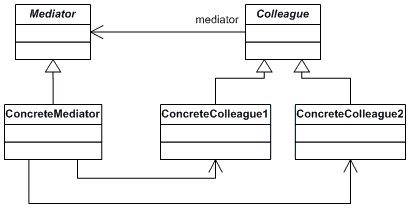

# C# Mediator Design Pattern

> **分類**：Behavioral Patterns（行為型模式）  
> **使用頻率 (Frequency of use)**：中低 (Medium-Low)  
> **原文連結**：[https://www.dofactory.com/net/mediator-design-pattern](https://www.dofactory.com/net/mediator-design-pattern)

---

## 定義與概述 (Definition)

**Mediator** Design Pattern 定義了一個物件，用來封裝一組物件之間的互動方式。Mediator 藉由避免物件之間明確地互相參考（Referring），促進了鬆散耦合（Loose Coupling），並讓你可以獨立地改變它們之間的互動。

**Mediator** Design Pattern 的 C# 程式碼範例提供以下 3 種形式：
- [結構化程式碼 (Structural code)](#structural-code-in-c-結構化程式碼)
- [真實世界程式碼 (Real-world code)](#real-world-code-in-c-真實世界程式碼)
- [.NET 最佳化程式碼 (.NET optimized code)](#net-optimized-code-in-c-net-最佳化程式碼)

---

## UML 類別圖 (UML Class Diagram)

以下是參與此 Pattern 的類別與物件之視覺化關係圖：



---

## 參與者 (Participants)

參與此 Pattern 的類別與物件包括：

- **Mediator** (`IChatroom`)
  - 定義一個用於與各個 `Colleague`（同仁）物件進行通訊的介面。
- **ConcreteMediator** (`Chatroom`)
  - 透過協調各個 `Colleague` 物件來實作協同合作的行為。
  - 認識並維護其所有的 `Colleague` 物件。
- **Colleague classes** (`Participant`)
  - 每一個 `Colleague` 類別都知道它的 `Mediator` 物件。
  - 每當一個 `Colleague` 需要與另一個 `Colleague` 通訊時，都會改為透過其 `Mediator` 進行通訊。

---

## Structural code in C# (結構化程式碼)

這段結構化（Structural）程式碼示範了 Mediator Pattern 如何促進不同物件與不同物件型別之間的鬆散耦合通訊。Mediator（中介者）是一個中央樞紐（Central Hub），所有的互動都必須透過它來進行。

```csharp
using System;

namespace Mediator.Structural
{
    /// <summary>
    /// Mediator Design Pattern
    /// </summary>

    public class Program
    {
        public static void Main(string[] args)
        {
            ConcreteMediator m = new ConcreteMediator();

            ConcreteColleague1 c1 = new ConcreteColleague1(m);
            ConcreteColleague2 c2 = new ConcreteColleague2(m);

            m.Colleague1 = c1;
            m.Colleague2 = c2;

            c1.Send("How are you?");
            c2.Send("Fine, thanks");

            // Wait for user

            Console.ReadKey();
        }
    }

    /// <summary>
    /// The 'Mediator' abstract class
    /// </summary>

    public abstract class Mediator
    {
        public abstract void Send(string message,
            Colleague colleague);
    }

    /// <summary>
    /// The 'ConcreteMediator' class
    /// </summary>

    public class ConcreteMediator : Mediator
    {
        ConcreteColleague1 colleague1;
        ConcreteColleague2 colleague2;

        public ConcreteColleague1 Colleague1
        {
            set { colleague1 = value; }
        }

        public ConcreteColleague2 Colleague2
        {
            set { colleague2 = value; }
        }

        public override void Send(string message, Colleague colleague)
        {
            if (colleague == colleague1)
            {
                colleague2.Notify(message);
            }
            else
            {
                colleague1.Notify(message);
            }
        }
    }

    /// <summary>
    /// The 'Colleague' abstract class
    /// </summary>

    public abstract class Colleague
    {
        protected Mediator mediator;

        // Constructor

        public Colleague(Mediator mediator)
        {
            this.mediator = mediator;
        }
    }

    /// <summary>
    /// A 'ConcreteColleague' class
    /// </summary>

    public class ConcreteColleague1 : Colleague
    {
        // Constructor

        public ConcreteColleague1(Mediator mediator)
            : base(mediator)
        {
        }

        public void Send(string message)
        {
            mediator.Send(message, this);
        }

        public void Notify(string message)
        {
            Console.WriteLine("Colleague1 gets message: "
                + message);
        }
    }

    /// <summary>
    /// A 'ConcreteColleague' class
    /// </summary>

    public class ConcreteColleague2 : Colleague
    {
        // Constructor

        public ConcreteColleague2(Mediator mediator)
            : base(mediator)
        {
        }

        public void Send(string message)
        {
            mediator.Send(message, this);
        }

        public void Notify(string message)
        {
            Console.WriteLine("Colleague2 gets message: "
                + message);
        }
    }
}
```

### 輸出結果 (Output)

```text
Colleague2 gets message: How are you?

  Colleague1 gets message: Fine, thanks
```

---

## Real-world code in C# (真實世界程式碼)

這段真實世界（Real-world）程式碼示範了 Mediator Pattern 如何促進註冊到同一個聊天室（`Chatroom`）的不同參與者（`Participant`）之間的鬆散耦合通訊。`Chatroom` 是所有通訊發生的中央樞紐。目前在此範例中僅實作了一對一（One-to-one）通訊，但若要改為一對多（One-to-many）通訊也是非常容易的。

```csharp
using System;
using System.Collections.Generic;

namespace Mediator.RealWorld
{
    /// <summary>
    /// Mediator Design Pattern
    /// </summary>

    public class Program
    {
        public static void Main(string[] args)
        {
            // Create chatroom

            Chatroom chatroom = new Chatroom();

            // Create participants and register them

            Participant George = new Beatle("George");
            Participant Paul = new Beatle("Paul");
            Participant Ringo = new Beatle("Ringo");
            Participant John = new Beatle("John");
            Participant Yoko = new NonBeatle("Yoko");

            chatroom.Register(George);
            chatroom.Register(Paul);
            chatroom.Register(Ringo);
            chatroom.Register(John);
            chatroom.Register(Yoko);

            // Chatting participants

            Yoko.Send("John", "Hi John!");
            Paul.Send("Ringo", "All you need is love");
            Ringo.Send("George", "My sweet Lord");
            Paul.Send("John", "Can't buy me love");
            John.Send("Yoko", "My sweet love");

            // Wait for user

            Console.ReadKey();
        }
    }

    /// <summary>
    /// The 'Mediator' abstract class
    /// </summary>

    public abstract class AbstractChatroom
    {
        public abstract void Register(Participant participant);
        public abstract void Send(
            string from, string to, string message);
    }

    /// <summary>
    /// The 'ConcreteMediator' class
    /// </summary>

    public class Chatroom : AbstractChatroom
    {
        private Dictionary<string, Participant> participants = new Dictionary<string, Participant>();

        public override void Register(Participant participant)
        {
            if (!participants.ContainsValue(participant))
            {
                participants[participant.Name] = participant;
            }

            participant.Chatroom = this;
        }

        public override void Send(string from, string to, string message)
        {
            Participant participant = participants[to];

            if (participant != null)
            {
                participant.Receive(from, message);
            }
        }
    }

    /// <summary>
    /// The 'AbstractColleague' class
    /// </summary>

    public class Participant
    {
        Chatroom chatroom;
        string name;

        // Constructor

        public Participant(string name)
        {
            this.name = name;
        }

        // Gets participant name

        public string Name
        {
            get { return name; }
        }

        // Gets chatroom

        public Chatroom Chatroom
        {
            set { chatroom = value; }
            get { return chatroom; }
        }

        // Sends message to given participant

        public void Send(string to, string message)
        {
            chatroom.Send(name, to, message);
        }

        // Receives message from given participant

        public virtual void Receive(
            string from, string message)
        {
            Console.WriteLine("{0} to {1}: '{2}'",
                from, Name, message);
        }
    }

    /// <summary>
    /// A 'ConcreteColleague' class
    /// </summary>

    public class Beatle : Participant
    {
        // Constructor

        public Beatle(string name)
            : base(name)
        {
        }

        public override void Receive(string from, string message)
        {
            Console.Write("To a Beatle: ");
            base.Receive(from, message);
        }
    }

    /// <summary>
    /// A 'ConcreteColleague' class
    /// </summary>

    public class NonBeatle : Participant
    {
        // Constructor
        public NonBeatle(string name)
            : base(name)
        {
        }

        public override void Receive(string from, string message)
        {
            Console.Write("To a non-Beatle: ");
            base.Receive(from, message);
        }
    }
}
```

### 輸出結果 (Output)

```text
To a Beatle: Yoko to John: 'Hi John!'

  To a Beatle: Paul to Ringo: 'All you need is love'

  To a Beatle: Ringo to George: 'My sweet Lord'

  To a Beatle: Paul to John: 'Can't buy me love'

  To a non-Beatle: John to Yoko: 'My sweet love'
```

---

## .NET Optimized code in C# (.NET 最佳化程式碼)

這段 .NET 最佳化（.NET Optimized）程式碼示範了與上述相同的邏輯，但採用了更現代化的 C# 與 .NET 功能（例如 Primary Constructors 與字典索引）。這是一個優雅的 C# Mediator 解決方案。

```csharp
namespace Mediator.NetOptimized;

using static System.Console;
using System.Collections.Generic;

/// <summary>
/// Mediator Design Pattern
/// </summary>
public class Program
{
    public static void Main()
    {
        // Create chatroom participants
        var George = new Beatle { Name = "George" };
        var Paul = new Beatle { Name = "Paul" };
        var Ringo = new Beatle { Name = "Ringo" };
        var John = new Beatle { Name = "John" };
        var Yoko = new NonBeatle { Name = "Yoko" };

        // Create chatroom and register participants
        var chatroom = new Chatroom();
        chatroom.Register(George);
        chatroom.Register(Paul);
        chatroom.Register(Ringo);
        chatroom.Register(John);
        chatroom.Register(Yoko);

        // Chatting participants
        Yoko.Send("John", "Hi John!");
        Paul.Send("Ringo", "All you need is love");
        Ringo.Send("George", "My sweet Lord");
        Paul.Send("John", "Can't buy me love");
        John.Send("Yoko", "My sweet love");

        // Wait for user
        ReadKey();
    }
}

/// <summary>
/// The 'Mediator' interface
/// </summary>
public interface IChatroom
{
    void Register(Participant participant);
    void Send(string from, string to, string message);
}

/// <summary>
/// The 'ConcreteMediator' class
/// </summary>
public class Chatroom : IChatroom
{
    private readonly Dictionary<string, Participant> participants = [];

    public void Register(Participant participant)
    {
        participants.TryAdd(participant.Name, participant);
        participant.Chatroom = this;
    }

    public void Send(string from, string to, string message)
    {
        var participant = participants[to];
        if (participant != null)
        {
            participant.Receive(from, message);
        }
    }
}

/// <summary>
/// The 'AbstractColleague' class
/// </summary>
public class Participant
{
    // Gets or sets participant name
    public string Name { get; set; } = null!;

    // Gets or sets chatroom
    public Chatroom Chatroom { get; set; } = null!;

    // Send a message to given participant
    public void Send(string to, string message)
    {
        Chatroom.Send(Name, to, message);
    }

    // Receive message from participant
    public virtual void Receive(string from, string message)
    {
        WriteLine($"{from} to {Name}: '{message}'");
    }
}

/// <summary>
/// A 'ConcreteColleague' class
/// </summary>
public class Beatle : Participant
{
    public override void Receive(string from, string message)
    {
        Write("To a Beatle: ");
        base.Receive(from, message);
    }
}

/// <summary>
/// A 'ConcreteColleague' class
/// </summary>
public class NonBeatle : Participant
{
    public override void Receive(string from, string message)
    {
        Write("To a non-Beatle: ");
        base.Receive(from, message);
    }
}
```

### 輸出結果 (Output)

```text
To a Beatle: Yoko to John: 'Hi John!'

    To a Beatle: Paul to Ringo: 'All you need is love'

    To a Beatle: Ringo to George: 'My sweet Lord'

    To a Beatle: Paul to John: 'Can't buy me love'

    To a non-Beatle: John to Yoko: 'My sweet love'
```

---

## 導覽 (Navigation)

| 上一篇 | 總覽 | 下一篇 |
| :--- | :---: | ---: |
| [← 上一篇：Iterator](Iterator.md) | [🏠 C# Design Patterns 總覽](Index.md) | [下一篇：Memento →](Memento.md) |
