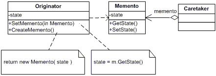

# C# Memento Design Pattern

> **分類**：Behavioral Patterns（行為型模式）  
> **使用頻率 (Frequency of use)**：低 (Low)  
> **原文連結**：[https://www.dofactory.com/net/memento-design-pattern](https://www.dofactory.com/net/memento-design-pattern)

---

## 定義與概述 (Definition)

**Memento** Design Pattern 在不違反封裝（Encapsulation）的前提下，捕捉並將物件的內部狀態外部化（Externalizes），以便該物件稍後可以還原（Restored）到此狀態。

**Memento** Design Pattern 的 C# 程式碼範例提供以下 3 種形式：
- [結構化程式碼 (Structural code)](#structural-code-in-c-結構化程式碼)
- [真實世界程式碼 (Real-world code)](#real-world-code-in-c-真實世界程式碼)
- [.NET 最佳化程式碼 (.NET optimized code)](#net-optimized-code-in-c-net-最佳化程式碼)

---

## UML 類別圖 (UML Class Diagram)

以下是參與此 Pattern 的類別與物件之視覺化關係圖：



---

## 參與者 (Participants)

參與此 Pattern 的類別與物件包括：

- **Memento** (`Memento`)
  - 儲存發起者（`Originator`）物件的內部狀態。根據 `Originator` 的決定，Memento 可以儲存所需之多或少的 `Originator` 內部狀態。
  - 防止 `Originator` 以外的其他物件存取其內容。Memento 實際上擁有兩個介面：`Caretaker`（保管者）只能看到 Memento 的窄介面（Narrow Interface）——它只能將 Memento 傳遞給其他物件；相反地，`Originator` 可以看到寬介面（Wide Interface），讓它可以存取將自身還原至先前狀態所需的所有資料。理想情況下，只有產生該 Memento 的 `Originator` 才被允許存取該 Memento 的內部狀態。
- **Originator** (`SalesProspect`)
  - 建立一個包含其目前內部狀態快照（Snapshot）的 Memento。
  - 使用 Memento 來還原其內部狀態。
- **Caretaker** (`Caretaker` / `ProspectMemory`)
  - 負責妥善保管 Memento。
  - 絕不對 Memento 的內容進行操作或檢查。

---

## Structural code in C# (結構化程式碼)

這段結構化（Structural）程式碼示範了 Memento Pattern 如何暫時儲存並還原另一個物件的內部狀態。

```csharp
using System;

namespace Memento.Structural
{
    /// <summary>
    /// Memento Design Pattern
    /// </summary>

    public class Program
    {
        public static void Main(string[] args)
        {
            Originator o = new Originator();
            o.State = "On";

            // Store internal state

            Caretaker c = new Caretaker();
            c.Memento = o.CreateMemento();

            // Continue changing originator

            o.State = "Off";

            // Restore saved state

            o.SetMemento(c.Memento);

            // Wait for user

            Console.ReadKey();
        }
    }

    /// <summary>
    /// The 'Originator' class
    /// </summary>

    public class Originator
    {
        string state;

        public string State
        {
            get { return state; }
            set
            {
                state = value;
                Console.WriteLine("State = " + state);
            }
        }

        // Creates memento 

        public Memento CreateMemento()
        {
            return (new Memento(state));
        }

        // Restores original state

        public void SetMemento(Memento memento)
        {
            Console.WriteLine("Restoring state...");
            State = memento.State;
        }
    }

    /// <summary>
    /// The 'Memento' class
    /// </summary>

    public class Memento
    {
        string state;

        // Constructor

        public Memento(string state)
        {
            this.state = state;
        }

        public string State
        {
            get { return state; }
        }
    }

    /// <summary>
    /// The 'Caretaker' class
    /// </summary>

    public class Caretaker
    {
        Memento memento;

        public Memento Memento
        {
            set { memento = value; }
            get { return memento; }
        }
    }
}
```

### 輸出結果 (Output)

```text
State = On

  State = Off

  Restoring state:

  State = On
```

---

## Real-world code in C# (真實世界程式碼)

這段真實世界（Real-world）程式碼示範了 Memento Pattern 如何暫時儲存並隨後還原潛在客戶（`SalesProspect`）的內部狀態。

```csharp
using System;

namespace Memento.RealWorld
{
    /// <summary>
    /// Memento Design Pattern
    /// </summary>

    public class Program
    {
        public static void Main(string[] args)
        {
            SalesProspect s = new SalesProspect();
            s.Name = "Noel van Halen";
            s.Phone = "(412) 256-0990";
            s.Budget = 25000.0;

            // Store internal state

            ProspectMemory m = new ProspectMemory();
            m.Memento = s.SaveMemento();

            // Continue changing originator

            s.Name = "Leo Welch";
            s.Phone = "(310) 209-7111";
            s.Budget = 1000000.0;

            // Restore saved state

            s.RestoreMemento(m.Memento);

            // Wait for user

            Console.ReadKey();
        }
    }

    /// <summary>
    /// The 'Originator' class
    /// </summary>

    public class SalesProspect
    {
        string name;
        string phone;
        double budget;

        // Gets or sets name

        public string Name
        {
            get { return name; }
            set
            {
                name = value;
                Console.WriteLine("Name:   " + name);
            }
        }

        // Gets or sets phone

        public string Phone
        {
            get { return phone; }
            set
            {
                phone = value;
                Console.WriteLine("Phone:  " + phone);
            }
        }

        // Gets or sets budget

        public double Budget
        {
            get { return budget; }
            set
            {
                budget = value;
                Console.WriteLine("Budget: " + budget);
            }
        }

        // Stores memento

        public Memento SaveMemento()
        {
            Console.WriteLine("\nSaving state --\n");
            return new Memento(name, phone, budget);
        }

        // Restores memento

        public void RestoreMemento(Memento memento)
        {
            Console.WriteLine("\nRestoring state --\n");
            Name = memento.Name;
            Phone = memento.Phone;
            Budget = memento.Budget;
        }
    }

    /// <summary>
    /// The 'Memento' class
    /// </summary>

    public class Memento
    {
        string name;
        string phone;
        double budget;

        // Constructor

        public Memento(string name, string phone, double budget)
        {
            this.name = name;
            this.phone = phone;
            this.budget = budget;
        }

        public string Name
        {
            get { return name; }
            set { name = value; }
        }

        public string Phone
        {
            get { return phone; }
            set { phone = value; }
        }

        public double Budget
        {
            get { return budget; }
            set { budget = value; }
        }
    }

    /// <summary>
    /// The 'Caretaker' class
    /// </summary>

    public class ProspectMemory
    {
        Memento memento;

        public Memento Memento
        {
            set { memento = value; }
            get { return memento; }
        }
    }
}
```

### 輸出結果 (Output)

```text
Name:   Noel van Halen

  Phone:  (412) 256-0990

  Budget: 25000

  

  Saving state --

  

  Name:   Leo Welch

  Phone:  (310) 209-7111

  Budget: 1000000

  

  Restoring state --

  

  Name:   Noel van Halen

  Phone:  (412) 256-0990

  Budget: 25000
```

---

## .NET Optimized code in C# (.NET 最佳化程式碼)

這段 .NET 最佳化（.NET Optimized）程式碼示範了與上述相同的邏輯，但採用了更現代化的 C# 與 .NET 功能（例如透過 `System.Text.Json.JsonSerializer` 將狀態序列化與反序列化）。這是一個優雅的 C# Memento 解決方案。

```csharp
namespace Memento.NetOptimized;

using System.Text.Json;
using static System.Console;

/// <summary>
/// Memento Design Pattern
/// </summary>
public class Program
{
    public static void Main()
    {
        // Init sales prospect through object initialization
        var s = new SalesProspect
        {
            Name = "Joel van Halen",
            Phone = "(412) 256-0990",
            Budget = 25000.0
        };

        // Store internal state
        var m = new ProspectMemory(s.SaveMemento());

        // Change originator
        s.Name = "Leo Welch";
        s.Phone = "(310) 209-7111";
        s.Budget = 1000000.0;

        // Restore saved state
        s.RestoreMemento(m.Memento);

        // Wait for user
        ReadKey();
    }
}

/// <summary>
/// The 'Originator' class
/// </summary>
public class SalesProspect
{
    private string name = null!;
    private string phone = null!;
    private double budget;

    // Gets or sets name
    public string Name
    {
        get => name; 
        set
        {
            name = value;
            WriteLine("Name:   " + name);
        }
    }

    // Gets or sets phone
    public string Phone
    {
        get => phone;
        set
        {
            phone = value;
            WriteLine("Phone:  " + phone);
        }
    }

    // Gets or sets budget
    public double Budget
    {
        get => budget;
        set
        {
            budget = value;
            WriteLine("Budget: " + budget);
        }
    }

    // Stores (serializes) memento
    public Memento SaveMemento()
    {
        WriteLine("\nSaving state --\n");

        var memento = new Memento();
        return memento.Serialize(this);
    }

    // Restores (deserializes) memento
    public void RestoreMemento(Memento memento)
    {
        WriteLine("\nRestoring state --\n");

        var s = (SalesProspect)memento.Deserialize();
        Name = s.Name;
        Phone = s.Phone;
        Budget = s.Budget;
    }
}

/// <summary>
/// The 'Memento' class
/// </summary>
public class Memento
{
    private string store = null!;

    public Memento Serialize(object o)
    {
        store = JsonSerializer.Serialize(o);
        return this;
    }

    public object Deserialize()
    {
        return JsonSerializer.Deserialize<SalesProspect>(store)!;
    }
}

/// <summary>
/// The 'Caretaker' class
/// </summary>
public record ProspectMemory (Memento Memento);
```

### 輸出結果 (Output)

```text
Name:   Noel van Halen

    Phone:  (412) 256-0990

    Budget: 25000

    

    Saving state --

    

    Name:   Leo Welch

    Phone:  (310) 209-7111

    Budget: 1000000

    

    Restoring state --

    

    Name:   Noel van Halen

    Phone:  (412) 256-0990

    Budget: 25000
```

---

## 導覽 (Navigation)

| 上一篇 | 總覽 | 下一篇 |
| :--- | :---: | ---: |
| [← 上一篇：Mediator](Mediator.md) | [🏠 C# Design Patterns 總覽](Index.md) | [下一篇：Observer →](Observer.md) |
