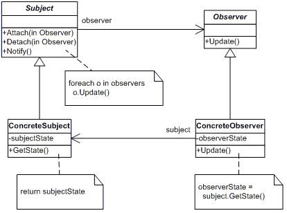

# C# Observer Design Pattern

> **分類**：Behavioral Patterns（行為型模式）  
> **使用頻率 (Frequency of use)**：高 (High)  
> **原文連結**：[https://www.dofactory.com/net/observer-design-pattern](https://www.dofactory.com/net/observer-design-pattern)

---

## 定義與概述 (Definition)

**Observer** Design Pattern 在物件之間定義了一對多（One-to-many）的相依關係，使得當一個物件改變狀態時，所有相依於它的物件都會自動收到通知並進行更新。

**Observer** Design Pattern 的 C# 程式碼範例提供以下 3 種形式：
- [結構化程式碼 (Structural code)](#structural-code-in-c-結構化程式碼)
- [真實世界程式碼 (Real-world code)](#real-world-code-in-c-真實世界程式碼)
- [.NET 最佳化程式碼 (.NET optimized code)](#net-optimized-code-in-c-net-最佳化程式碼)

---

## UML 類別圖 (UML Class Diagram)

以下是參與此 Pattern 的類別與物件之視覺化關係圖：



---

## 參與者 (Participants)

參與此 Pattern 的類別與物件包括：

- **Subject** (`Stock`)
  - 認識它的觀察者（Observers）。可以有任意數量的 `Observer` 物件同時觀察一個 `Subject`。
  - 提供一個用於附加（Attaching）與分離（Detaching）`Observer` 物件的介面。
- **ConcreteSubject** (`IBM`)
  - 儲存 `ConcreteObserver` 感興趣的狀態。
  - 當其狀態改變時，向它的觀察者發送通知。
- **Observer** (`IInvestor`)
  - 為那些在 `Subject` 狀態改變時應該收到通知的物件定義一個更新介面（Updating Interface）。
- **ConcreteObserver** (`Investor`)
  - 維護一個指向 `ConcreteSubject` 物件的參考。
  - 儲存應該與 `Subject` 保持一致的狀態。
  - 實作 `Observer` 的更新介面，以確保其自身狀態與 `Subject` 的狀態保持一致。

---

## Structural code in C# (結構化程式碼)

這段結構化（Structural）程式碼示範了 Observer Pattern 如何讓已註冊的物件在狀態改變時收到通知並進行更新。

```csharp
using System;
using System.Collections.Generic;

namespace Observer.Structural
{
    /// <summary>
    /// Observer Design Pattern
    /// </summary>

    public class Program
    {
        public static void Main(string[] args)
        {
            // Configure Observer pattern

            ConcreteSubject s = new ConcreteSubject();

            s.Attach(new ConcreteObserver(s, "X"));
            s.Attach(new ConcreteObserver(s, "Y"));
            s.Attach(new ConcreteObserver(s, "Z"));

            // Change subject and notify observers

            s.SubjectState = "ABC";
            s.Notify();

            // Wait for user

            Console.ReadKey();
        }
    }

    /// <summary>
    /// The 'Subject' abstract class
    /// </summary>

    public abstract class Subject
    {
        private List<Observer> observers = new List<Observer>();

        public void Attach(Observer observer)
        {
            observers.Add(observer);
        }

        public void Detach(Observer observer)
        {
            observers.Remove(observer);
        }

        public void Notify()
        {
            foreach (Observer o in observers)
            {
                o.Update();
            }
        }
    }

    /// <summary>
    /// The 'ConcreteSubject' class
    /// </summary>

    public class ConcreteSubject : Subject
    {
        private string subjectState;

        // Gets or sets subject state

        public string SubjectState
        {
            get { return subjectState; }
            set { subjectState = value; }
        }
    }

    /// <summary>
    /// The 'Observer' abstract class
    /// </summary>

    public abstract class Observer
    {
        public abstract void Update();
    }

    /// <summary>
    /// The 'ConcreteObserver' class
    /// </summary>

    public class ConcreteObserver : Observer
    {
        private string name;
        private string observerState;
        private ConcreteSubject subject;

        // Constructor

        public ConcreteObserver(
            ConcreteSubject subject, string name)
        {
            this.subject = subject;
            this.name = name;
        }

        public override void Update()
        {
            observerState = subject.SubjectState;
            Console.WriteLine("Observer {0}'s new state is {1}",
                name, observerState);
        }

        // Gets or sets subject

        public ConcreteSubject Subject
        {
            get { return subject; }
            set { subject = value; }
        }
    }
}
```

### 輸出結果 (Output)

```text
Observer X's new state is ABC

  Observer Y's new state is ABC

  Observer Z's new state is ABC
```

---

## Real-world code in C# (真實世界程式碼)

這段真實世界（Real-world）程式碼示範了 Observer Pattern 如何讓已註冊的投資人（`Investor`）在每次股票（`Stock`）價格變動時都收到通知。

```csharp
using System;
using System.Collections.Generic;

namespace Observer.RealWorld
{
    /// <summary>
    /// Observer Design Pattern
    /// </summary>

    public class Program
    {
        public static void Main(string[] args)
        {
            // Create IBM stock and attach investors

            IBM ibm = new IBM("IBM", 120.00);
            ibm.Attach(new Investor("Sorros"));
            ibm.Attach(new Investor("Berkshire"));

            // Fluctuating prices will notify investors

            ibm.Price = 120.10;
            ibm.Price = 121.00;
            ibm.Price = 120.50;
            ibm.Price = 120.75;

            // Wait for user

            Console.ReadKey();
        }
    }

    /// <summary>
    /// The 'Subject' abstract class
    /// </summary>

    public abstract class Stock
    {
        private string symbol;
        private double price;
        private List<IInvestor> investors = new List<IInvestor>();

        // Constructor

        public Stock(string symbol, double price)
        {
            this.symbol = symbol;
            this.price = price;
        }

        public void Attach(IInvestor investor)
        {
            investors.Add(investor);
        }

        public void Detach(IInvestor investor)
        {
            investors.Remove(investor);
        }

        public void Notify()
        {
            foreach (IInvestor investor in investors)
            {
                investor.Update(this);
            }

            Console.WriteLine("");
        }

        // Gets or sets the price

        public double Price
        {
            get { return price; }
            set
            {
                if (price != value)
                {
                    price = value;
                    Notify();
                }
            }
        }

        // Gets the symbol

        public string Symbol
        {
            get { return symbol; }
        }
    }

    /// <summary>
    /// The 'ConcreteSubject' class
    /// </summary>

    public class IBM : Stock
    {
        // Constructor

        public IBM(string symbol, double price)
            : base(symbol, price)
        {
        }
    }

    /// <summary>
    /// The 'Observer' interface
    /// </summary>

    public interface IInvestor
    {
        void Update(Stock stock);
    }

    /// <summary>
    /// The 'ConcreteObserver' class
    /// </summary>

    public class Investor : IInvestor
    {
        private string name;
        private Stock stock;

        // Constructor

        public Investor(string name)
        {
            this.name = name;
        }

        public void Update(Stock stock)
        {
            Console.WriteLine("Notified {0} of {1}'s " +
                "change to {2:C}", name, stock.Symbol, stock.Price);
        }

        // Gets or sets the stock

        public Stock Stock
        {
            get { return stock; }
            set { stock = value; }
        }
    }
}
```

### 輸出結果 (Output)

```text
Notified Sorros of IBM's change to $120.10

  Notified Berkshire of IBM's change to $120.10

  

  Notified Sorros of IBM's change to $121.00

  Notified Berkshire of IBM's change to $121.00

  

  Notified Sorros of IBM's change to $120.50

  Notified Berkshire of IBM's change to $120.50

  

  Notified Sorros of IBM's change to $120.75

  Notified Berkshire of IBM's change to $120.75
```

---

## .NET Optimized code in C# (.NET 最佳化程式碼)

這段 .NET 最佳化（.NET Optimized）程式碼示範了與上述相同的邏輯，但採用了更現代化的 C# 與 .NET 功能（例如 C# 原生的 `event` 與 `EventHandler<ChangeEventArgs>` 委派機制）。這是一個優雅的 C# Observer 解決方案。

```csharp
namespace Observer.NetOptimized;

using static System.Console;
using System;

/// <summary>
/// Observer Design Pattern
/// </summary>
public class Program
{
    public static void Main()
    {
        // Create IBM stock and attach investors
        var ibm = new IBM(120.00);

        // Attach 'listeners', i.e. Investors
        ibm.Attach(new Investor { Name = "Sorros" });
        ibm.Attach(new Investor { Name = "Berkshire" });

        // Fluctuating prices will notify listening investors
        ibm.Price = 120.10;
        ibm.Price = 121.00;
        ibm.Price = 120.50;
        ibm.Price = 120.75;

        // Wait for user
        ReadKey();
    }
}

// Custom event arguments
public class ChangeEventArgs : EventArgs
{
    // Gets or sets symbol
    public string Symbol { get; set; }

    // Gets or sets price
    public double Price { get; set; }
}

/// <summary>
/// The 'Subject' abstract class
/// </summary>
public abstract class Stock(string symbol, double price)
{
    protected string symbol = symbol;
    protected double price = price;

    // Event
    public event EventHandler<ChangeEventArgs> Change = null!;

    // Invoke the Change event
    public virtual void OnChange(ChangeEventArgs e)
    {
        Change?.Invoke(this, e);
    }

    public void Attach(IInvestor investor)
    {
        Change += investor.Update;
    }

    public void Detach(IInvestor investor)
    {
        Change -= investor.Update;
    }

    // Gets or sets the price
    public double Price
    {
        get => price; 
        set
        {
            if (price != value)
            {
                price = value;
                OnChange(new ChangeEventArgs { Symbol = symbol, Price = price });
                WriteLine("");
            }
        }
    }
}

/// <summary>
/// The 'ConcreteSubject' class
/// </summary>
public class IBM(double price) : Stock("IBM", price)
{
}

/// <summary>
/// The 'Observer' interface
/// </summary>
public interface IInvestor
{
    void Update(object sender, ChangeEventArgs e);
}

/// <summary>
/// The 'ConcreteObserver' class
/// </summary>
public class Investor : IInvestor
{
    // Gets or sets the investor name
    public string Name { get; set; } = null!;

    // Gets or sets the stock
    public Stock Stock { get; set; } = null!;

    public void Update(object sender, ChangeEventArgs e)
    {
        WriteLine("Notified {0} of {1}'s " +
            "change to {2:C}", Name, e.Symbol, e.Price);
    }
}
```

### 輸出結果 (Output)

```text
Notified Sorros of IBM's change to $120.10

    Notified Berkshire of IBM's change to $120.10

    

    Notified Sorros of IBM's change to $121.00

    Notified Berkshire of IBM's change to $121.00

    

    Notified Sorros of IBM's change to $120.50

    Notified Berkshire of IBM's change to $120.50

    

    Notified Sorros of IBM's change to $120.75

    Notified Berkshire of IBM's change to $120.75
```

---

## 導覽 (Navigation)

| 上一篇 | 總覽 | 下一篇 |
| :--- | :---: | ---: |
| [← 上一篇：Memento](Memento.md) | [🏠 C# Design Patterns 總覽](Index.md) | [下一篇：State →](State.md) |
