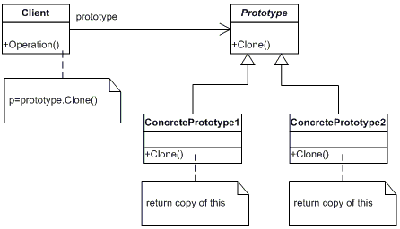

# C# Prototype Design Pattern

> **分類**：Creational Patterns（建立型模式）  
> **使用頻率 (Frequency of use)**：中 (Medium)  
> **原文連結**：[https://www.dofactory.com/net/prototype-design-pattern](https://www.dofactory.com/net/prototype-design-pattern)

---

## 定義與概述 (Definition)

**Prototype** Design Pattern 使用一個原型實例（Prototypical Instance）來指定要建立之物件的種類，並透過複製（Copying）這個原型來建立新的物件。

本篇分成兩個部分：

- **[現代 C# 實作](#現代-c-實作-net-11--c-15)**：可以直接建置與執行的範例專案，建議由此開始閱讀。
- **[附錄：Dofactory 原版範例](#附錄dofactory-原版範例)**：Structural、Real-world、.NET Optimized 三種原版程式碼，作為對照。

---

## 問題情境 (Problem)

調色盤裡有幾個基準色，新的顏色常常是「某個基準色稍微改一點」。不使用 Prototype 時，複製要自己一個欄位一個欄位地抄：

```csharp
// 示意：手動逐欄位複製，欄位一增加就容易漏掉
var pink = new Color(red.Red, red.Green, red.Blue);
pink.Green = 192;
pink.Blue = 203;
```

- 複製的程式碼散落在各處，類別新增欄位時，每一處都要記得修改。
- 呼叫端必須知道物件的具體型別才能 `new`。

Prototype 把「複製自己」變成物件本身的能力。在 C# 中，`record` 已經內建這項能力。

---

## UML 類別圖 (UML Class Diagram)

以下是參與此 Pattern 的類別與物件之視覺化關係圖：



---

## 參與者 (Participants)

參與此 Pattern 的類別與物件包括：

> 括號內是 Dofactory 原版範例（見附錄）使用的類別名稱。現代 C# 實作中各角色對應的型別，請見下一節開頭的「角色對照」。

- **Prototype** (`ColorPrototype`)
  - 宣告一個用於複製（Cloning）自身的介面。
- **ConcretePrototype** (`Color`)
  - 實作一個用於複製自身的操作。
- **Client** (`ColorManager`)
  - 透過要求一個原型（Prototype）複製自身來建立新物件。

---

## 現代 C# 實作 (.NET 11 / C# 15)

> **範例專案**：[samples/Prototype](samples/Prototype)  
> **執行方式**：`dotnet run --project samples/Prototype`

**角色對照**：Prototype = `Color`、`Gradient`（`record` 內建複製能力）；原型註冊表 = `ColorPalette`；Client = 最上方的程式碼。

<!-- sample:Prototype/Program.cs -->
```csharp
// Prototype：先準備好「樣板物件」，需要新物件時複製樣板再微調，而不是從頭建立。

// 原型註冊表：把常用的樣板集中管理
var palette = new ColorPalette();
palette.Register("red", new Color(255, 0, 0));
palette.Register("green", new Color(0, 255, 0));

// record 的 with 運算式 = 複製一份，同時改掉指定的屬性
Color red = palette.Clone("red");
Color pink = palette.Clone("red") with { Green = 192, Blue = 203 };
Console.WriteLine($"red  = {red}");
Console.WriteLine($"pink = {pink}");

Color anotherRed = palette.Clone("red");
Console.WriteLine($"Same value: {red == anotherRed}, same instance: {ReferenceEquals(red, anotherRed)}");

// 陷阱：with 是「淺複製」。成員若是可變的參考型別（例如 List），複製品和本尊會共用同一個物件
var sunset = new Gradient("sunset", [new Color(255, 94, 77), new Color(255, 195, 113)]);
Gradient shallow = sunset with { Name = "shallow copy" };
shallow.Stops.Add(new Color(0, 0, 0));
Console.WriteLine($"Added a stop to the shallow copy -> the original now has {sunset.Stops.Count} stops (it started with 2)");

// 解法：需要完全獨立的複製品時，自己提供深複製
Gradient deep = sunset.DeepCopy() with { Name = "deep copy" };
deep.Stops.Clear();
Console.WriteLine($"Cleared the deep copy -> the original still has {sunset.Stops.Count} stops");

// ---- Prototype：record 由編譯器自動產生複製用的建構函式 ----
public sealed record Color(int Red, int Green, int Blue);

public sealed record Gradient(string Name, List<Color> Stops)
{
    // Color 本身不可變，所以只需要複製清單，不必再複製每一個 Color
    public Gradient DeepCopy() => this with { Stops = [.. Stops] };
}

// ---- Prototype Registry ----
public sealed class ColorPalette
{
    private readonly Dictionary<string, Color> _prototypes = new();

    public void Register(string name, Color prototype) => _prototypes[name] = prototype;

    // with { } 不改任何屬性，等於「原樣複製一份」
    public Color Clone(string name) => _prototypes[name] with { };
}
```
<!-- /sample -->

### 輸出結果 (Output)

<!-- output:Prototype -->
```text
red  = Color { Red = 255, Green = 0, Blue = 0 }
pink = Color { Red = 255, Green = 192, Blue = 203 }
Same value: True, same instance: False
Added a stop to the shallow copy -> the original now has 3 stops (it started with 2)
Cleared the deep copy -> the original still has 3 stops
```
<!-- /output -->

### 重點解說

- **`record` 內建複製**：編譯器會替 `record` 產生複製用的建構函式。`with { }` 會複製一份，大括號內可以同時指定要修改的屬性，原本的物件不會被改動。
- **值相等與參考相等**：`red == anotherRed` 為 `True`，因為 `record` 以內容比較；`ReferenceEquals` 為 `False`，證明它們是兩個不同的物件（輸出第 3 行）。
- **淺複製的陷阱**：`with` 只複製欄位本身。`Gradient.Stops` 是一個 `List`，複製品拿到的是同一個清單的參考，所以修改複製品會連本尊一起改掉（輸出第 4 行）。
- **深複製要自己寫**：`DeepCopy()` 用 `[.. Stops]` 建立一個新的清單。由於 `Color` 不可變，不需要再逐一複製每個顏色。

---

## 與 Dofactory 原版的差異

- 原版 .NET Optimized 用 `JsonSerializer` 先序列化再反序列化來複製物件。這種做法比較慢，只複製得到可序列化的公開成員，而且型別必須能被反序列化。本版使用 `record` 內建的複製機制。
- 原版 Structural 與 Real-world 使用 `MemberwiseClone()`，它同樣是淺複製，但原版沒有說明淺複製的後果。本版特別示範這個陷阱與解法。

---

## .NET 中的對應 (In .NET)

- **`record` 與 `with` 運算式**：語言層級的 Prototype。
- **`ICloneable`**：這個介面存在，但 .NET 的設計指引不建議在公開 API 使用，因為它沒有規定 `Clone()` 是深複製還是淺複製。
- **淺複製的 API**：`Array.Clone()`、`new List<T>(source)`、`[.. source]`、`object.MemberwiseClone()` 都只複製第一層。

---

## 何時該用、何時不該用

**適合使用**

- 建立物件的成本高或設定繁瑣，而新物件與既有物件大同小異。
- 需要在不知道具體型別的情況下複製物件。

**不適合使用**

- 物件是不可變的：直接共用同一個實例即可，不需要複製。
- 物件之間的參考關係很深或有循環：深複製很難寫對，可以考慮改成不可變的設計。

---

## 練習題

1. 把 `Gradient.Stops` 的型別改成 `ImmutableList<Color>`（命名空間 `System.Collections.Immutable`）。淺複製的陷阱還存在嗎？`DeepCopy` 還需要嗎？
2. `ColorPalette.Clone` 找不到名稱時會丟出 `KeyNotFoundException`。改成丟出訊息包含顏色名稱的例外。
3. `Color` 是不可變的 `record`，`ColorPalette.Clone` 其實可以直接回傳同一個實例。這樣做有什麼好處？什麼情況下就不能這樣做？

---

## 附錄：Dofactory 原版範例

> 以下保留 Dofactory 網站的三種原版程式碼作為對照，點選標題即可展開。  
> 輸出結果是實際編譯並執行這些程式碼所得（執行時移除了會等待按鍵的 `Console.ReadKey()`，文化特性為 en-US）。  
> 原版使用較舊的 C# 寫法，撰寫新程式時請以上方的「現代 C# 實作」為準。

<details>
<summary><b>Structural code（結構化程式碼）</b></summary>

這段結構化（Structural）程式碼示範了 Prototype Pattern 如何透過複製相同類別中已存在的物件（原型，Prototypes）來建立新物件。

```csharp
using System;

namespace Prototype.Structural
{
    /// <summary>
    /// Prototype Design Pattern
    /// </summary>

    public class Program
    {
        public static void Main(string[] args)
        {
            // Create two instances and clone each

            ConcretePrototype1 p1 = new ConcretePrototype1("I");
            ConcretePrototype1 c1 = (ConcretePrototype1)p1.Clone();
            Console.WriteLine("Cloned: {0}", c1.Id);

            ConcretePrototype2 p2 = new ConcretePrototype2("II");
            ConcretePrototype2 c2 = (ConcretePrototype2)p2.Clone();
            Console.WriteLine("Cloned: {0}", c2.Id);

            // Wait for user

            Console.ReadKey();
        }
    }

    /// <summary>
    /// The 'Prototype' abstract class
    /// </summary>

    public abstract class Prototype
    {
        string id;

        // Constructor

        public Prototype(string id)
        {
            this.id = id;
        }

        // Gets id

        public string Id
        {
            get { return id; }
        }

        public abstract Prototype Clone();
    }

    /// <summary>
    /// A 'ConcretePrototype' class 
    /// </summary>

    public class ConcretePrototype1 : Prototype
    {
        // Constructor

        public ConcretePrototype1(string id)
            : base(id)
        {
        }

        // Returns a shallow copy

        public override Prototype Clone()
        {
            return (Prototype)this.MemberwiseClone();
        }
    }

    /// <summary>
    /// A 'ConcretePrototype' class 
    /// </summary>

    public class ConcretePrototype2 : Prototype
    {
        // Constructor

        public ConcretePrototype2(string id)
            : base(id)
        {
        }

        // Returns a shallow copy

        public override Prototype Clone()
        {
            return (Prototype)this.MemberwiseClone();
        }
    }
}
```

**輸出結果 (Output)**

```text
Cloned: I
Cloned: II
```

</details>

<details>
<summary><b>Real-world code（真實世界程式碼）</b></summary>

這段真實世界（Real-world）程式碼示範了 Prototype Pattern 如何透過複製已存在且由使用者自訂的同型別 `Color` 物件，來建立新的 `Color` 物件。

```csharp
using System;
using System.Collections.Generic;

namespace Prototype.RealWorld
{
    /// <summary>
    /// Prototype Design Pattern
    /// </summary>

    public class Program
    {
        public static void Main(string[] args)
        {
            ColorManager colormanager = new ColorManager();

            // Initialize with standard colors

            colormanager["red"] = new Color(255, 0, 0);
            colormanager["green"] = new Color(0, 255, 0);
            colormanager["blue"] = new Color(0, 0, 255);

            // User adds personalized colors

            colormanager["angry"] = new Color(255, 54, 0);
            colormanager["peace"] = new Color(128, 211, 128);
            colormanager["flame"] = new Color(211, 34, 20);

            // User clones selected colors

            Color color1 = colormanager["red"].Clone() as Color;
            Color color2 = colormanager["peace"].Clone() as Color;
            Color color3 = colormanager["flame"].Clone() as Color;

            // Wait for user

            Console.ReadKey();
        }
    }

    /// <summary>
    /// The 'Prototype' abstract class
    /// </summary>

    public abstract class ColorPrototype
    {
        public abstract ColorPrototype Clone();
    }

    /// <summary>
    /// The 'ConcretePrototype' class
    /// </summary>

    public class Color : ColorPrototype
    {
        int red;
        int green;
        int blue;

        // Constructor

        public Color(int red, int green, int blue)
        {
            this.red = red;
            this.green = green;
            this.blue = blue;
        }

        // Create a shallow copy

        public override ColorPrototype Clone()
        {
            Console.WriteLine(
                "Cloning color RGB: {0,3},{1,3},{2,3}",
                red, green, blue);

            return this.MemberwiseClone() as ColorPrototype;
        }
    }

    /// <summary>
    /// Prototype manager
    /// </summary>

    public class ColorManager
    {
        private Dictionary<string, ColorPrototype> colors =
            new Dictionary<string, ColorPrototype>();

        // Indexer

        public ColorPrototype this[string key]
        {
            get { return colors[key]; }
            set { colors.Add(key, value); }
        }
    }
}
```

**輸出結果 (Output)**

```text
Cloning color RGB: 255,  0,  0
Cloning color RGB: 128,211,128
Cloning color RGB: 211, 34, 20
```

</details>

<details>
<summary><b>.NET Optimized code（.NET 最佳化程式碼）</b></summary>

這段 .NET 最佳化（.NET Optimized）程式碼示範了與上述相同的邏輯，但採用了更現代化的 C# 與 .NET 功能（例如透過 `System.Text.Json.JsonSerializer` 進行深層複製 Deep Clone，以及使用 `ICloneable<T>` 泛型介面）。此版本的實作細節與限制，請見上方的〈與 Dofactory 原版的差異〉。

```csharp
namespace Prototype.NetOptimized;

using static System.Console;
using System.Text.Json;
using System.Collections.Generic;

/// <summary>
/// Prototype Design Pattern
/// </summary>
public class Program
{
    public static void Main()
    {
        var manager = new ColorManager();

        // Initialize with standard colors
        manager[ColorType.Red] = new Color { Red = 255, Blue = 0, Green = 0 };
        manager[ColorType.Green] = new Color { Red = 0, Blue = 255, Green = 0 };
        manager[ColorType.Blue] = new Color { Red = 0, Blue = 0, Green = 255 };

        // User adds personalized colors
        manager[ColorType.Angry] = new Color { Red = 255, Blue = 54, Green = 0 };
        manager[ColorType.Peace] = new Color { Red = 128, Blue = 211, Green = 128 };
        manager[ColorType.Flame] = new Color { Red = 211, Blue = 34, Green = 20 };

        // User uses selected colors
        _ = manager[ColorType.Red].Clone();
        _ = manager[ColorType.Peace].Clone();
        _ = manager[ColorType.Flame].Clone(false); // Deep Copy

        // Wait for user
        ReadKey();
    }
}
/// <summary>
/// ICloneable is not supported in .NET Core
/// </summary>
public interface ICloneableObject
{
    object Clone();
}

/// <summary>
/// The 'ConcretePrototype' class
/// </summary>
public class Color : ICloneableObject
{
    public byte Red { get; set; }
    public byte Green { get; set; }
    public byte Blue { get; set; }

    // Returns a shallow or a deep copy
    public object? Clone(bool shallow)
    {
        return shallow ? Clone() : DeepCopy();
    }

    // Creates a shallow copy
    public object Clone()
    {
        WriteLine(
            "Shallow copy of color RGB: {0,3},{1,3},{2,3}",
            Red, Green, Blue);

        return MemberwiseClone();
    }

    // Creates a deep copy
    public object? DeepCopy()
    {
        // use serialized to create a deep copy
        var serialized = JsonSerializer.Serialize(this);
        var copy = JsonSerializer.Deserialize<Color>(serialized);

        if (copy is not null)
        {
            WriteLine(
                "*Deep* copy of color RGB: {0,3},{1,3},{2,3}",
                (copy as Color).Red, (copy as Color).Green, (copy as Color).Blue
            );
        }

        return copy;
    }
}

/// <summary>
/// Type-safe prototype manager
/// </summary>
public record ColorManager
{
    private readonly Dictionary<ColorType, Color> colors = [];

    // Gets or sets color
    public Color this[ColorType type]
    {
        get => colors[type]; 
        set => colors.Add(type, value); 
    }
}

/// <summary>
/// Color type enumerations
/// </summary>
public enum ColorType
{
    Red,
    Green,
    Blue,

    Angry,
    Peace,
    Flame
}
```

**輸出結果 (Output)**

```text
Shallow copy of color RGB: 255,  0,  0
Shallow copy of color RGB: 128,128,211
*Deep* copy of color RGB: 211, 20, 34
```

</details>

---

## 導覽 (Navigation)

| 上一篇 | 總覽 | 下一篇 |
| :--- | :---: | ---: |
| [← 上一篇：Factory Method](FactoryMethod.md) | [🏠 C# Design Patterns 總覽](Index.md) | [下一篇：Singleton →](Singleton.md) |
