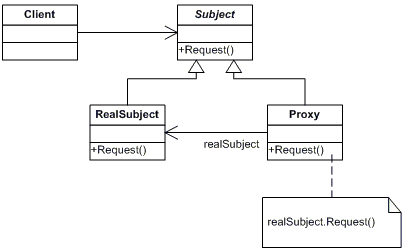

# C# Proxy Design Pattern

> **分類**：Structural Patterns（結構型模式）  
> **使用頻率 (Frequency of use)**：中高 (Medium-High)  
> **原文連結**：[https://www.dofactory.com/net/proxy-design-pattern](https://www.dofactory.com/net/proxy-design-pattern)

---

## 定義與概述 (Definition)

**Proxy** Design Pattern 為另一個物件提供一個替身（Surrogate）或佔位符（Placeholder），以控制對該物件的存取。

本篇分成兩個部分：

- **[現代 C# 實作](#現代-c-實作-net-11--c-15)**：可以直接建置與執行的範例專案，建議由此開始閱讀。
- **[附錄：Dofactory 原版範例](#附錄dofactory-原版範例)**：Structural、Real-world、.NET Optimized 三種原版程式碼，作為對照。

---

## 問題情境 (Problem)

`RemoteCalculator` 在建立時必須連線到遠端的計算服務，成本很高；我們還希望記錄每一次呼叫。但是：

- 不想修改 `RemoteCalculator`（它的責任只有計算）。
- 不想讓每個使用它的地方都自己處理「什麼時候連線」與「記錄呼叫」。

Proxy 是一個和真實物件介面完全相同的替身。呼叫端以為自己在使用真實物件，實際上每個呼叫都先經過 Proxy，由它決定何時建立真實物件、要不要轉交、轉交的前後要做什麼。

---

## UML 類別圖 (UML Class Diagram)

以下是參與此 Pattern 的類別與物件之視覺化關係圖：



---

## 參與者 (Participants)

參與此 Pattern 的類別與物件包括：

> 括號內是 Dofactory 原版範例（見附錄）使用的類別名稱。現代 C# 實作中各角色對應的型別，請見下一節開頭的「角色對照」。

- **Proxy** (`MathProxy`)
  - 維護一個參考（Reference），讓 Proxy 可以存取真實主體（`RealSubject`）。如果 `RealSubject` 與 `Subject` 的介面相同，`Proxy` 可以直接指向 `Subject`。
  - 提供一個與 `Subject` 完全相同的介面，以便在任何需要真實主體的地方都可以用 Proxy 來替代。
  - 控制對真實主體的存取，並可能負責建立與刪除它。
  - 其他職責取決於 Proxy 的類型：
    - *遠端代理（Remote Proxies）*：負責對請求及其引數（Arguments）進行編碼，並將編碼後的請求發送給位於不同位址空間（Address Space）中的真實主體。
    - *虛擬代理（Virtual Proxies）*：可以快取（Cache）關於真實主體的額外資訊，以便延遲對它的實際存取。例如，動機（Motivation）中的 `ImageProxy` 會快取真實圖片的尺寸範圍。
    - *保護代理（Protection Proxies）*：檢查呼叫者是否具備執行該請求所需的存取權限。
- **Subject** (`IMath`)
  - 為 `RealSubject` 與 `Proxy` 定義共同介面，使任何預期使用 `RealSubject` 的地方都可以使用 `Proxy`。
- **RealSubject** (`Math`)
  - 定義 `Proxy` 所代表的真實物件。

---

## 現代 C# 實作 (.NET 11 / C# 15)

> **範例專案**：[samples/Proxy](samples/Proxy)  
> **執行方式**：`dotnet run --project samples/Proxy`

**角色對照**：Subject = `ICalculator`；RealSubject = `RemoteCalculator`；Proxy = `CalculatorProxy`；Client = 最上方的程式碼。

<!-- sample:Proxy/Program.cs -->
```csharp
// Proxy：提供一個和真實物件「介面相同」的替身，在轉交呼叫的前後加上額外的控制。

ICalculator calculator = new CalculatorProxy();
Console.WriteLine("Proxy created. The real calculator has not been created yet.");

// 呼叫端使用 Proxy 的方式，和直接使用真實物件完全一樣
Console.WriteLine($"4 + 2 = {calculator.Add(4, 2)}");
Console.WriteLine($"4 * 2 = {calculator.Multiply(4, 2)}");
Console.WriteLine($"4 / 2 = {calculator.Divide(4, 2)}");

// ---- Subject：Proxy 與 RealSubject 共同的介面 ----
public interface ICalculator
{
    double Add(double x, double y);
    double Multiply(double x, double y);
    double Divide(double x, double y);
}

// ---- RealSubject：假設建立它的成本很高（例如要連線到遠端服務） ----
public sealed class RemoteCalculator : ICalculator
{
    public RemoteCalculator() => Console.WriteLine("  [RemoteCalculator] connecting to the math service...");

    public double Add(double x, double y) => x + y;
    public double Multiply(double x, double y) => x * y;
    public double Divide(double x, double y) => x / y;
}

// ---- Proxy：延後建立真實物件（Virtual Proxy），並記錄每一次呼叫 ----
public sealed class CalculatorProxy : ICalculator
{
    // Lazy<T>：第一次讀取 Value 時才執行建立動作，之後都回傳同一個物件
    private readonly Lazy<RemoteCalculator> _real = new(() => new RemoteCalculator());

    public double Add(double x, double y)
    {
        Log($"Add({x}, {y})");
        return _real.Value.Add(x, y);
    }

    public double Multiply(double x, double y)
    {
        Log($"Multiply({x}, {y})");
        return _real.Value.Multiply(x, y);
    }

    public double Divide(double x, double y)
    {
        Log($"Divide({x}, {y})");
        return _real.Value.Divide(x, y);
    }

    private static void Log(string call) => Console.WriteLine($"  [Proxy] {call}");
}
```
<!-- /sample -->

### 輸出結果 (Output)

<!-- output:Proxy -->
```text
Proxy created. The real calculator has not been created yet.
  [Proxy] Add(4, 2)
  [RemoteCalculator] connecting to the math service...
4 + 2 = 6
  [Proxy] Multiply(4, 2)
4 * 2 = 8
  [Proxy] Divide(4, 2)
4 / 2 = 2
```
<!-- /output -->

### 重點解說

- **建立 Proxy 時，真實物件還不存在**：對照輸出的前三行，`connecting...` 出現在第一次呼叫 `Add` 的時候，而且只出現一次。這種用途稱為 Virtual Proxy。
- **`Lazy<T>`**：把「第一次用到才建立，之後重複使用同一個」的邏輯交給 .NET 處理。
- **呼叫端只認得 `ICalculator`**：把 `new CalculatorProxy()` 換成 `new RemoteCalculator()`，其餘程式碼完全不用改。
- **與 Decorator 的差別**：兩者結構幾乎一樣，差別在目的。Proxy 控制對物件的「存取」（何時建立、能不能呼叫、實際在哪裡執行）；Decorator 是替物件「增加功能」，而且通常由呼叫端決定要包哪幾層。

---

## 與 Dofactory 原版的差異

- 原版的 `MathProxy` 在欄位初始化時就 `new Math()`，每個方法只是單純轉交呼叫，看不出 Proxy 的用途。本版示範延後建立與記錄呼叫。
- 原版把類別命名為 `Math`，與 `System.Math` 同名，容易造成混淆。本版改名為 `RemoteCalculator`。

---

## .NET 中的對應 (In .NET)

- **EF Core 消極式載入**：`UseLazyLoadingProxies()` 會產生繼承實體類別的 Proxy，第一次讀取導覽屬性時才查詢資料庫。
- **`System.Reflection.DispatchProxy`**：在執行期產生實作指定介面的 Proxy，不必為每個方法手寫轉交。
- **遠端代理**：gRPC 產生的用戶端類別、`HttpClient` 的 Typed Client、Refit，都讓遠端呼叫看起來像呼叫本地物件。

---

## 何時該用、何時不該用

**適合使用**

- 延後建立成本高的物件（Virtual Proxy）。
- 在呼叫前檢查權限（Protection Proxy）。
- 把遠端呼叫包裝成本地介面（Remote Proxy）。
- 快取呼叫結果。

**不適合使用**

- 物件建立成本低，也不需要任何存取控制：多一層只是增加閱讀成本。
- 介面的方法很多又常常變動：每個方法都要手寫轉交，可以考慮 `DispatchProxy` 或來源產生器。

---

## 練習題

1. 寫一個 `CachingCalculatorProxy`：以相同參數第二次呼叫 `Add` 時，直接回傳快取的結果，不呼叫真實物件。
2. 寫一個保護代理：`Divide` 的除數為 0 時丟出 `DivideByZeroException`，不轉交給真實物件。（`double` 除以 0 不會丟出例外，結果是 `Infinity`。）
3. 把 `ICalculator calculator = new CalculatorProxy();` 換成 `new RemoteCalculator()`，比較輸出的差異。

---

## 附錄：Dofactory 原版範例

> 以下保留 Dofactory 網站的三種原版程式碼作為對照，點選標題即可展開。  
> 輸出結果是實際編譯並執行這些程式碼所得（執行時移除了會等待按鍵的 `Console.ReadKey()`，文化特性為 en-US）。  
> 原版使用較舊的 C# 寫法，撰寫新程式時請以上方的「現代 C# 實作」為準。

<details>
<summary><b>Structural code（結構化程式碼）</b></summary>

這段結構化（Structural）程式碼示範了 Proxy Pattern 如何提供一個代表物件（Proxy），用來控制對另一個相似物件的存取。

```csharp
using System;

namespace Proxy.Structural
{
    /// <summary>
    /// Proxy Design Pattern
    /// </summary>

    public class Program
    {
        public static void Main(string[] args)
        {
            // Create proxy and request a service

            Proxy proxy = new Proxy();
            proxy.Request();

            // Wait for user

            Console.ReadKey();
        }
    }

    /// <summary>
    /// The 'Subject' abstract class
    /// </summary>

    public abstract class Subject
    {
        public abstract void Request();
    }

    /// <summary>
    /// The 'RealSubject' class
    /// </summary>

    public class RealSubject : Subject
    {
        public override void Request()
        {
            Console.WriteLine("Called RealSubject.Request()");
        }
    }

    /// <summary>
    /// The 'Proxy' class
    /// </summary>

    public class Proxy : Subject
    {
        private RealSubject realSubject;

        public override void Request()
        {
            // Use 'lazy initialization'

            if (realSubject == null)
            {
                realSubject = new RealSubject();
            }

            realSubject.Request();
        }
    }
}
```

**輸出結果 (Output)**

```text
Called RealSubject.Request()
```

</details>

<details>
<summary><b>Real-world code（真實世界程式碼）</b></summary>

這段真實世界（Real-world）程式碼示範了針對 `Math` 物件的 Proxy Pattern，該物件由一個 `MathProxy` 物件所代表。

```csharp
using System;

namespace Proxy.RealWorld
{
    /// <summary>
    /// Proxy Design Pattern
    /// </summary>

    public class Program
    {
        public static void Main(string[] args)
        {
            // Create math proxy

            MathProxy proxy = new MathProxy();

            // Do the math

            Console.WriteLine("4 + 2 = " + proxy.Add(4, 2));
            Console.WriteLine("4 - 2 = " + proxy.Sub(4, 2));
            Console.WriteLine("4 * 2 = " + proxy.Mul(4, 2));
            Console.WriteLine("4 / 2 = " + proxy.Div(4, 2));

            // Wait for user

            Console.ReadKey();
        }
    }

    /// <summary>
    /// The 'Subject interface
    /// </summary>

    public interface IMath
    {
        double Add(double x, double y);
        double Sub(double x, double y);
        double Mul(double x, double y);
        double Div(double x, double y);
    }

    /// <summary>
    /// The 'RealSubject' class
    /// </summary>

    public class Math : IMath
    {
        public double Add(double x, double y) { return x + y; }
        public double Sub(double x, double y) { return x - y; }
        public double Mul(double x, double y) { return x * y; }
        public double Div(double x, double y) { return x / y; }
    }

    /// <summary>
    /// The 'Proxy Object' class
    /// </summary>

    public class MathProxy : IMath
    {
        private Math math = new Math();

        public double Add(double x, double y)
        {
            return math.Add(x, y);
        }
        public double Sub(double x, double y)
        {
            return math.Sub(x, y);
        }
        public double Mul(double x, double y)
        {
            return math.Mul(x, y);
        }
        public double Div(double x, double y)
        {
            return math.Div(x, y);
        }
    }
}
```

**輸出結果 (Output)**

```text
4 + 2 = 6
4 - 2 = 2
4 * 2 = 8
4 / 2 = 2
```

</details>

<details>
<summary><b>.NET Optimized code（.NET 最佳化程式碼）</b></summary>

這段 .NET 最佳化（.NET Optimized）程式碼示範了與上述相同的邏輯，但採用了更現代化的 C# 與 .NET 功能（例如運算式主體方法 Expression-bodied Methods 與字串插值）。此版本的實作細節與限制，請見上方的〈與 Dofactory 原版的差異〉。

```csharp
namespace Proxy.NetOptimized;

using static System.Console;
using System.Threading;

/// <summary>
/// Proxy Design Pattern
/// </summary>
public class Program
{
    public static void Main()
    {
        // Create math proxy
        var proxy = new MathProxy();

        // Do the math
        WriteLine($"4 + 2 = {proxy.Add(4, 2)}");
        WriteLine($"4 - 2 = {proxy.Sub(4, 2)}");
        WriteLine($"4 * 2 = {proxy.Mul(4, 2)}");
        WriteLine($"4 / 2 = {proxy.Div(4, 2)}");

        // Wait for user
        ReadKey();
    }
}

/// <summary>
/// The 'Subject' interface
/// </summary>
public interface IMath
{
    double Add(double x, double y);
    double Sub(double x, double y);
    double Mul(double x, double y);
    double Div(double x, double y);
}

/// <summary>
/// The 'RealSubject' class
/// </summary>
public class Math : IMath
{
    public double Add(double x, double y) => x + y;
    public double Sub(double x, double y) => x - y;
    public double Mul(double x, double y) => x * y;
    public double Div(double x, double y) => x / y;
}

/// <summary>
/// The remote 'Proxy Object' class
/// </summary>
public class MathProxy : IMath
{
    private readonly Math math = new();

    public double Add(double x, double y)
    {
        Thread.Sleep(800);
        return math.Add(x, y);
    }

    public double Sub(double x, double y)
    {
        Thread.Sleep(800);
        return math.Sub(x, y);
    }

    public double Mul(double x, double y)
    {
        Thread.Sleep(800);
        return math.Mul(x, y);
    }

    public double Div(double x, double y)
    {
        Thread.Sleep(800);
        return math.Div(x, y);
    }
}
```

**輸出結果 (Output)**

```text
4 + 2 = 6
4 - 2 = 2
4 * 2 = 8
4 / 2 = 2
```

</details>

---

## 導覽 (Navigation)

| 上一篇 | 總覽 | 下一篇 |
| :--- | :---: | ---: |
| [← 上一篇：Flyweight](Flyweight.md) | [🏠 C# Design Patterns 總覽](Index.md) | [下一篇：Chain of Responsibility →](ChainOfResponsibility.md) |
