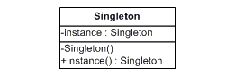

# C# Singleton Design Pattern

> **分類**：Creational Patterns（建立型模式）  
> **使用頻率 (Frequency of use)**：中高 (Medium-High)  
> **原文連結**：[https://www.dofactory.com/net/singleton-design-pattern](https://www.dofactory.com/net/singleton-design-pattern)

---

## 定義與概述 (Definition)

**Singleton** Design Pattern 確保一個類別只有一個實例（Instance），並提供一個存取它的全域存取點（Global Point of Access）。

本篇分成兩個部分：

- **[現代 C# 實作](#現代-c-實作-net-11--c-15)**：可以直接建置與執行的範例專案，建議由此開始閱讀。
- **[附錄：Dofactory 原版範例](#附錄dofactory-原版範例)**：Structural、Real-world、.NET Optimized 三種原版程式碼，作為對照。

---

## 問題情境 (Problem)

負載平衡器必須知道「下一個請求該交給哪一台伺服器」。如果每個模組各自建立一個，就會有好幾份互不相通的狀態：

```csharp
// 示意：每個地方各自 new，各自從第一台伺服器開始輪
var balancerA = new LoadBalancer();   // 訂單模組
var balancerB = new LoadBalancer();   // 付款模組
```

結果是第一台伺服器收到的請求比其他伺服器多，負載並沒有被平均分配。我們需要保證整個應用程式只有一個負載平衡器，而且每個地方拿到的都是同一個。

---

## UML 類別圖 (UML Class Diagram)

以下是參與此 Pattern 的類別與物件之視覺化關係圖：



---

## 參與者 (Participants)

參與此 Pattern 的類別與物件包括：

> 括號內是 Dofactory 原版範例（見附錄）使用的類別名稱。現代 C# 實作中各角色對應的型別，請見下一節開頭的「角色對照」。

- **Singleton** (`LoadBalancer`)
  - 定義一個 `Instance` 操作，讓用戶端（Clients）可以存取其唯一的實例。`Instance` 是一個類別層級（靜態，`static`）的操作。
  - 負責建立並維護其自身唯一的實例。

---

## 現代 C# 實作 (.NET 11 / C# 15)

> **範例專案**：[samples/Singleton](samples/Singleton)  
> **執行方式**：`dotnet run --project samples/Singleton`

**角色對照**：Singleton = `LoadBalancer`（傳統做法）。在 DI 做法中，「保證唯一」的責任由容器承擔，`RoundRobinLoadBalancer` 只是一般類別。

<!-- sample:Singleton/Program.cs -->
```csharp
// Singleton：整個應用程式只有一個實例。現代 .NET 通常交給 DI 容器來保證，而不是自己寫。

using Microsoft.Extensions.DependencyInjection;

// ===== 做法一：傳統 Singleton（類別自己保證只有一個實例） =====
LoadBalancer b1 = LoadBalancer.Instance;
LoadBalancer b2 = LoadBalancer.Instance;
Console.WriteLine($"Same instance: {ReferenceEquals(b1, b2)}");

for (int i = 0; i < 6; i++)
{
    // 每個請求只呼叫一次 NextServer()，再讀取同一台伺服器的屬性
    Server server = b1.NextServer();
    Console.WriteLine($"Dispatch request to: {server.Name} ({server.Ip})");
}

// ===== 做法二：交給 DI 容器管理生命週期（實務首選） =====
var services = new ServiceCollection();
services.AddSingleton<IReadOnlyList<Server>>(ServerFarm.Default);
services.AddSingleton<ILoadBalancer, RoundRobinLoadBalancer>();

using ServiceProvider provider = services.BuildServiceProvider();
ILoadBalancer d1 = provider.GetRequiredService<ILoadBalancer>();
ILoadBalancer d2 = provider.GetRequiredService<ILoadBalancer>();
Console.WriteLine($"Same instance from DI: {ReferenceEquals(d1, d2)}");
Console.WriteLine($"Dispatch request to: {d1.NextServer().Name}");

public sealed record Server(string Name, string Ip);

public static class ServerFarm
{
    public static readonly IReadOnlyList<Server> Default =
    [
        new("ServerI", "120.14.220.18"),
        new("ServerII", "120.14.220.19"),
        new("ServerIII", "120.14.220.20"),
        new("ServerIV", "120.14.220.21"),
        new("ServerV", "120.14.220.22"),
    ];
}

public interface ILoadBalancer
{
    Server NextServer();
}

// ---- 傳統 Singleton ----
public sealed class LoadBalancer : ILoadBalancer
{
    // Lazy<T> 保證：第一次用到時才建立，而且多個執行緒同時存取也只會建立一次
    private static readonly Lazy<LoadBalancer> LazyInstance = new(() => new LoadBalancer());

    public static LoadBalancer Instance => LazyInstance.Value;

    private readonly IReadOnlyList<Server> _servers = ServerFarm.Default;
    private readonly Lock _gate = new();
    private int _next;

    // private 建構函式：外部無法 new，只能透過 Instance 取得
    private LoadBalancer() { }

    public Server NextServer()
    {
        // 只有一個實例不代表執行緒安全：它的可變狀態（_next）仍然要自己保護
        lock (_gate)
        {
            Server server = _servers[_next];
            _next = (_next + 1) % _servers.Count;
            return server;
        }
    }
}

// ---- 交給 DI 的版本：只是一個普通類別，「只有一個」由容器的註冊方式決定 ----
public sealed class RoundRobinLoadBalancer(IReadOnlyList<Server> servers) : ILoadBalancer
{
    private readonly Lock _gate = new();
    private int _next;

    public Server NextServer()
    {
        lock (_gate)
        {
            Server server = servers[_next];
            _next = (_next + 1) % servers.Count;
            return server;
        }
    }
}
```
<!-- /sample -->

### 輸出結果 (Output)

<!-- output:Singleton -->
```text
Same instance: True
Dispatch request to: ServerI (120.14.220.18)
Dispatch request to: ServerII (120.14.220.19)
Dispatch request to: ServerIII (120.14.220.20)
Dispatch request to: ServerIV (120.14.220.21)
Dispatch request to: ServerV (120.14.220.22)
Dispatch request to: ServerI (120.14.220.18)
Same instance from DI: True
Dispatch request to: ServerI
```
<!-- /output -->

### 重點解說

- **`Lazy<T>`**：第一次讀取 `Value` 時才建立物件，而且多個執行緒同時讀取也只會建立一次，不需要自己寫鎖定邏輯。
- **`private` 建構函式加 `sealed`**：外部無法 `new`，也無法用繼承繞過限制。
- **只有一個實例不等於執行緒安全**：Singleton 會被所有執行緒共用，它的可變狀態（`_next`）仍然要用 `lock` 保護。`System.Threading.Lock` 是 .NET 9 加入的專用鎖定型別。
- **每個請求只呼叫一次 `NextServer()`**：先把結果存進變數，再讀取它的 `Name` 與 `Ip`。呼叫兩次會拿到兩台不同的伺服器。
- **DI 版本是普通類別**：`RoundRobinLoadBalancer` 沒有靜態成員，也沒有私有建構函式，可以從建構函式接收伺服器清單。「只有一個」是由 `AddSingleton` 這個註冊方式決定的。

---

## 與 Dofactory 原版的差異

- 原版 Real-world 手寫 double-checked locking，而且 `instance` 欄位沒有標記 `volatile`。本版改用 `Lazy<T>`，不需要自己處理這些細節。
- 原版在 Singleton 內部以 `new Random()` 隨機挑選伺服器。`Random` 的執行個體不是執行緒安全的，而 Singleton 正是會被多個執行緒共用的物件。本版改為依序輪流，並以 `lock` 保護。
- 原版沒有介紹 DI。本版加入第二種做法，這也是現代 .NET 應用程式實際使用的方式。

---

## .NET 中的對應 (In .NET)

- **`services.AddSingleton<TService, TImplementation>()`**：由 DI 容器建立並保存唯一的實例，類別本身不需要任何特殊寫法。
- **框架內建的 Singleton 服務**：`IHttpClientFactory`、`ILoggerFactory`、`IMemoryCache`、`TimeProvider.System`。
- **留意生命週期**：Singleton 服務不可以直接相依 Scoped 服務（例如 EF Core 的 `DbContext`），否則那個 Scoped 物件會被一直持有。開發環境下，內建容器的範圍驗證會對這種情況丟出例外。

---

## 何時該用、何時不該用

**適合使用**

- 確實只能有一份的共用資源或狀態，例如快取、組態、連線集區。

**不適合使用**

- 只是為了「到處都能方便取用」：那其實是全域變數。相依關係會變得看不見，單元測試也難以隔離。
- 物件帶有每個請求或每個使用者各自不同的狀態。

實務上請優先用 DI 容器註冊為 Singleton；只有在無法使用 DI 的地方，才考慮傳統的靜態寫法。

---

## 練習題

1. 用 `Parallel.For` 同時呼叫 `LoadBalancer.Instance.NextServer()` 10,000 次，統計每台伺服器被選中的次數。接著把 `lock` 拿掉再執行幾次，比較結果。
2. 為 `RoundRobinLoadBalancer` 寫一個單元測試：傳入只有兩台伺服器的清單，確認它會輪流回傳。同樣的測試換成 `LoadBalancer.Instance` 要怎麼寫？困難在哪裡？
3. 把註冊改成 `AddTransient`，觀察 `Same instance from DI` 的輸出有什麼變化。

---

## 附錄：Dofactory 原版範例

> 以下保留 Dofactory 網站的三種原版程式碼作為對照，點選標題即可展開。  
> 輸出結果是實際編譯並執行這些程式碼所得（執行時移除了會等待按鍵的 `Console.ReadKey()`，文化特性為 en-US）。  
> 原版使用較舊的 C# 寫法，撰寫新程式時請以上方的「現代 C# 實作」為準。

<details>
<summary><b>Structural code（結構化程式碼）</b></summary>

這段結構化（Structural）程式碼示範了 Singleton Pattern 如何確保該類別只能建立單一實例（即 Singleton）。

```csharp
using System;

namespace Singleton.Structural
{
    /// <summary>
    /// Singleton Design Pattern
    /// </summary>

    public class Program
    {
        public static void Main(string[] args)
        {
            // Constructor is protected -- cannot use new

            Singleton s1 = Singleton.Instance();
            Singleton s2 = Singleton.Instance();

            // Test for same instance

            if (s1 == s2)
            {
                Console.WriteLine("Objects are the same instance");
            }

            // Wait for user

            Console.ReadKey();
        }
    }

    /// <summary>
    /// The 'Singleton' class
    /// </summary>

    public class Singleton
    {
        static Singleton instance;

        // Constructor is 'protected'

        protected Singleton()
        {
        }

        public static Singleton Instance()
        {
            // Uses lazy initialization.
            // Note: this is not thread safe.
            if (instance == null)
            {
                instance = new Singleton();
            }

            return instance;
        }
    }
}
```

**輸出結果 (Output)**

```text
Objects are the same instance
```

</details>

<details>
<summary><b>Real-world code（真實世界程式碼）</b></summary>

這段真實世界（Real-world）程式碼將 Singleton Pattern 示範為一個負載平衡（`LoadBalancer`）物件。該類別只能建立單一實例（Singleton），因為伺服器可能會動態地上線或離線，且每個請求都必須透過這唯一一個掌握（Web）伺服器叢集（Farm）狀態的物件來處理。

```csharp
using System;
using System.Collections.Generic;

namespace Singleton.RealWorld
{
    /// <summary>
    /// Singleton Design Pattern
    /// </summary>

    public class Program
    {
        public static void Main(string[] args)
        {
            LoadBalancer b1 = LoadBalancer.GetLoadBalancer();
            LoadBalancer b2 = LoadBalancer.GetLoadBalancer();
            LoadBalancer b3 = LoadBalancer.GetLoadBalancer();
            LoadBalancer b4 = LoadBalancer.GetLoadBalancer();

            // Same instance?

            if (b1 == b2 && b2 == b3 && b3 == b4)
            {
                Console.WriteLine("Same instance\n");
            }

            // Load balance 15 server requests

            LoadBalancer balancer = LoadBalancer.GetLoadBalancer();
            for (int i = 0; i < 15; i++)
            {
                string server = balancer.Server;
                Console.WriteLine("Dispatch Request to: " + server);
            }

            // Wait for user

            Console.ReadKey();
        }
    }

    /// <summary>
    /// The 'Singleton' class
    /// </summary>

    public class LoadBalancer
    {
        static LoadBalancer instance;
        List<string> servers = new List<string>();
        Random random = new Random();

        // Lock synchronization object

        private static object locker = new object();

        // Constructor (protected)

        protected LoadBalancer()
        {
            // List of available servers
            servers.Add("ServerI");
            servers.Add("ServerII");
            servers.Add("ServerIII");
            servers.Add("ServerIV");
            servers.Add("ServerV");
        }

        public static LoadBalancer GetLoadBalancer()
        {
            // Support multithreaded applications through
            // 'Double checked locking' pattern which (once
            // the instance exists) avoids locking each
            // time the method is invoked

            if (instance == null)
            {
                lock (locker)
                {
                    if (instance == null)
                    {
                        instance = new LoadBalancer();
                    }
                }
            }

            return instance;
        }

        // Simple, but effective random load balancer

        public string Server
        {
            get
            {
                int r = random.Next(servers.Count);
                return servers[r].ToString();
            }
        }
    }
}
```

**輸出結果 (Output)**

```text
Same instance

Dispatch Request to: ServerIV
Dispatch Request to: ServerIII
Dispatch Request to: ServerIII
Dispatch Request to: ServerIV
Dispatch Request to: ServerIV
Dispatch Request to: ServerIII
Dispatch Request to: ServerV
Dispatch Request to: ServerI
Dispatch Request to: ServerV
Dispatch Request to: ServerV
Dispatch Request to: ServerV
Dispatch Request to: ServerIV
Dispatch Request to: ServerV
Dispatch Request to: ServerV
Dispatch Request to: ServerI
```

</details>

<details>
<summary><b>.NET Optimized code（.NET 最佳化程式碼）</b></summary>

這段 .NET 最佳化（.NET Optimized）程式碼示範了與上述相同的邏輯，但採用了更現代化、內建的 .NET 功能（例如 `sealed` 類別、唯讀靜態欄位初始化與 `record` 型別）。它的執行緒安全（Thread Safety）來自 .NET 對靜態欄位初始化的保證。此版本的實作細節與限制，請見上方的〈與 Dofactory 原版的差異〉。

```csharp
namespace Singleton.NetOptimized;

using static System.Console;
using System;
using System.Collections.Generic;

public class Program
{
    /// <summary>
    /// Singleton Design Pattern
    /// </summary>
    public static void Main()
    {
        var b1 = LoadBalancer.GetLoadBalancer();
        var b2 = LoadBalancer.GetLoadBalancer();
        var b3 = LoadBalancer.GetLoadBalancer();
        var b4 = LoadBalancer.GetLoadBalancer();

        // Confirm these are the same instance
        if (b1 == b2 && b2 == b3 && b3 == b4)
        {
            WriteLine("Same instance\n");
        }

        var balancer = LoadBalancer.GetLoadBalancer();

        // Load balance 15 requests for a server
        for (int i = 0; i < 15; i++)
        {
            var server = balancer.NextServer.Name;
            WriteLine("Dispatch request to: " + server);
        }

        // Wait for user
        ReadKey();
    }
}

/// <summary>
/// The 'Singleton' class
/// </summary>
public sealed class LoadBalancer
{
    // Static members are 'eagerly initialized', that is, 
    // immediately when class is loaded for the first time.
    // .NET guarantees thread safety for static initialization
    private static readonly LoadBalancer instance = new();

    private readonly List<Server> servers;
    private readonly Random random = new();

    // Note: constructor is 'private'
    private LoadBalancer()
    {
        // Load list of available servers

        servers = [
                    new(Name: "ServerI", Ip: "120.14.220.18"),
                    new(Name: "ServerII", Ip: "120.14.220.19" ),
                    new(Name: "ServerIII", Ip: "120.14.220.20" ),
                    new(Name: "ServerIV", Ip: "120.14.220.21" ),
                    new(Name: "ServerV", Ip: "120.14.220.22" )
                  ];
    }

    public static LoadBalancer GetLoadBalancer()
    {
        return instance;
    }

    // Simple, but effective load balancer
    public Server NextServer
    {
        get => servers[random.Next(servers.Count)];
    }
}

/// <summary>
/// Represents a server machine
/// </summary>
public record Server (string Name, string Ip);
```

**輸出結果 (Output)**

```text
Same instance

Dispatch request to: ServerI
Dispatch request to: ServerII
Dispatch request to: ServerIV
Dispatch request to: ServerIII
Dispatch request to: ServerII
Dispatch request to: ServerIII
Dispatch request to: ServerV
Dispatch request to: ServerI
Dispatch request to: ServerIII
Dispatch request to: ServerII
Dispatch request to: ServerI
Dispatch request to: ServerIII
Dispatch request to: ServerIV
Dispatch request to: ServerIII
Dispatch request to: ServerV
```

</details>

---

## 導覽 (Navigation)

| 上一篇 | 總覽 | 下一篇 |
| :--- | :---: | ---: |
| [← 上一篇：Prototype](Prototype.md) | [🏠 C# Design Patterns 總覽](README.md) | [下一篇：Adapter →](Adapter.md) |
