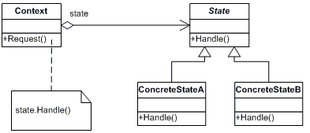

# C# State Design Pattern

> **分類**：Behavioral Patterns（行為型模式）  
> **使用頻率 (Frequency of use)**：中 (Medium)  
> **原文連結**：[https://www.dofactory.com/net/state-design-pattern](https://www.dofactory.com/net/state-design-pattern)

---

## 定義與概述 (Definition)

**State** Design Pattern 允許一個物件在其內部狀態改變時改變其行為。該物件看起來就像是改變了它的類別一樣。

本篇分成兩個部分：

- **[現代 C# 實作](#現代-c-實作-net-11--c-15)**：可以直接建置與執行的範例專案，建議由此開始閱讀。
- **[附錄：Dofactory 原版範例](#附錄dofactory-原版範例)**：Structural、Real-world、.NET Optimized 三種原版程式碼，作為對照。

---

## 問題情境 (Problem)

銀行帳戶依餘額分成三種等級，各有不同的規則：透支時不能提款、只有最高等級才有利息。用旗標加上條件判斷來寫：

```csharp
// 示意：每個方法都要判斷一次目前的狀態；新增一種狀態，就要修改所有方法
public void Withdraw(decimal amount)
{
    if (_status == "Red") { /* 拒絕 */ }
    else if (_status == "Silver") { /* ... */ }
    else if (_status == "Gold") { /* ... */ }
}

public void PayInterest()
{
    if (_status == "Gold") { /* ... */ }   // 這裡又判斷一次
}
```

- 同樣的狀態判斷散落在每一個方法裡。
- 新增一種狀態時，必須找出所有判斷的地方逐一修改，漏掉一個就是 bug。

State 把「在某個狀態下該怎麼做」各自寫成一個類別。帳戶持有目前的狀態物件，並把工作轉交給它。

---

## UML 類別圖 (UML Class Diagram)

以下是參與此 Pattern 的類別與物件之視覺化關係圖：



---

## 參與者 (Participants)

參與此 Pattern 的類別與物件包括：

> 括號內是 Dofactory 原版範例（見附錄）使用的類別名稱。現代 C# 實作中各角色對應的型別，請見下一節開頭的「角色對照」。

- **Context** (`Account`)
  - 定義用戶端（Clients）感興趣的介面。
  - 維護一個定義目前狀態之 `ConcreteState` 子類別的實例（Instance）。
- **State** (`State`)
  - 定義一個介面，用來封裝與 `Context` 之特定狀態相關聯的行為。
- **Concrete State** (`RedState`, `SilverState`, `GoldState`)
  - 每一個子類別都實作一個與 `Context` 某個狀態相關聯的行為。

---

## 現代 C# 實作 (.NET 11 / C# 15)

> **範例專案**：[samples/State](samples/State)  
> **執行方式**：`dotnet run --project samples/State`

**角色對照**：Context = `Account`；State = `AccountState`；ConcreteState = `RedState`、`SilverState`、`GoldState`。

<!-- sample:State/Program.cs -->
```csharp
// State：把「每個狀態下該怎麼做」各自寫成一個類別，物件把工作轉交給目前的狀態物件。

var account = new Account("Jim Johnson");

account.Deposit(500m);
account.Deposit(300m);
account.Deposit(550m);
account.PayInterest();
account.Withdraw(2_000m);
account.Withdraw(1_100m);

// ---- State：定義每個狀態都要回答的問題，並提供預設答案 ----
public abstract class AccountState
{
    public static readonly AccountState Red = new RedState();
    public static readonly AccountState Silver = new SilverState();
    public static readonly AccountState Gold = new GoldState();

    public abstract string Name { get; }

    public virtual decimal CalculateInterest(decimal balance) => 0m;

    public virtual bool CanWithdraw => true;

    // 狀態轉換的規則集中在一個地方，而不是散落在每個狀態類別裡
    public static AccountState For(decimal balance) => balance switch
    {
        < 0m => Red,
        < 1_000m => Silver,
        _ => Gold,
    };
}

// ---- ConcreteState：只覆寫和預設不同的行為 ----
public sealed class RedState : AccountState
{
    public override string Name => "Red";

    // 透支中：不能再提款
    public override bool CanWithdraw => false;
}

public sealed class SilverState : AccountState
{
    public override string Name => "Silver";
}

public sealed class GoldState : AccountState
{
    public override string Name => "Gold";

    // 只有 Gold 帳戶有利息
    public override decimal CalculateInterest(decimal balance) => balance * 0.05m;
}

// ---- Context：沒有任何「if 現在是某某狀態」的判斷，只問目前的狀態物件 ----
public sealed class Account(string owner)
{
    private AccountState _state = AccountState.Silver;

    public decimal Balance { get; private set; }

    public void Deposit(decimal amount)
    {
        ChangeBalance(Balance + amount);
        Report($"Deposited ${amount:N2}");
    }

    public void Withdraw(decimal amount)
    {
        if (!_state.CanWithdraw)
        {
            Report($"Withdrawal of ${amount:N2} refused");
            return;
        }

        ChangeBalance(Balance - amount);
        Report($"Withdrew ${amount:N2}");
    }

    public void PayInterest()
    {
        ChangeBalance(Balance + _state.CalculateInterest(Balance));
        Report("Interest paid");
    }

    private void ChangeBalance(decimal newBalance)
    {
        Balance = newBalance;
        _state = AccountState.For(Balance);
    }

    private void Report(string action) =>
        Console.WriteLine($"{owner}: {action,-32} Balance = {Balance,10:N2}  Status = {_state.Name}");
}
```
<!-- /sample -->

### 輸出結果 (Output)

<!-- output:State -->
```text
Jim Johnson: Deposited $500.00                Balance =     500.00  Status = Silver
Jim Johnson: Deposited $300.00                Balance =     800.00  Status = Silver
Jim Johnson: Deposited $550.00                Balance =   1,350.00  Status = Gold
Jim Johnson: Interest paid                    Balance =   1,417.50  Status = Gold
Jim Johnson: Withdrew $2,000.00               Balance =    -582.50  Status = Red
Jim Johnson: Withdrawal of $1,100.00 refused  Balance =    -582.50  Status = Red
```
<!-- /output -->

### 重點解說

- **`Account` 裡沒有任何「現在是哪一種狀態」的判斷**：它只問目前的狀態物件「能不能提款」「利息是多少」。
- **基底類別提供預設行為**：狀態子類別只需要覆寫與預設不同的部分，所以 `SilverState` 幾乎是空的。
- **狀態物件可以共用**：這些狀態類別沒有任何欄位，所以整個程式各用一個實例就夠了（`static readonly`）。
- **轉換規則集中在 `AccountState.For`**：`switch` 運算式搭配關係模式（`< 0m`、`< 1_000m`），由上而下比對，第一個符合的就是結果。
- **`ChangeBalance` 是唯一能改變餘額的地方**：餘額與狀態一定會一起更新，不會出現兩者不一致。

---

## 與 Dofactory 原版的差異

- 原版的三個狀態類別各自重複了 `Deposit`、`Withdraw`、`PayInterest` 與 `StateChangeCheck`，內容幾乎相同。本版把共同的流程留在 `Account`，狀態類別只回答「利息怎麼算」與「能不能提款」。
- 原版把餘額存在狀態物件裡，每次轉換狀態都要 `new` 一個新的狀態並把餘額複製過去。本版的餘額屬於 `Account`，狀態物件不帶資料。
- 原版的 `RedState` 定義了 `serviceFee`，但它只被用來修改一個之後不再使用的參數，對餘額沒有任何影響。本版移除這個欄位。
- 原版以 `double` 表示金額。本版改用 `decimal`。

---

## .NET 中的對應 (In .NET)

- **編譯器產生的狀態機**：`async`/`await` 與 `yield return` 的方法，都會被編譯器轉成「記住目前進行到哪一步」的狀態機類別。
- **`enum` 加 `switch`**：基底類別庫公開的狀態大多是列舉，例如 `TaskStatus`、`WebSocketState`、`ConnectionState`。狀態之間行為差異不大時，這是最常見的做法。
- **Stateless 套件**：以設定的方式描述狀態、觸發事件與轉換，適合流程複雜的工作流程。

---

## 何時該用、何時不該用

**適合使用**

- 物件在不同狀態下，有「好幾個」方法的行為都不一樣。
- 狀態的種類預期會繼續增加。

**不適合使用**

- 狀態只有兩三種，而且差別只是一兩個數值：`enum` 加上 `switch` 運算式更短也更清楚。
- 狀態完全可以從資料即時算出來，而且各狀態的行為差異很小。

---

## 練習題

1. 新增 `PlatinumState`：餘額達 10,000 以上，利率 7%。`Account` 需要修改嗎？
2. 新增「凍結」狀態：由行員手動設定，不能由餘額推算；凍結時不能存款也不能提款。`AccountState.For` 還適用嗎？`Account` 要怎麼調整？
3. 改用 `enum AccountLevel` 加上 `switch` 運算式重寫這個範例。比較兩種寫法在「新增一種狀態」與「新增一個操作」時，各需要修改幾個地方。

---

## 附錄：Dofactory 原版範例

> 以下保留 Dofactory 網站的三種原版程式碼作為對照，點選標題即可展開。  
> 輸出結果是實際編譯並執行這些程式碼所得（執行時移除了會等待按鍵的 `Console.ReadKey()`，文化特性為 en-US）。  
> 原版使用較舊的 C# 寫法，撰寫新程式時請以上方的「現代 C# 實作」為準。

<details>
<summary><b>Structural code（結構化程式碼）</b></summary>

這段結構化（Structural）程式碼示範了 State Pattern 如何讓物件根據其內部狀態展現不同的行為，並能在執行期間動態切換狀態物件。

```csharp
using System;

namespace State.Structural
{
    /// <summary>
    /// State Design Pattern
    /// </summary>

    public class Program
    {
        public static void Main(string[] args)
        {
            // Setup context in a state

            var context = new Context(new ConcreteStateA());

            // Issue requests, which toggles state

            context.Request();
            context.Request();
            context.Request();
            context.Request();

            // Wait for user

            Console.ReadKey();
        }
    }

    /// <summary>
    /// The 'State' abstract class
    /// </summary>

    public abstract class State
    {
        public abstract void Handle(Context context);
    }

    /// <summary>
    /// A 'ConcreteState' class
    /// </summary>

    public class ConcreteStateA : State
    {
        public override void Handle(Context context)
        {
            context.State = new ConcreteStateB();
        }
    }

    /// <summary>
    /// A 'ConcreteState' class
    /// </summary>

    public class ConcreteStateB : State
    {
        public override void Handle(Context context)
        {
            context.State = new ConcreteStateA();
        }
    }

    /// <summary>
    /// The 'Context' class
    /// </summary>

    public class Context
    {
        State state;

        // Constructor

        public Context(State state)
        {
            this.State = state;
        }

        // Gets or sets the state

        public State State
        {
            get { return state; }
            set
            {
                state = value;
                Console.WriteLine("State: " + state.GetType().Name);
            }
        }

        public void Request()
        {
            state.Handle(this);
        }
    }
}
```

**輸出結果 (Output)**

```text
State: ConcreteStateA
State: ConcreteStateB
State: ConcreteStateA
State: ConcreteStateB
State: ConcreteStateA
```

</details>

<details>
<summary><b>Real-world code（真實世界程式碼）</b></summary>

這段真實世界（Real-world）程式碼示範了 State Pattern 如何讓銀行帳戶（`Account`）根據其餘額（Balance）展現不同的行為。行為上的差異被委派（Delegated）給名為 `RedState`、`SilverState` 與 `GoldState` 的 `State` 物件。這些狀態分別代表透支帳戶、新開立帳戶以及信用良好的帳戶。

```csharp
using System;

namespace State.RealWorld
{
    /// <summary>
    /// State Design Pattern
    /// </summary>

    public class Program
    {
        public static void Main(string[] args)
        {
            // Open a new account

            Account account = new Account("Jim Johnson");

            // Apply financial transactions

            account.Deposit(500.0);
            account.Deposit(300.0);
            account.Deposit(550.0);
            account.PayInterest();
            account.Withdraw(2000.00);
            account.Withdraw(1100.00);

            // Wait for user

            Console.ReadKey();
        }
    }

    /// <summary>
    /// The 'State' abstract class
    /// </summary>

    public abstract class State
    {
        protected Account account;
        protected double balance;

        protected double interest;
        protected double lowerLimit;
        protected double upperLimit;

        // Properties

        public Account Account
        {
            get { return account; }
            set { account = value; }
        }

        public double Balance
        {
            get { return balance; }
            set { balance = value; }
        }

        public abstract void Deposit(double amount);
        public abstract void Withdraw(double amount);
        public abstract void PayInterest();
    }


    /// <summary>
    /// A 'ConcreteState' class
    /// <remarks>
    /// Red indicates that account is overdrawn 
    /// </remarks>
    /// </summary>

    public class RedState : State
    {
        private double serviceFee;

        // Constructor

        public RedState(State state)
        {
            this.balance = state.Balance;
            this.account = state.Account;
            Initialize();
        }

        private void Initialize()
        {
            // Should come from a datasource

            interest = 0.0;
            lowerLimit = -100.0;
            upperLimit = 0.0;
            serviceFee = 15.00;
        }

        public override void Deposit(double amount)
        {
            balance += amount;
            StateChangeCheck();
        }

        public override void Withdraw(double amount)
        {
            amount = amount - serviceFee;
            Console.WriteLine("No funds available for withdrawal!");
        }

        public override void PayInterest()
        {
            // No interest is paid
        }

        private void StateChangeCheck()
        {
            if (balance > upperLimit)
            {
                account.State = new SilverState(this);
            }
        }
    }

    /// <summary>
    /// A 'ConcreteState' class
    /// <remarks>
    /// Silver indicates a non-interest bearing state
    /// </remarks>
    /// </summary>

    public class SilverState : State
    {
        // Overloaded constructors

        public SilverState(State state) :
            this(state.Balance, state.Account)
        {
        }

        public SilverState(double balance, Account account)
        {
            this.balance = balance;
            this.account = account;
            Initialize();
        }

        private void Initialize()
        {
            // Should come from a datasource
            interest = 0.0;
            lowerLimit = 0.0;
            upperLimit = 1000.0;
        }

        public override void Deposit(double amount)
        {
            balance += amount;
            StateChangeCheck();
        }

        public override void Withdraw(double amount)
        {
            balance -= amount;
            StateChangeCheck();
        }

        public override void PayInterest()
        {
            balance += interest * balance;
            StateChangeCheck();
        }

        private void StateChangeCheck()
        {
            if (balance < lowerLimit)
            {
                account.State = new RedState(this);
            }
            else if (balance > upperLimit)
            {
                account.State = new GoldState(this);
            }
        }
    }

    /// <summary>
    /// A 'ConcreteState' class
    /// <remarks>
    /// Gold indicates an interest bearing state
    /// </remarks>
    /// </summary>

    public class GoldState : State
    {
        // Overloaded constructors
        public GoldState(State state)
            : this(state.Balance, state.Account)
        {
        }

        public GoldState(double balance, Account account)
        {
            this.balance = balance;
            this.account = account;
            Initialize();
        }

        private void Initialize()
        {
            // Should come from a database
            interest = 0.05;
            lowerLimit = 1000.0;
            upperLimit = 10000000.0;
        }

        public override void Deposit(double amount)
        {
            balance += amount;
            StateChangeCheck();
        }

        public override void Withdraw(double amount)
        {
            balance -= amount;
            StateChangeCheck();
        }

        public override void PayInterest()
        {
            balance += interest * balance;
            StateChangeCheck();
        }

        private void StateChangeCheck()
        {
            if (balance < 0.0)
            {
                account.State = new RedState(this);
            }
            else if (balance < lowerLimit)
            {
                account.State = new SilverState(this);
            }
        }
    }

    /// <summary>
    /// The 'Context' class
    /// </summary>

    public class Account
    {
        private State state;
        private string owner;

        // Constructor

        public Account(string owner)
        {
            // New accounts are 'Silver' by default
            this.owner = owner;
            this.state = new SilverState(0.0, this);
        }

        public double Balance
        {
            get { return state.Balance; }
        }

        public State State
        {
            get { return state; }
            set { state = value; }
        }

        public void Deposit(double amount)
        {
            state.Deposit(amount);
            Console.WriteLine("Deposited {0:C} --- ", amount);
            Console.WriteLine(" Balance = {0:C}", this.Balance);
            Console.WriteLine(" Status  = {0}",
                this.State.GetType().Name);
            Console.WriteLine("");
        }

        public void Withdraw(double amount)
        {
            state.Withdraw(amount);
            Console.WriteLine("Withdrew {0:C} --- ", amount);
            Console.WriteLine(" Balance = {0:C}", this.Balance);
            Console.WriteLine(" Status  = {0}\n",
                this.State.GetType().Name);
        }

        public void PayInterest()
        {
            state.PayInterest();
            Console.WriteLine("Interest Paid --- ");
            Console.WriteLine(" Balance = {0:C}", this.Balance);
            Console.WriteLine(" Status  = {0}\n",
                this.State.GetType().Name);
        }
    }
}
```

**輸出結果 (Output)**

```text
Deposited $500.00 ---
 Balance = $500.00
 Status  = SilverState

Deposited $300.00 ---
 Balance = $800.00
 Status  = SilverState

Deposited $550.00 ---
 Balance = $1,350.00
 Status  = GoldState

Interest Paid ---
 Balance = $1,417.50
 Status  = GoldState

Withdrew $2,000.00 ---
 Balance = -$582.50
 Status  = RedState

No funds available for withdrawal!
Withdrew $1,100.00 ---
 Balance = -$582.50
 Status  = RedState
```

</details>

<details>
<summary><b>.NET Optimized code（.NET 最佳化程式碼）</b></summary>

這段 .NET 最佳化（.NET Optimized）程式碼示範了與上述相同的邏輯，但採用了更現代化的 C# 與 .NET 功能。此版本的實作細節與限制，請見上方的〈與 Dofactory 原版的差異〉。

```csharp
namespace State.NetOptimized;

using static System.Console;

/// <summary>
/// State Design Pattern
/// </summary>
public class Program
{
    public static void Main()
    {
        // Open a new account
        var account = new Account("Jim Johnson");

        // Apply financial transactions
        account.Deposit(500.0);
        account.Deposit(300.0);
        account.Deposit(550.0);
        account.PayInterest();
        account.Withdraw(2000.00);
        account.Withdraw(1100.00);

        // Wait for user
        ReadKey();
    }
}

/// <summary>
/// The 'State' abstract class
/// </summary>
public abstract class State
{
    protected double interest;
    protected double lowerLimit;
    protected double upperLimit;

    // Gets or sets the account
    public Account Account { get; set; } = null!;

    // Gets or sets the balance
    public double Balance { get; set; }

    public abstract void Deposit(double amount);
    public abstract void Withdraw(double amount);
    public abstract void PayInterest();
}

/// <summary>
/// A 'ConcreteState' class
/// <remarks>
/// Red state indicates account is overdrawn 
/// </remarks>
/// </summary>
public class RedState : State
{
    private double serviceFee;

    // Constructor
    public RedState(State state)
    {
        Balance = state.Balance;
        Account = state.Account;
        Initialize();
    }

    private void Initialize()
    {
        // Should come from a datasource
        interest = 0.0;
        lowerLimit = -100.0;
        upperLimit = 0.0;
        serviceFee = 15.00;
    }

    public override void Deposit(double amount)
    {
        Balance += amount;
        StateChangeCheck();
    }

    public override void Withdraw(double amount)
    {
        amount -= serviceFee;
        WriteLine("No funds available for withdrawal!");
    }

    public override void PayInterest()
    {
        // No interest is paid
    }

    private void StateChangeCheck()
    {
        if (Balance > upperLimit)
        {
            Account.State = new SilverState(this);
        }
    }
}

/// <summary>
/// A 'ConcreteState' class
/// <remarks>
/// Silver state is non-interest bearing state
/// </remarks>
/// </summary>
public class SilverState : State
{
    // Overloaded constructors

    public SilverState(State state) :
        this(state.Balance, state.Account)
    {
    }

    public SilverState(double balance, Account account)
    {
        Balance = balance;
        Account = account;
        Initialize();
    }

    private void Initialize()
    {
        // Should come from a datasource
        interest = 0.0;
        lowerLimit = 0.0;
        upperLimit = 1000.0;
    }

    public override void Deposit(double amount)
    {
        Balance += amount;
        StateChangeCheck();
    }

    public override void Withdraw(double amount)
    {
        Balance -= amount;
        StateChangeCheck();
    }

    public override void PayInterest()
    {
        Balance += interest * Balance;
        StateChangeCheck();
    }

    private void StateChangeCheck()
    {
        if (Balance < lowerLimit)
        {
            Account.State = new RedState(this);
        }
        else if (Balance > upperLimit)
        {
            Account.State = new GoldState(this);
        }
    }
}

/// <summary>
/// A 'ConcreteState' class
/// <remarks>
/// Gold incidates interest bearing state
/// </remarks>
/// </summary>
public class GoldState : State
{
    // Overloaded constructors
    public GoldState(State state)
        : this(state.Balance, state.Account)
    {
    }

    public GoldState(double balance, Account account)
    {
        Balance = balance;
        Account = account;
        Initialize();
    }

    private void Initialize()
    {
        // Should come from a database
        interest = 0.05;
        lowerLimit = 1000.0;
        upperLimit = 10000000.0;
    }

    public override void Deposit(double amount)
    {
        Balance += amount;
        StateChangeCheck();
    }

    public override void Withdraw(double amount)
    {
        Balance -= amount;
        StateChangeCheck();
    }

    public override void PayInterest()
    {
        Balance += interest * Balance;
        StateChangeCheck();
    }

    private void StateChangeCheck()
    {
        if (Balance < 0.0)
        {
            Account.State = new RedState(this);
        }
        else if (Balance < lowerLimit)
        {
            Account.State = new SilverState(this);
        }
    }
}

/// <summary>
/// The 'Context' class
/// </summary>
public class Account
{
    private readonly string owner;

    // Constructor
    public Account(string owner)
    {
        // New accounts are 'Silver' by default
        this.owner = owner;
        this.State = new SilverState(0.0, this);
    }

    // Gets the balance
    public double Balance
    {
        get { return State.Balance; }
    }

    // Gets or sets state
    public State State { get; set; }

    public void Deposit(double amount)
    {
        State.Deposit(amount);
        WriteLine($"Owner: {owner}");
        WriteLine("Deposited {0:C} --- ", amount);
        WriteLine(" Balance = {0:C}", this.Balance);
        WriteLine(" Status  = {0}", this.State.GetType().Name);
        WriteLine("");
    }

    public void Withdraw(double amount)
    {
        State.Withdraw(amount);
        WriteLine($"Owner: {owner}"); 
        WriteLine("Withdrew {0:C} --- ", amount);
        WriteLine(" Balance = {0:C}", this.Balance);
        WriteLine(" Status  = {0}\n", this.State.GetType().Name);
    }

    public void PayInterest()
    {
        State.PayInterest();
        WriteLine("Interest Paid --- ");
        WriteLine(" Balance = {0:C}", this.Balance);
        WriteLine(" Status  = {0}\n", this.State.GetType().Name);
    }
}
```

**輸出結果 (Output)**

```text
Owner: Jim Johnson
Deposited $500.00 ---
 Balance = $500.00
 Status  = SilverState

Owner: Jim Johnson
Deposited $300.00 ---
 Balance = $800.00
 Status  = SilverState

Owner: Jim Johnson
Deposited $550.00 ---
 Balance = $1,350.00
 Status  = GoldState

Interest Paid ---
 Balance = $1,417.50
 Status  = GoldState

Owner: Jim Johnson
Withdrew $2,000.00 ---
 Balance = -$582.50
 Status  = RedState

No funds available for withdrawal!
Owner: Jim Johnson
Withdrew $1,100.00 ---
 Balance = -$582.50
 Status  = RedState
```

</details>

---

## 導覽 (Navigation)

| 上一篇 | 總覽 | 下一篇 |
| :--- | :---: | ---: |
| [← 上一篇：Observer](Observer.md) | [🏠 C# Design Patterns 總覽](Index.md) | [下一篇：Strategy →](Strategy.md) |
