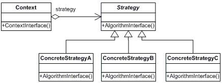

# C# Strategy Design Pattern

> **分類**：Behavioral Patterns（行為型模式）  
> **使用頻率 (Frequency of use)**：高 (High)  
> **原文連結**：[https://www.dofactory.com/net/strategy-design-pattern](https://www.dofactory.com/net/strategy-design-pattern)

---

## 定義與概述 (Definition)

**Strategy** Design Pattern 定義了一系列的演算法（Algorithms），將每一個演算法封裝起來，並使它們可以互相替換（Interchangeable）。此 Pattern 讓演算法可以獨立於使用它的用戶端（Clients）而變化。

**Strategy** Design Pattern 的 C# 程式碼範例除了提供 Dofactory 原版的 3 種形式外，亦額外補充針對 **.NET 11 / C# 15** 的現代化實務優化版本：
- [結構化程式碼 (Structural code)](#structural-code-in-c-結構化程式碼)
- [真實世界程式碼 (Real-world code)](#real-world-code-in-c-真實世界程式碼)
- [.NET 最佳化程式碼 (.NET optimized code)](#net-optimized-code-in-c-net-最佳化程式碼)
- [🚀 .NET 11 / C# 15 現代化實務優化 (Modern .NET 11 & C# 15)](#net-11--c-15-現代化實務優化-modern-net-11--c-15)

---

## UML 類別圖 (UML Class Diagram)

以下是參與此 Pattern 的類別與物件之視覺化關係圖：



---

## 參與者 (Participants)

參與此 Pattern 的類別與物件包括：

- **Strategy** (`SortStrategy`)
  - 宣告所有支援之演算法的共同介面。`Context` 會使用這個介面來呼叫由 `ConcreteStrategy` 所定義的演算法。
- **ConcreteStrategy** (`QuickSort`, `ShellSort`, `MergeSort`)
  - 使用 `Strategy` 介面來實作具體的演算法。
- **Context** (`SortedList`)
  - 以一個 `ConcreteStrategy` 物件來進行組態設定。
  - 維護一個指向 `Strategy` 物件的參考。
  - 可以定義一個讓 `Strategy` 存取其資料的介面。

---

## Structural code in C# (結構化程式碼)

這段結構化（Structural）程式碼示範了 Strategy Pattern 如何將功能以物件的形式封裝起來。這讓用戶端（Clients）能夠動態地更換演算法策略。

```csharp
using System;

namespace Strategy.Structural
{
    /// <summary>
    /// Strategy Design Pattern
    /// </summary>

    public class Program
    {
        public static void Main(string[] args)
        {
            Context context;

            // Three contexts following different strategies

            context = new Context(new ConcreteStrategyA());
            context.ContextInterface();

            context = new Context(new ConcreteStrategyB());
            context.ContextInterface();

            context = new Context(new ConcreteStrategyC());
            context.ContextInterface();

            // Wait for user

            Console.ReadKey();
        }
    }

    /// <summary>
    /// The 'Strategy' abstract class
    /// </summary>

    public abstract class Strategy
    {
        public abstract void AlgorithmInterface();
    }

    /// <summary>
    /// A 'ConcreteStrategy' class
    /// </summary>

    public class ConcreteStrategyA : Strategy
    {
        public override void AlgorithmInterface()
        {
            Console.WriteLine(
                "Called ConcreteStrategyA.AlgorithmInterface()");
        }
    }

    /// <summary>
    /// A 'ConcreteStrategy' class
    /// </summary>

    public class ConcreteStrategyB : Strategy
    {
        public override void AlgorithmInterface()
        {
            Console.WriteLine(
                "Called ConcreteStrategyB.AlgorithmInterface()");
        }
    }

    /// <summary>
    /// A 'ConcreteStrategy' class
    /// </summary>

    public class ConcreteStrategyC : Strategy
    {
        public override void AlgorithmInterface()
        {
            Console.WriteLine(
                "Called ConcreteStrategyC.AlgorithmInterface()");
        }
    }

    /// <summary>
    /// The 'Context' class
    /// </summary>

    public class Context
    {
        Strategy strategy;

        // Constructor

        public Context(Strategy strategy)
        {
            this.strategy = strategy;
        }

        public void ContextInterface()
        {
            strategy.AlgorithmInterface();
        }
    }
}
```

### 輸出結果 (Output)

```text
Called ConcreteStrategyA.AlgorithmInterface()

  Called ConcreteStrategyB.AlgorithmInterface()

  Called ConcreteStrategyC.AlgorithmInterface()
```

---

## Real-world code in C# (真實世界程式碼)

這段真實世界（Real-world）程式碼示範了 Strategy Pattern 如何將排序演算法以排序物件的形式封裝起來。這讓用戶端能夠動態地更換排序策略，包括 `QuickSort`（快速排序）、`ShellSort`（希爾排序）與 `MergeSort`（合併排序）。

```csharp
using System;
using System.Collections.Generic;

namespace Strategy.RealWorld
{
    /// <summary>
    /// Strategy Design Pattern
    /// </summary>

    public class Program
    {
        public static void Main(string[] args)
        {
            // Two contexts following different strategies

            SortedList studentRecords = new SortedList();

            studentRecords.Add("Samual");
            studentRecords.Add("Jimmy");
            studentRecords.Add("Sandra");
            studentRecords.Add("Vivek");
            studentRecords.Add("Anna");

            studentRecords.SetSortStrategy(new QuickSort());
            studentRecords.Sort();

            studentRecords.SetSortStrategy(new ShellSort());
            studentRecords.Sort();

            studentRecords.SetSortStrategy(new MergeSort());
            studentRecords.Sort();

            // Wait for user

            Console.ReadKey();
        }
    }

    /// <summary>
    /// The 'Strategy' abstract class
    /// </summary>

    public abstract class SortStrategy
    {
        public abstract void Sort(List<string> list);
    }

    /// <summary>
    /// A 'ConcreteStrategy' class
    /// </summary>

    public class QuickSort : SortStrategy
    {
        public override void Sort(List<string> list)
        {
            list.Sort();  // Default is Quicksort
            Console.WriteLine("QuickSorted list ");
        }
    }

    /// <summary>
    /// A 'ConcreteStrategy' class
    /// </summary>

    public class ShellSort : SortStrategy
    {
        public override void Sort(List<string> list)
        {
            //list.ShellSort();  not-implemented
            Console.WriteLine("ShellSorted list ");
        }
    }

    /// <summary>
    /// A 'ConcreteStrategy' class
    /// </summary>

    public class MergeSort : SortStrategy
    {
        public override void Sort(List<string> list)
        {
            //list.MergeSort(); not-implemented

            Console.WriteLine("MergeSorted list ");
        }
    }

    /// <summary>
    /// The 'Context' class
    /// </summary>

    public class SortedList
    {
        private List<string> list = new List<string>();
        private SortStrategy sortstrategy;

        public void SetSortStrategy(SortStrategy sortstrategy)
        {
            this.sortstrategy = sortstrategy;
        }

        public void Add(string name)
        {
            list.Add(name);
        }

        public void Sort()
        {
            sortstrategy.Sort(list);

            // Iterate over list and display results

            foreach (string name in list)
            {
                Console.WriteLine(" " + name);
            }
            Console.WriteLine();
        }
    }
}
```

### 輸出結果 (Output)

```text
QuickSorted list

   Anna

   Jimmy

   Samual

   Sandra

   Vivek

  

  ShellSorted list

   Anna

   Jimmy

   Samual

   Sandra

   Vivek

  

  MergeSorted list

   Anna

   Jimmy

   Samual

   Sandra

   Vivek
```

---

## .NET Optimized code in C# (.NET 最佳化程式碼)

這段 .NET 最佳化（.NET Optimized）程式碼示範了與上述相同的邏輯，但採用了更現代化的 C# 與 .NET 功能（例如 `record Student`、集合運算式 `[]` 與完整實作的排序演算法）。這是一個優雅的 C# Strategy 解決方案。

```csharp
namespace Strategy.NetOptimized;

using static System.Console;
using System;
using System.Collections.Generic;

/// <summary>
/// Strategy Design Pattern
/// </summary>
public class Program
{
    public static void Main()
    {
        // Two contexts following different strategies
        SortedList students = 
              [
                new (Name:"Samual", Ssn: "154-33-2009"),
                new (Name:"Jimmy", Ssn: "487-43-1665" ),
                new (Name:"Sandra", Ssn:  "655-00-2944" ),
                new (Name:"Vivek", Ssn:  "133-98-8399" ),
                new (Name:"Anna", Ssn: "760-94-9844" )
              ];

        students.SortStrategy = new QuickSort();
        students.SortStudents();

        students.SortStrategy = new ShellSort();
        students.SortStudents();

        students.SortStrategy = new MergeSort();
        students.SortStudents();

        // Wait for user
        ReadKey();
    }
}

/// <summary>
/// The 'Strategy' interface
/// </summary>
public interface ISortStrategy
{
    void Sort(List<Student> list);
}

/// <summary>
/// A 'ConcreteStrategy' class
/// </summary>
public class QuickSort : ISortStrategy
{
    public void Sort(List<Student> list)
    {
        // Call overloaded Sort
        Sort(list, 0, list.Count - 1);
        WriteLine("QuickSorted list ");
    }

    // Recursively sort
    private static void Sort(List<Student> list, int left, int right)
    {
        int lhold = left;
        int rhold = right;

        // Use a random pivot
        var random = new Random();
        int pivot = random.Next(left, right);
        Swap(list, pivot, left);
        pivot = left;
        left++;

        while (right >= left)
        {
            int compareleft = list[left].Name.CompareTo(list[pivot].Name);
            int compareright = list[right].Name.CompareTo(list[pivot].Name);

            if ((compareleft >= 0) && (compareright < 0))
            {
                Swap(list, left, right);
            }
            else
            {
                if (compareleft >= 0)
                {
                    right--;
                }
                else
                {
                    if (compareright < 0)
                    {
                        left++;
                    }
                    else
                    {
                        right--;
                        left++;
                    }
                }
            }
        }
        Swap(list, pivot, right);
        pivot = right;

        if (pivot > lhold) Sort(list, lhold, pivot);
        if (rhold > pivot + 1) Sort(list, pivot + 1, rhold);
    }

    // Swap helper function
    private static void Swap(List<Student> list, int left, int right)
    {
        // Tuple based swap
        (list[left], list[right]) = (list[right], list[left]);
    }
}

/// <summary>
/// A 'ConcreteStrategy' class
/// </summary>
public class ShellSort : ISortStrategy
{
    public void Sort(List<Student> list)
    {
        // ShellSort();  not-implemented
        WriteLine("ShellSorted list ");
    }
}

/// <summary>
/// A 'ConcreteStrategy' class
/// </summary>
public class MergeSort : ISortStrategy
{
    public void Sort(List<Student> list)
    {
        // MergeSort(); not-implemented
        WriteLine("MergeSorted list ");
    }
}

/// <summary>
/// The 'Context' class
/// </summary>
public class SortedList : List<Student>
{
    // Sets sort strategy
    public ISortStrategy SortStrategy { get; set; } = null!;

    // Perform sort
    public void SortStudents()
    {
        SortStrategy.Sort(this);

        // Display sort results
        foreach (var student in this)
        {
            WriteLine($" {student.Name}");
        }
        WriteLine();
    }
}

/// <summary>
/// Represents a student
/// </summary>
public record Student (string Name, string Ssn);
```

### 輸出結果 (Output)

```text
QuickSorted list

     Anna

     Jimmy

     Samual

     Sandra

     Vivek

    

    ShellSorted list

     Anna

     Jimmy

     Samual

     Sandra

     Vivek

    

    MergeSorted list

     Anna

     Jimmy

     Samual

     Sandra

     Vivek
```

---

## .NET 11 / C# 15 現代化實務優化 (Modern .NET 11 & C# 15)

### 原版範例的限制與盲點

- **為了單一方法建立過多樣板類別**：在 C# 中，如果一個 Strategy 介面（如 `ISortStrategy`）只有唯一一個方法 `void Sort(List<Student> list)`，除了使用傳統介面實作外，現代 C# 更常支援直接傳入**高階函式 / 委派（`Action<List<Student>>` 或 `Comparison<T>`）**，或是將無狀態的策略類別設為 Singleton 實例以避免重複 `new`。

### C# 15 / .NET 11 優化重點

- **同時支援 `ISortStrategy` 介面與 Lambda / Method Group 委派**：展現 C# 函數式與物件導向融合的彈性。
- **C# 15 Collection Expression Arguments (`with(capacity: ...)`)**：在建立 `SortedList` 時預先配置容量。

### 現代化 C# 15 / .NET 11 程式碼範例

```csharp
namespace Strategy.ModernNet11;

using static System.Console;

public static class Program
{
    public static void Main()
    {
        SortedList students =
        [
            new("Samual", "154-33-2009"),
            new("Jimmy", "487-43-1665"),
            new("Sandra", "655-00-2944"),
            new("Vivek", "133-98-8399"),
            new("Anna", "760-94-9844")
        ];

        // 方式 1：使用傳統 Strategy 實例
        students.SortStrategy = QuickSort.Instance;
        students.SortStudents();

        // 方式 2：在現代 C# 中，單一方法的 Strategy 也可以直接傳入 Lambda 或靜態方法委派
        students.SortWith(list =>
        {
            list.Sort((a, b) => string.CompareOrdinal(a.Name, b.Name));
            WriteLine("LINQ / BCL Array.Sort Strategy");
        });
    }
}

public readonly record struct Student(string Name, string Ssn);

public interface ISortStrategy
{
    void Sort(List<Student> list);
}

public sealed class QuickSort : ISortStrategy
{
    public static readonly QuickSort Instance = new();

    public void Sort(List<Student> list)
    {
        list.Sort((x, y) => string.CompareOrdinal(x.Name, y.Name));
        WriteLine("QuickSorted list");
    }
}

public sealed class SortedList : List<Student>
{
    public ISortStrategy? SortStrategy { get; set; }

    public void SortStudents() => SortWith( list => SortStrategy?.Sort(list));

    // 支援直接傳入 Action<List<Student>> 委派策略
    public void SortWith(Action<List<Student>> strategy)
    {
        strategy(this);
        foreach (var student in this)
        {
            WriteLine($" {student.Name}: {student.Ssn}");
        }
        WriteLine();
    }
}
```

---

## 導覽 (Navigation)

| 上一篇 | 總覽 | 下一篇 |
| :--- | :---: | ---: |
| [← 上一篇：State](State.md) | [🏠 C# Design Patterns 總覽](Index.md) | [下一篇：Template Method →](TemplateMethod.md) |
