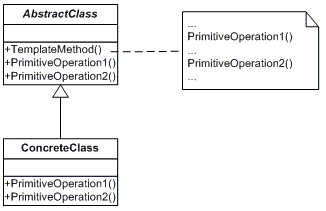

# C# Template Method Design Pattern

> **分類**：Behavioral Patterns（行為型模式）  
> **使用頻率 (Frequency of use)**：中 (Medium)  
> **原文連結**：[https://www.dofactory.com/net/template-method-design-pattern](https://www.dofactory.com/net/template-method-design-pattern)

---

## 定義與概述 (Definition)

**Template Method** Design Pattern 在一個操作中定義了演算法的骨架（Skeleton），並將某些步驟推遲（Deferring）到子類別中實作。此 Pattern 讓子類別可以在不改變演算法結構的情況下，重新定義演算法的某些特定步驟。

本篇分成兩個部分：

- **[現代 C# 實作](#現代-c-實作-net-11--c-15)**：可以直接建置與執行的範例專案，建議由此開始閱讀。
- **[附錄：Dofactory 原版範例](#附錄dofactory-原版範例)**：Structural、Real-world、.NET Optimized 三種原版程式碼，作為對照。

---

## 問題情境 (Problem)

有兩份報表：類別清單與產品清單。兩者的流程完全相同（連線、查詢、顯示前 N 筆、中斷連線），只有「查詢什麼」與「每一列怎麼顯示」不同。

如果直接複製貼上兩份程式碼：

- 流程重複了兩次。日後要調整流程（例如加上記錄），兩份都要改。
- 很容易出現其中一份被改過、另一份沒改的不一致（例如某一份忘了中斷連線）。

Template Method 把固定的流程寫在基底類別的一個方法裡，其中會變動的步驟宣告成抽象或虛擬方法，交給子類別提供。

---

## UML 類別圖 (UML Class Diagram)

以下是參與此 Pattern 的類別與物件之視覺化關係圖：



---

## 參與者 (Participants)

參與此 Pattern 的類別與物件包括：

> 括號內是 Dofactory 原版範例（見附錄）使用的類別名稱。現代 C# 實作中各角色對應的型別，請見下一節開頭的「角色對照」。

- **AbstractClass** (`DataObject` / `DataAccessor`)
  - 定義抽象的*基本操作（Primitive Operations）*，由具體子類別（Concrete Subclasses）實作這些操作以完成演算法的各個步驟。
  - 實作一個定義演算法骨架的範本方法（Template Method）。此 Template Method 不僅會呼叫基本操作，也會呼叫定義在 `AbstractClass` 或其他物件中的操作。
- **ConcreteClass** (`CustomerDataObject` / `CategoryAccessor`, `ProductAccessor`)
  - 實作基本操作，以執行演算法中專屬於子類別的步驟。

---

## 現代 C# 實作 (.NET 11 / C# 15)

> **範例專案**：[samples/TemplateMethod](samples/TemplateMethod)  
> **執行方式**：`dotnet run --project samples/TemplateMethod`

**角色對照**：AbstractClass = `DataReport<T>`；Template Method = `Run`；ConcreteClass = `CategoryReport`、`ProductReport`。

<!-- sample:TemplateMethod/Program.cs -->
```csharp
// Template Method：基底類別固定「流程的順序」，子類別只負責填入其中幾個步驟。

new CategoryReport().Run(top: 5);
new ProductReport().Run(top: 3);

// ---- AbstractClass ----
public abstract class DataReport<T>
{
    // Template Method：流程固定。C# 的方法預設不是 virtual，所以子類別無法改變步驟順序
    public void Run(int top)
    {
        Connect();
        IReadOnlyList<T> rows = Select();

        Console.WriteLine($"{Title} ----");
        foreach (T row in rows.Take(top))
        {
            Console.WriteLine($"  {Format(row)}");
        }

        Disconnect();
        Console.WriteLine();
    }

    // 必要步驟：abstract，子類別一定要實作
    protected abstract string Title { get; }
    protected abstract IReadOnlyList<T> Select();

    // 選擇性步驟（Hook）：virtual，有預設行為，子類別需要時才覆寫
    protected virtual string Format(T row) => row?.ToString() ?? "";
    protected virtual void Connect() => Console.WriteLine("[connect]");
    protected virtual void Disconnect() => Console.WriteLine("[disconnect]");
}

// ---- ConcreteClass ----
public sealed class CategoryReport : DataReport<string>
{
    protected override string Title => "Categories";

    protected override IReadOnlyList<string> Select() =>
        ["Red", "Green", "Blue", "Yellow", "Purple", "White", "Black"];
}

public sealed record Product(string Name, decimal Price);

public sealed class ProductReport : DataReport<Product>
{
    protected override string Title => "Products";

    protected override IReadOnlyList<Product> Select() =>
    [
        new("Car", 25_000m),
        new("Bike", 480m),
        new("Boat", 12_500m),
        new("Truck", 41_000m),
        new("Moped", 1_900m),
    ];

    // 覆寫 Hook：自訂每一列的顯示方式
    protected override string Format(Product row) => $"{row.Name,-6} ${row.Price,10:N2}";
}
```
<!-- /sample -->

### 輸出結果 (Output)

<!-- output:TemplateMethod -->
```text
[connect]
Categories ----
  Red
  Green
  Blue
  Yellow
  Purple
[disconnect]

[connect]
Products ----
  Car    $ 25,000.00
  Bike   $    480.00
  Boat   $ 12,500.00
[disconnect]
```
<!-- /output -->

### 重點解說

- **流程不能被改變**：`Run` 不是 `virtual`，子類別無法覆寫它，所以步驟的順序由基底類別保證。
- **`abstract` 與 `virtual` 的分工**：`abstract` 成員是子類別「一定要」提供的步驟；`virtual` 成員有預設行為，子類別需要時才覆寫，稱為 Hook。
- **`protected`**：這些步驟只開放給子類別，外部只能呼叫 `Run`。
- **`rows.Take(top)`**：資料筆數少於 `top` 時也不會出錯，有幾筆就顯示幾筆。
- **泛型基底類別**：`DataReport<T>` 讓每個子類別決定自己的資料型別，`CategoryReport` 使用 `string`，`ProductReport` 使用 `Product`。

---

## 與 Dofactory 原版的差異

- 原版以 `for (int i = 0; i < top; i++)` 讀取前 N 筆，資料筆數不足時會丟出 `ArgumentOutOfRangeException`。本版改用 `Take(top)`。
- 原版 .NET Optimized 為了泛型條件約束 `where T : class, new()`，把資料類別的屬性宣告成 `= null!`。本版不需要這個條件約束。
- 原版的每個子類別都要自己實作內容幾乎相同的 `Process`。本版把顯示的迴圈留在基底類別，只開放 `Format` 這個 Hook。

---

## .NET 中的對應 (In .NET)

- **`BackgroundService`**：啟動與停止的流程由基底類別處理，你只需要覆寫 `ExecuteAsync`。
- **`Stream`**：`CopyTo`、`ReadExactly` 等方法是建立在抽象的 `Read` 與 `Write` 之上，子類別只要實作最基本的讀寫。
- **`DbContext`**：`OnConfiguring` 與 `OnModelCreating` 是 EF Core 在固定時機呼叫的 Hook。
- **Blazor 的 `ComponentBase`**：`OnInitializedAsync`、`OnParametersSet` 等生命週期方法。

---

## 何時該用、何時不該用

**適合使用**

- 多個類別的流程相同，只有少數幾個步驟不同。
- 撰寫框架，要讓使用者在固定的生命週期中插入自己的程式碼。

**不適合使用**

- 會變動的步驟只有一個：傳入委派比繼承更輕巧（參考 Strategy）。
- 子類別需要改變步驟的順序。
- 繼承已經很多層：繼承是很強的相依關係，而且 C# 的類別只能繼承一個基底類別。

---

## 練習題

1. 新增 `CustomerReport`，資料型別自訂，並覆寫 `Format`。
2. 新增一個 Hook：`protected virtual bool ShowFooter => false;`。為 `true` 時在最後印出顯示的筆數。
3. 不使用繼承，改寫成一個方法：`static void RunReport<T>(string title, Func<IReadOnlyList<T>> select, Func<T, string> format, int top)`。比較兩種寫法的優缺點。

---

## 附錄：Dofactory 原版範例

> 以下保留 Dofactory 網站的三種原版程式碼作為對照，點選標題即可展開。  
> 輸出結果是實際編譯並執行這些程式碼所得（執行時移除了會等待按鍵的 `Console.ReadKey()`，文化特性為 en-US）。  
> 原版使用較舊的 C# 寫法，撰寫新程式時請以上方的「現代 C# 實作」為準。

<details>
<summary><b>Structural code（結構化程式碼）</b></summary>

這段結構化（Structural）程式碼示範了 Template Method Pattern 如何提供方法呼叫順序的骨架。一個或多個步驟可以推遲到子類別中，由子類別實作這些步驟，而不會改變整體的呼叫順序。

```csharp
using System;

namespace Template.Structural
{
    /// <summary>
    /// Template Design Pattern
    /// </summary>

    public class Program
    {
        public static void Main(string[] args)
        {
            AbstractClass aA = new ConcreteClassA();
            aA.TemplateMethod();

            AbstractClass aB = new ConcreteClassB();
            aB.TemplateMethod();

            // Wait for user

            Console.ReadKey();
        }
    }

    /// <summary>
    /// The 'AbstractClass' abstract class
    /// </summary>

    public abstract class AbstractClass
    {
        public abstract void PrimitiveOperation1();
        public abstract void PrimitiveOperation2();

        // The "Template method"

        public void TemplateMethod()
        {
            PrimitiveOperation1();
            PrimitiveOperation2();
            Console.WriteLine("");
        }
    }

    /// <summary>
    /// A 'ConcreteClass' class
    /// </summary>

    public class ConcreteClassA : AbstractClass
    {
        public override void PrimitiveOperation1()
        {
            Console.WriteLine("ConcreteClassA.PrimitiveOperation1()");
        }

        public override void PrimitiveOperation2()
        {
            Console.WriteLine("ConcreteClassA.PrimitiveOperation2()");
        }
    }

    /// <summary>
    /// A 'ConcreteClass' class
    /// </summary>

    public class ConcreteClassB : AbstractClass
    {
        public override void PrimitiveOperation1()
        {
            Console.WriteLine("ConcreteClassB.PrimitiveOperation1()");
        }

        public override void PrimitiveOperation2()
        {
            Console.WriteLine("ConcreteClassB.PrimitiveOperation2()");
        }
    }
}
```

**輸出結果 (Output)**

```text
ConcreteClassA.PrimitiveOperation1()
ConcreteClassA.PrimitiveOperation2()

ConcreteClassB.PrimitiveOperation1()
ConcreteClassB.PrimitiveOperation2()
```

</details>

<details>
<summary><b>Real-world code（真實世界程式碼）</b></summary>

這段真實世界（Real-world）程式碼示範了一個名為 `Run()` 的 Template Method，它提供了方法呼叫順序的骨架。這些步驟的實作被推遲到了 `CustomerDataObject` 子類別中，由該子類別實作 `Connect`、`Select`、`Process` 與 `Disconnect` 方法。

```csharp
using System;
using System.Collections.Generic;

namespace Template.RealWorld
{
    /// <summary>
    /// Template Design Pattern
    /// </summary>

    public class Program
    {
        public static void Main(string[] args)
        {
            DataAccessor categories = new Categories();
            categories.Run(5);

            DataAccessor products = new Products();
            products.Run(3);

            // Wait for user

            Console.ReadKey();
        }
    }

    /// <summary>
    /// The 'AbstractClass' abstract class
    /// </summary>

    public abstract class DataAccessor
    {
        public abstract void Connect();
        public abstract void Select();
        public abstract void Process(int top);
        public abstract void Disconnect();

        // The 'Template Method' 

        public void Run(int top)
        {
            Connect();
            Select();
            Process(top);
            Disconnect();
        }
    }

    /// <summary>
    /// A 'ConcreteClass' class
    /// </summary>

    public class Categories : DataAccessor
    {
        private List<string> categories;

        public override void Connect()
        {
            categories = new List<string>();
        }

        public override void Select()
        {
            categories.Add("Red");
            categories.Add("Green");
            categories.Add("Blue");
            categories.Add("Yellow");
            categories.Add("Purple");
            categories.Add("White");
            categories.Add("Black");
        }

        public override void Process(int top)
        {
            Console.WriteLine("Categories ---- ");

            for(int i = 0; i < top; i++)
            {
                Console.WriteLine(categories[i]);
            }
            
            Console.WriteLine();
        }

        public override void Disconnect()
        {
            categories.Clear();
        }
    }

    /// <summary>
    /// A 'ConcreteClass' class
    /// </summary>

    public class Products : DataAccessor
    {
        private List<string> products;

        public override void Connect()
        {
            products = new List<string>();
        }

        public override void Select()
        {
            products.Add("Car");
            products.Add("Bike");
            products.Add("Boat");
            products.Add("Truck");
            products.Add("Moped");
            products.Add("Rollerskate");
            products.Add("Stroller");
        }

        public override void Process(int top)
        {
            Console.WriteLine("Products ---- ");

            for (int i = 0; i < top; i++)
            {
                Console.WriteLine(products[i]);
            }

            Console.WriteLine();
        }

        public override void Disconnect()
        {
            products.Clear();
        }
    }
}
```

**輸出結果 (Output)**

```text
Categories ----
Red
Green
Blue
Yellow
Purple

Products ----
Car
Bike
Boat
```

</details>

<details>
<summary><b>.NET Optimized code（.NET 最佳化程式碼）</b></summary>

這段 .NET 最佳化（.NET Optimized）程式碼示範了與上述相同的邏輯，但採用了更現代化的 C# 與 .NET 功能（例如泛型 `DataAccessor<T>`、`record` 型別與集合運算式 `[]`）。此版本的實作細節與限制，請見上方的〈與 Dofactory 原版的差異〉。

```csharp
namespace Template.NetOptimized;

using static System.Console;

/// <summary>
/// Template Design Pattern
/// </summary>
public class Program
{
    public static void Main()
    {
        var categories = new CategoryAccessor();
        categories.Run(5);

        var products = new ProductAccessor();
        products.Run(3);

        // Wait for user
        ReadKey();
    }
}

public record Category
{
    public string CategoryName { get; set; } = null!;
}

public record Product
{
    public string ProductName { get; set; } = null!;
}

/// <summary>
/// The 'AbstractClass' abstract class
/// </summary>
public abstract class DataAccessor<T> where T : class, new()
{
    protected List<T> Items { get; set; } = [];

    public virtual void Connect()
    {
        Items.Clear();
    }
    public abstract void Select();
    public abstract void Process(int top);
    public virtual void Disconnect()
    {
        Items.Clear();
    }

    // The 'Template Method' 
    public void Run(int top)
    {
        Connect();
        Select();
        Process(top);
        Disconnect();
    }
}

/// <summary>
/// A 'ConcreteClass' class
/// </summary>
public class CategoryAccessor : DataAccessor<Category>
{
    public override void Select()
    {
        Items.Add(new() { CategoryName = "Red" });
        Items.Add(new() { CategoryName = "Green" });
        Items.Add(new() { CategoryName = "Blue" });
        Items.Add(new() { CategoryName = "Yellow" });
        Items.Add(new() { CategoryName = "Purple" }); ;
        Items.Add(new() { CategoryName = "White" });
        Items.Add(new() { CategoryName = "Black" });
    }

    public override void Process(int top)
    {
        WriteLine("Categories ---- ");

        for (int i = 0; i < top; i++)
        {
            WriteLine(Items[i].CategoryName);
        }

        WriteLine();
    }
}

/// <summary>
/// A 'ConcreteClass' class
/// </summary>
public class ProductAccessor : DataAccessor<Product>
{
    public override void Select()
    {
        Items.Add(new Product { ProductName = "Car" });
        Items.Add(new Product { ProductName = "Bike" });
        Items.Add(new Product { ProductName = "Boat" });
        Items.Add(new Product { ProductName = "Truck" });
        Items.Add(new Product { ProductName = "Moped" });
        Items.Add(new Product { ProductName = "Rollerskate" });
        Items.Add(new Product { ProductName = "Stroller" });
    }

    public override void Process(int top)
    {
        WriteLine("Products ---- ");

        for (int i = 0; i < top; i++)
        {
            WriteLine(Items[i].ProductName);
        }

        WriteLine();
    }
}
```

**輸出結果 (Output)**

```text
Categories ----
Red
Green
Blue
Yellow
Purple

Products ----
Car
Bike
Boat
```

</details>

---

## 導覽 (Navigation)

| 上一篇 | 總覽 | 下一篇 |
| :--- | :---: | ---: |
| [← 上一篇：Strategy](Strategy.md) | [🏠 C# Design Patterns 總覽](Index.md) | [下一篇：Visitor →](Visitor.md) |
