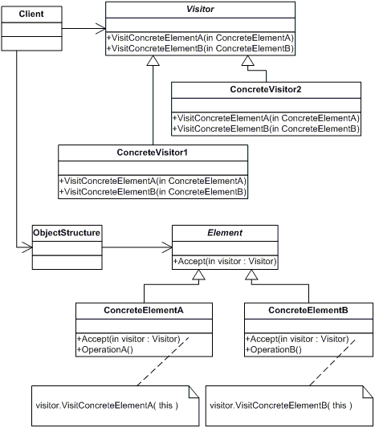

# C# Visitor Design Pattern

> **分類**：Behavioral Patterns（行為型模式）  
> **使用頻率 (Frequency of use)**：低 (Low)  
> **原文連結**：[https://www.dofactory.com/net/visitor-design-pattern](https://www.dofactory.com/net/visitor-design-pattern)

---

## 定義與概述 (Definition)

**Visitor** Design Pattern 代表一個要在某個物件結構（Object Structure）之各個元素上執行的操作。此 Pattern 讓你可以在不修改各元素所屬類別的情況下，定義一個新的操作。

**Visitor** Design Pattern 的 C# 程式碼範例提供以下 3 種形式：
- [結構化程式碼 (Structural code)](#structural-code-in-c-結構化程式碼)
- [真實世界程式碼 (Real-world code)](#real-world-code-in-c-真實世界程式碼)
- [.NET 最佳化程式碼 (.NET optimized code)](#net-optimized-code-in-c-net-最佳化程式碼)

---

## UML 類別圖 (UML Class Diagram)

以下是參與此 Pattern 的類別與物件之視覺化關係圖：



---

## 參與者 (Participants)

參與此 Pattern 的類別與物件包括：

- **Visitor** (`Visitor` / `IVisitor`)
  - 為物件結構中的每一個 `ConcreteElement` 類別宣告一個 `Visit` 操作。該操作的名稱與簽章（Signature）會識別出向 Visitor 發送 `Visit` 請求的類別。這讓 Visitor 可以確定正在被拜訪之元素的具體類別，接著 Visitor 就可以直接透過該元素的特定介面來存取它。
- **ConcreteVisitor** (`IncomeVisitor`, `VacationVisitor`)
  - 實作由 `Visitor` 所宣告的每一個操作。每個操作都實作了為結構中對應之類別或物件所定義之演算法的一部分。`ConcreteVisitor` 為演算法提供脈絡（Context），並儲存其區域狀態（Local State）。在走訪結構的過程中，這個狀態通常會用來累積結果。
- **Element** (`Element`)
  - 定義一個以 `Visitor` 作為引數（Argument）的 `Accept` 操作。
- **ConcreteElement** (`Employee`)
  - 實作以 `Visitor` 作為引數的 `Accept` 操作。
- **ObjectStructure** (`Employees`)
  - 可以列舉（Enumerate）它的各個元素。
  - 可以提供一個高階介面，允許 `Visitor` 拜訪它的元素。
  - 可以是一個 **Composite**（組合模式），或是一個集合（Collection），例如清單（`List`）或集合（`Set`）。

---

## Structural code in C# (結構化程式碼)

這段結構化（Structural）程式碼示範了 Visitor Pattern 如何讓一個物件走訪（Traverses）一個物件結構，並對該結構中的每個節點執行相同的操作。不同的 Visitor 物件會定義不同的操作。

```csharp
using System;
using System.Collections.Generic;

namespace Visitor.Structural
{
    /// <summary>
    /// Visitor Design Pattern
    /// </summary>

    public class Program
    {
        public static void Main(string[] args)
        {
            // Setup structure

            ObjectStructure o = new ObjectStructure();
            o.Attach(new ConcreteElementA());
            o.Attach(new ConcreteElementB());

            // Create visitor objects

            ConcreteVisitor1 v1 = new ConcreteVisitor1();
            ConcreteVisitor2 v2 = new ConcreteVisitor2();

            // Structure accepting visitors

            o.Accept(v1);
            o.Accept(v2);

            // Wait for user

            Console.ReadKey();
        }
    }

    /// <summary>
    /// The 'Visitor' abstract class
    /// </summary>

    public abstract class Visitor
    {
        public abstract void VisitConcreteElementA(
            ConcreteElementA concreteElementA);
        public abstract void VisitConcreteElementB(
            ConcreteElementB concreteElementB);
    }

    /// <summary>
    /// A 'ConcreteVisitor' class
    /// </summary>

    public class ConcreteVisitor1 : Visitor
    {
        public override void VisitConcreteElementA(
            ConcreteElementA concreteElementA)
        {
            Console.WriteLine("{0} visited by {1}",
                concreteElementA.GetType().Name, this.GetType().Name);
        }

        public override void VisitConcreteElementB(
            ConcreteElementB concreteElementB)
        {
            Console.WriteLine("{0} visited by {1}",
                concreteElementB.GetType().Name, this.GetType().Name);
        }
    }

    /// <summary>
    /// A 'ConcreteVisitor' class
    /// </summary>

    public class ConcreteVisitor2 : Visitor
    {
        public override void VisitConcreteElementA(
            ConcreteElementA concreteElementA)
        {
            Console.WriteLine("{0} visited by {1}",
                concreteElementA.GetType().Name, this.GetType().Name);
        }

        public override void VisitConcreteElementB(
            ConcreteElementB concreteElementB)
        {
            Console.WriteLine("{0} visited by {1}",
                concreteElementB.GetType().Name, this.GetType().Name);
        }
    }

    /// <summary>
    /// The 'Element' abstract class
    /// </summary>

    public abstract class Element
    {
        public abstract void Accept(Visitor visitor);
    }

    /// <summary>
    /// A 'ConcreteElement' class
    /// </summary>

    public class ConcreteElementA : Element
    {
        public override void Accept(Visitor visitor)
        {
            visitor.VisitConcreteElementA(this);
        }

        public void OperationA()
        {
        }
    }

    /// <summary>
    /// A 'ConcreteElement' class
    /// </summary>

    public class ConcreteElementB : Element
    {
        public override void Accept(Visitor visitor)
        {
            visitor.VisitConcreteElementB(this);
        }

        public void OperationB()
        {
        }
    }

    /// <summary>
    /// The 'ObjectStructure' class
    /// </summary>

    public class ObjectStructure
    {
        List<Element> elements = new List<Element>();

        public void Attach(Element element)
        {
            elements.Add(element);
        }

        public void Detach(Element element)
        {
            elements.Remove(element);
        }

        public void Accept(Visitor visitor)
        {
            foreach (Element element in elements)
            {
                element.Accept(visitor);
            }
        }
    }
}
```

### 輸出結果 (Output)

```text
ConcreteElementA visited by ConcreteVisitor1

  ConcreteElementB visited by ConcreteVisitor1

  ConcreteElementA visited by ConcreteVisitor2

  ConcreteElementB visited by ConcreteVisitor2
```

---

## Real-world code in C# (真實世界程式碼)

這段真實世界（Real-world）程式碼示範了 Visitor Pattern 如何讓兩個物件走訪一份員工（`Employees`）清單，並對每位員工（`Employee`）執行相同的操作。這兩個 Visitor 物件定義了不同的操作——一個用來調整休假天數（`VacationVisitor`），另一個則用來調整薪資收入（`IncomeVisitor`）。

```csharp
using System;
using System.Collections.Generic;

namespace Visitor.RealWorld
{
    /// <summary>
    /// Visitor Design Pattern
    /// </summary>

    public class Program
    {
        public static void Main(string[] args)
        {
            // Setup employee collection

            Employees employee = new Employees();
            employee.Attach(new Clerk());
            employee.Attach(new Director());
            employee.Attach(new President());

            // Employees are 'visited'

            employee.Accept(new IncomeVisitor());
            employee.Accept(new VacationVisitor());

            // Wait for user

            Console.ReadKey();
        }
    }

    /// <summary>
    /// The 'Visitor' interface
    /// </summary>

    public interface IVisitor
    {
        void Visit(Element element);
    }

    /// <summary>
    /// A 'ConcreteVisitor' class
    /// </summary>

    public class IncomeVisitor : IVisitor
    {
        public void Visit(Element element)
        {
            Employee employee = element as Employee;

            // Provide 10% pay raise

            employee.Income *= 1.10;

            Console.WriteLine("{0} {1}'s new income: {2:C}",
                employee.GetType().Name, employee.Name,
                employee.Income);
        }
    }

    /// <summary>
    /// A 'ConcreteVisitor' class
    /// </summary>

    public class VacationVisitor : IVisitor
    {
        public void Visit(Element element)
        {
            Employee employee = element as Employee;

            // Provide 3 extra vacation days

            employee.VacationDays += 3;

            Console.WriteLine("{0} {1}'s new vacation days: {2}",
                employee.GetType().Name, employee.Name,
                employee.VacationDays);
        }
    }

    /// <summary>
    /// The 'Element' abstract class
    /// </summary>

    public abstract class Element
    {
        public abstract void Accept(IVisitor visitor);
    }

    /// <summary>
    /// The 'ConcreteElement' class
    /// </summary>

    public class Employee : Element
    {
        private string name;
        private double income;
        private int vacationDays;

        // Constructor

        public Employee(string name, double income,
            int vacationDays)
        {
            this.name = name;
            this.income = income;
            this.vacationDays = vacationDays;
        }

        public string Name
        {
            get { return name; }
            set { name = value; }
        }

        public double Income
        {
            get { return income; }
            set { income = value; }
        }

        public int VacationDays
        {
            get { return vacationDays; }
            set { vacationDays = value; }
        }

        public override void Accept(IVisitor visitor)
        {
            visitor.Visit(this);
        }
    }

    /// <summary>
    /// The 'ObjectStructure' class
    /// </summary>

    public class Employees
    {
        private List<Employee> employees = new List<Employee>();

        public void Attach(Employee employee)
        {
            employees.Add(employee);
        }

        public void Detach(Employee employee)
        {
            employees.Remove(employee);
        }

        public void Accept(IVisitor visitor)
        {
            foreach (Employee employee in employees)
            {
                employee.Accept(visitor);
            }
            Console.WriteLine();
        }
    }

    // Three employee types

    public class Clerk : Employee
    {
        // Constructor

        public Clerk()
            : base("Kevin", 25000.0, 14)
        {
        }
    }

    public class Director : Employee
    {
        // Constructor
        public Director()
            : base("Elly", 35000.0, 16)
        {
        }
    }

    public class President : Employee
    {
        // Constructor
        public President()
            : base("Eric", 45000.0, 21)
        {
        }
    }
}
```

### 輸出結果 (Output)

```text
Clerk Kevin's new income: $27,500.00

  Director Elly's new income: $38,500.00

  President Eric's new income: $49,500.00

  

  Clerk Kevin's new vacation days: 17

  Director Elly's new vacation days: 19

  President Eric's new vacation days: 24
```

---

## .NET Optimized code in C# (.NET 最佳化程式碼)

這段 .NET 最佳化（.NET Optimized）程式碼示範了與上述相同的真實世界情境，但採用了現代化、內建的 .NET 功能（例如 Primary Constructors、泛型 `List<Employee>` 繼承以及 C# Pattern Matching `is Employee employee`）。這是一個優雅的 C# Visitor 解決方案。

```csharp
namespace Visitor.NetOptimized;

using static System.Console;
using System.Collections.Generic;

/// <summary>
/// Visitor Design Pattern
/// </summary>
public class Program
{
    public static void Main()
    {
        // Setup employee collection
        var employees = new Employees
        {
            new Clerk(),
            new Director(),
            new President()
        };

        // Employees are 'visited'
        employees.Accept(new IncomeVisitor());
        employees.Accept(new VacationVisitor());

        // Wait for user
        ReadKey();
    }
}

/// <summary>
/// The 'Visitor' interface
/// </summary>
public interface IVisitor
{
    void Visit(Element element);
}

/// <summary>
/// A 'ConcreteVisitor' class
/// </summary>
public class IncomeVisitor : IVisitor
{
    public void Visit(Element element)
    {
        if (element is Employee employee)
        {
            // Provide 10% pay raise
            employee.Income *= 1.10;

            WriteLine($"{employee.GetType().Name} {employee.Name}'s new income: {employee.Income:C}");
        }
    }
}

/// <summary>
/// A 'ConcreteVisitor' class
/// </summary>
public class VacationVisitor : IVisitor
{
    public void Visit(Element element)
    {
        if (element is Employee employee)
        {
            // Provide 3 extra vacation days
            employee.VacationDays += 3;

            WriteLine($"{employee.GetType().Name} {employee.Name}'s new vacation days: {employee.VacationDays}");
        }
    }
}

/// <summary>
/// The 'Element' abstract class
/// </summary>
public abstract class Element
{
    public abstract void Accept(IVisitor visitor);
}

/// <summary>
/// The 'ConcreteElement' class
/// </summary>
public class Employee(string name, double income, int vacationDays) : Element
{
    public string Name { get; set; } = name;
    public double Income { get; set; } = income;
    public int VacationDays { get; set; } = vacationDays;

    public override void Accept(IVisitor visitor) =>
        visitor.Visit(this);
}

/// <summary>
/// The 'ObjectStructure' class
/// </summary>
public class Employees : List<Employee>
{
    public void Attach(Employee employee) => Add(employee);

    public void Detach(Employee employee) => Remove(employee);

    public void Accept(IVisitor visitor)
    {
        ForEach(employee => employee.Accept(visitor));
        WriteLine();
    }
}

// Three employee types

public class Clerk() : Employee("Kevin", 25000.0, 14)
{
}

public class Director() : Employee("Elly", 35000.0, 16)
{
}

public class President() : Employee("Eric", 45000.0, 21)
{
}
```

### 輸出結果 (Output)

```text
Clerk Kevin's new income: $27,500.00
Director Elly's new income: $38,500.00
President Eric's new income: $49,500.00

Clerk Kevin's new vacation days: 17
Director Elly's new vacation days: 19
President Eric's new vacation days: 24
```

---

## 導覽 (Navigation)

| 上一篇 | 總覽 | 下一篇 |
| :--- | :---: | ---: |
| [← 上一篇：Template Method](TemplateMethod.md) | [🏠 C# Design Patterns 總覽](Index.md) | [返回 C# Design Patterns 總覽 (Index) →](Index.md) |
